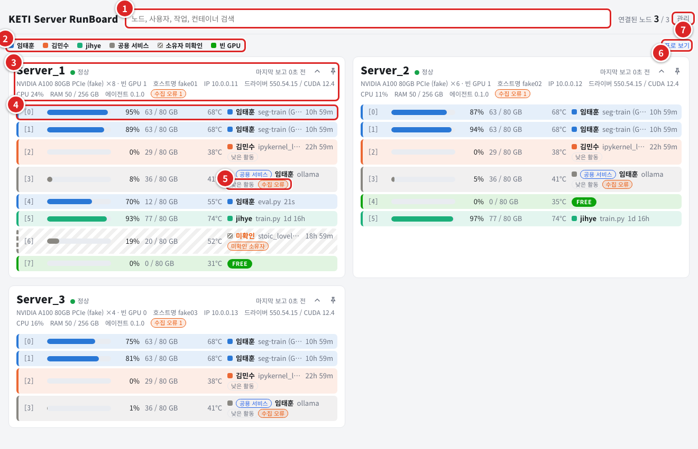
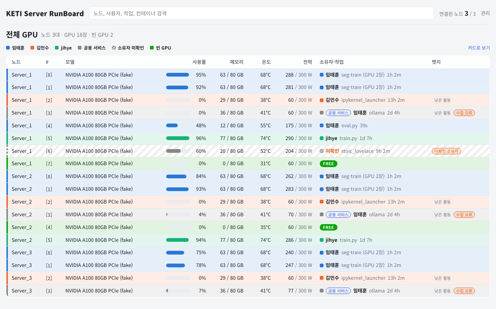
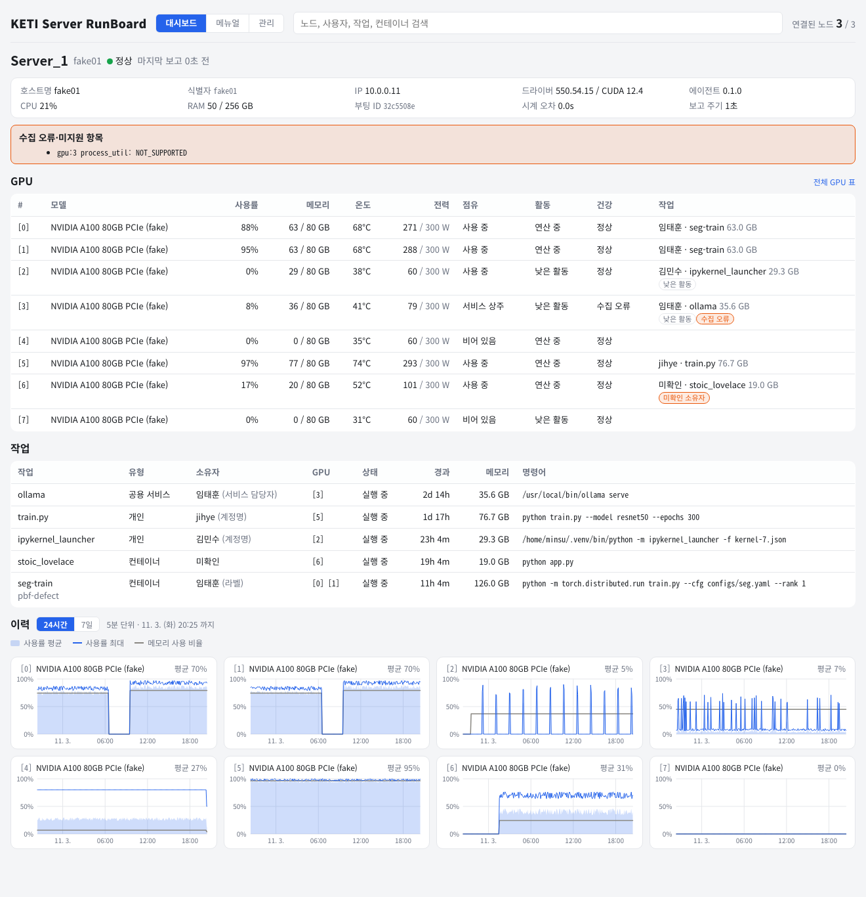
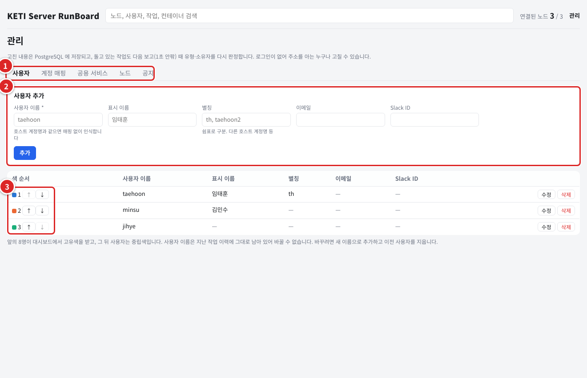

# KETI Server RunBoard

연구실 GPU 서버의 GPU 를 **누가 어떤 작업으로 쓰고 있는지** 한 화면에 보여 주는 대시보드다. GPU 노드마다 도는 에이전트가 GPU·프로세스·컨테이너 정보를 서버로 보내고, 서버가 작업과 소유자를 판정해 웹 화면으로 보여 준다. 사내용(KETI 내부)이다.

| 주소 | 내용 |
|---|---|
| `http://keties.iptime.org:55400` | 대시보드 |
| `http://keties.iptime.org:55400/admin` | 관리 화면 (사용자 등록, 계정 매핑, 공용 서비스, 노드, 공지) |

동작 원리, 설정, API, 서버·에이전트 설치, 개발 환경은 [README_DEV.md](README_DEV.md) 에 있다.

## 사용 방법

### 대시보드

1. **검색**: 노드·사람·작업·컨테이너 이름을 치면 맞는 GPU 행만 남는다.
2. **범례**: 행 색은 작업 소유자의 색이다. 초록은 빈 GPU, 빗금은 소유자 미확인이다.
3. **노드 카드 머리**: 연결 상태(정상·지연·비활성화)와 마지막 보고 시각. 노드 이름을 누르면 노드 상세로 간다.
4. **GPU 행**: 번호, 사용률, 메모리, 온도, 그리고 `소유자 작업 이름 경과`. 소유자를 누르면 사용자 화면, 작업 이름을 누르면 작업 상세로 간다. 빈 GPU 는 `FREE` 다.
5. **뱃지**: 주황은 확인할 것(`지연`, `온도`, `수집 오류`, `미확인 소유자`, `미확인`), 회색은 참고(`낮은 활동`, `수집 불가`)다.
6. **표로 보기**: 모든 GPU 를 한 표에 놓는다. 열 머리를 눌러 정렬한다.
7. **관리**: 사용자 등록 같은 관리 화면이다.

화면은 1초마다 새로 읽는다. 카드는 압정으로 맨 앞에 고정하고 꺾쇠로 접는다 (내 브라우저에만 저장된다).

### 전체 GPU 표와 노드 상세

노드 상세에는 GPU 표, 작업 표, GPU 별 이력 차트(24시간·7일)가 있다.

### 내 작업을 내 이름으로 보이게 하기

1. **탭**: 사용자, 계정 매핑, 공용 서비스, 노드, 공지.
2. **사용자 추가**: 사용자 이름에 호스트 계정명을 적는다. 노드마다 계정명이 다르면 별칭에 적는다. 등록한 사람만 이름과 색을 받는다.
3. **색 순서**: 앞 8명이 고유색을 받는다.

작업과 사람은 다음 중 하나로 이어진다.

| 경우 | 방법 |
|---|---|
| 컨테이너 (Docker 소켓 중계가 있는 노드) | 컨테이너를 만든 계정이 자동으로 붙는다. 그 계정명이 사용자 이름이나 별칭이면 된다 |
| 컨테이너 (그 밖의 노드, root 로 만든 컨테이너) | `docker run --label runboard.owner=<사용자> ...` 로 만들거나 이름을 `<사용자>_<용도>` 로 짓는다 |
| 호스트 계정으로 직접 실행 | 계정명이 사용자 이름·별칭과 같으면 자동. 다르면 '계정 매핑' 탭에 (노드, uid) → 사용자를 넣는다 |
| 공용 서비스 (Ollama, vLLM 등) | '공용 서비스' 탭에 매칭 규칙과 담당자를 넣는다 |

고치면 돌고 있는 작업도 다음 보고 때 다시 판정된다.

## 주의사항

- **Ubuntu 22.04 이상에서만 사용할 수 있다.** 다른 배포판·버전은 지원하지 않는다.
- **로그인이 없다.** 주소를 아는 누구나 보고, 관리 화면에서 고칠 수 있다. 사내에서만 쓴다.
- **소유자는 추정하지 않는다.** 등록하지 않으면 `미확인` 으로 보인다.
- **명령어의 비밀값은 `--token=`, `password=` 같은 꼴만 가린다.** 비밀값은 인자 대신 파일이나 환경변수로 넘긴다.
- **에이전트를 갱신할 때 `docker attach`·`exec -it`·`logs -f` 가 끊긴다.** 컨테이너는 계속 돈다.
- **끝난 작업은 화면에서 사라진다.** 지난 사용량 통계 기능은 없다.
