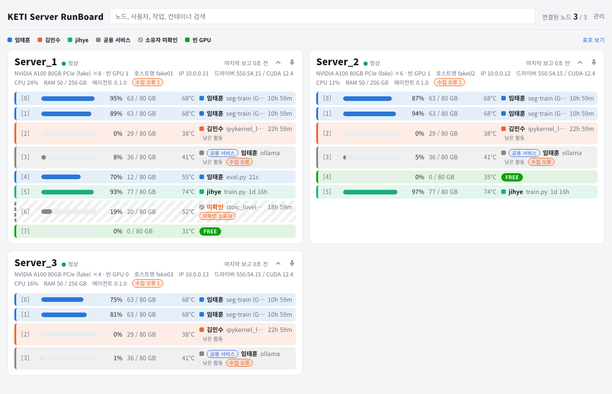
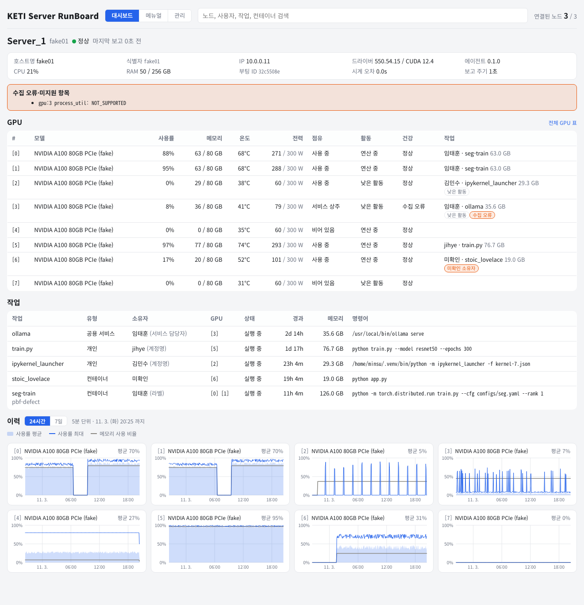

# KETI Server RunBoard

RunBoard 는 연구실 GPU 서버의 GPU 를 누가 어떤 작업으로 쓰고 있는지 한 화면에 보여 주는 대시보드다. GPU 노드마다 도는 에이전트가 GPU 지표·프로세스·실행 계정·컨테이너 정보를 서버로 보내고, 서버가 프로세스를 작업으로 묶고 소유자를 판정해 웹 화면과 API 로 보여 준다.

사내용(KETI 내부) 문서이며 외부에 배포하지 않는다. 2026-11-02 의 코드를 기준으로 지금의 동작만 적는다.



## 목차

1. [구성과 데이터 흐름](#1-구성과-데이터-흐름)
2. [에이전트](#2-에이전트)
3. [서버 동작](#3-서버-동작)
4. [설정](#4-설정)
5. [데이터베이스](#5-데이터베이스)
6. [API](#6-api)
7. [웹 화면](#7-웹-화면)
8. [명령줄](#8-명령줄)
9. [배포와 운영](#9-배포와-운영)
10. [개발](#10-개발)
11. [알려진 한계](#11-알려진-한계)

## 1. 구성과 데이터 흐름

RunBoard 는 GPU 노드마다 하나씩 도는 에이전트, 중앙 서버 하나, 서버가 함께 내보내는 웹 화면으로 이뤄진다. 에이전트는 사실(지표, 프로세스, 실행 계정, 컨테이너)만 보내고 작업의 유형과 소유자는 서버가 판정한다.

| 구성 요소 | 위치 | 하는 일 |
|---|---|---|
| 보고 스키마 | `common/` (`runboard-common`) | 에이전트가 보내는 보고(`NodeReport`)의 pydantic 모델. 에이전트는 보내기 전에, 서버는 받은 뒤에 같은 모델로 검증한다 |
| 에이전트 | `agent/` (`runboard-agent`) | NVML·`/proc`·Docker 에서 노드 상태를 모아 서버로 보낸다. Docker 소켓 중계(`runboard-agent docker-proxy`)도 이 패키지에 있다 |
| 서버 | `server/` (`runboard-server`) | FastAPI 프로세스 하나. 보고를 받아 작업·세션을 추적하고 소유자를 판정한다. 최신 상태는 메모리에, 샘플·집계·작업·세션·등록 정보·공지는 PostgreSQL 에 둔다. API 와 웹 화면을 같은 포트로 낸다 |
| 웹 | `web/` | React 대시보드. 빌드 결과를 서버가 `/` 에서 내보낸다 |
| 배포 | `deploy/` | 서버 compose 파일, 서버 설정 예시, 에이전트 설치 스크립트 |

### 용어

| 용어 | 뜻 |
|---|---|
| 노드 | 에이전트가 도는 GPU 서버 하나 |
| 식별자 | 서버가 노드를 구분하는 키. 에이전트의 `node_id`, 없으면 호스트명. API 경로와 화면 주소에 쓴다 |
| 호스트명 | 에이전트가 보고한 노드 이름. 기본은 그 서버의 호스트명이다 |
| 화면 이름 | 화면에 크게 보이는 노드 이름. 서버가 처음 본 순서대로 `Server_1`, `Server_2` … 를 붙이고 관리 화면에서 바꾼다 |
| 작업 | GPU 를 쓰는 프로세스의 묶음. 컨테이너 하나, 또는 프로세스 그룹 하나 |
| 세션 | 프로세스 하나가 GPU 하나를 쓴 관측 구간. 작업은 세션의 묶음이다 |
| 실행 계정 | 프로세스를 실행한 Linux 계정. 사실일 뿐 소유자와 같지 않다 |
| 소유자 | 서버가 규칙으로 판정한 작업의 주인. 판정하지 못하면 소유자 미확인이다 |
| 공용 서비스 | Ollama·vLLM 처럼 여럿이 같이 쓰는 상주 프로세스. 관리 화면에 등록하고 담당자를 둔다 |
| 등록 정보 | 사용자(별칭 포함), 계정 매핑, 공용 서비스. DB 에 두고 관리 화면에서 고친다 |
| 연결 상태 | 노드의 보고가 제때 오는지: 정상, 지연, 비활성화 |
| 미확인 세션 | 노드가 비활성화됐거나 서버가 막 재시작해 지금도 도는지 모르는 세션 |
| 빈 GPU | 열린 세션이 없는 GPU. 대시보드의 `FREE`, 노드 상세의 '비어 있음' |

### 데이터 흐름

1. 수집. 에이전트는 1초마다 NVML 로 GPU 지표와 GPU 를 쓰는 프로세스를 읽는다. 프로세스마다 psutil(`/proc`)로 실행 계정·명령어를, `getpgid` 로 프로세스 그룹을, `/proc/<pid>/cgroup` 에서 컨테이너 ID 를 읽고, 컨테이너 안이면 Docker API 로 컨테이너 이름·이미지·라벨을 붙인다.
2. 보고. 노드의 지금 상태 전체를 JSON 한 건으로 `POST /api/v1/report` 에 보낸다 (`Authorization: Bearer <토큰>`). GPU 가 동작 중이면 1초마다, 모두 놀면 30초마다 보내고, 다음 보고까지의 최대 간격을 `report_interval_s` 에 적는다. 실패한 보고는 다시 보내지 않는다.
3. 수신. 서버는 토큰을 확인하고 메모리의 최신 상태를 바꾼다. 처음 본 노드에는 화면 이름을 붙인다. 처음 본 프로세스는 유형·소유자를 판정해 작업·세션을 만들고, 연속 두 번의 보고에서 빠진 프로세스의 세션을 끝낸다. 세션의 생성·종료·미확인·복귀는 바로 DB 에 쓰고, GPU 샘플과 노드 행은 노드마다 30초에 한 번 쓴다.
4. tick. 서버는 10초마다 노드의 연결 상태를 판정하고, 비활성화된 노드의 세션을 미확인으로 바꾸고, 24시간 넘게 미확인인 세션을 끝내고, 쌓인 변경을 저장한다. 이어서 닫힌 5분 구간을 집계하고 1시간마다 보존 기간이 지난 행을 지운다.
5. 조회. 웹은 1초마다 `GET /api/v1/overview` 같은 조회 API 를 부른다. 조회 API 는 메모리만 읽는다. 노드 상세의 이력 차트는 1분마다 `GET /api/v1/nodes/{key}/history` 로 DB 의 5분 집계를 읽는다.

### 주기와 시간 기준

| 항목 | 값 (기본) | 내용 | 바꾸는 곳 |
|---|---|---|---|
| 수집 | 1초 | 에이전트가 NVML·`/proc`·Docker 를 읽는 간격. GPU 가 놀 때도 같다 | 에이전트 `active_interval` |
| 보고 (동작 중) | 1초 | GPU 하나라도 프로세스가 있거나 사용률이 0 보다 크면 동작 중이다 | 에이전트 `active_interval` |
| 보고 (유휴) | 30초 | 모든 GPU 에 프로세스가 없고 사용률이 0 이거나 값이 없다 | 에이전트 `idle_interval` |
| 빠른 보고 유지 | 5초 | 동작이 멈춘 뒤에도 이 시간 동안은 1초마다 보고한다 | 에이전트 `idle_grace` |
| 보고 재시도 | 2·4·8·16·32초, 그 뒤 60초 | 보고가 실패한 뒤 기다리는 시간. 성공하면 원래 주기로 돌아간다 | 고정 |
| 컨테이너 조회 캐시 | 60초 | 같은 컨테이너의 이름·이미지·라벨을 다시 묻지 않는다 | 고정 |
| Docker 재연결 | 60초 | Docker 에 붙지 못하면 이 시간 뒤에 다시 붙는다 | 고정 |
| 샘플 저장 | 30초 | 보고를 받을 때 그 노드의 마지막 저장 뒤 이만큼 지났으면 GPU 샘플과 노드·GPU 행을 쓴다 | `server.persist_interval_s` |
| tick | 10초 | 연결 판정, 미확인 전이, 변경 저장, 5분 집계, 보존 정리 | 고정 |
| 5분 집계 | 5분 구간 | 구간이 끝나고 60초가 더 지난 뒤의 tick 이 GPU 별로 집계한다 | 구간은 고정, 기다림은 `thresholds.clock_skew_max_s` |
| 보존 정리 | 1시간 | 서버가 시작할 때 한 번, 그 뒤 1시간마다 | 주기는 고정, 기간은 `server.retention` |
| 지연 | 보고 주기 + 15초 | 마지막 보고 뒤 이만큼 지나면 지연. 동작 중 노드 16초, 유휴 노드 45초 | `thresholds.delayed_s` |
| 비활성화 | 보고 주기 + 30초 | 동작 중 노드 31초, 유휴 노드 60초. 그 노드의 열린 세션은 다음 tick 에 미확인이 된다 | `thresholds.offline_s` |
| 미확인 세션 종료 | 24시간 | 마지막으로 보인 뒤 이 시간이 지난 미확인 세션을 tick 이 끝낸다 | `thresholds.offline_close_after_s` |
| 웹 실시간 조회 | 1초 | 헤더와 공지 배너, 대시보드, 전체 GPU 표, 노드·사용자·작업 화면, 관리 화면의 노드 탭. 브라우저 탭이 가려지면 멈춘다 | 고정 |
| 웹 이력 조회 | 60초 | 노드 상세의 이력 차트 | 고정 |
| 관리 목록 | 폴링 없음 | 사용자·계정 매핑·공용 서비스·공지 목록. 탭을 열 때, 고친 뒤, 브라우저 탭이 다시 보일 때 읽는다 | — |

보고 주기는 에이전트가 보고에 적은 `report_interval_s` 다. 서버는 여기에 `delayed_s`·`offline_s` 를 더해 연결 상태를 판정하므로 30초마다 보고하는 유휴 노드가 지연으로 보이지 않는다. 화면의 연결 상태는 조회할 때마다 계산하고 세션을 미확인으로 바꾸는 일은 tick 이 하므로, 노드가 비활성화로 보인 뒤 세션이 미확인이 되기까지 최대 10초 걸린다.

## 2. 에이전트

에이전트(`runboard-agent run`)는 GPU 노드에서 `runboard` 계정의 systemd 서비스로 돈다. 설치는 9장 'GPU 노드 설치', 설정 키는 4장 '에이전트 설정', 명령줄 옵션은 8장 'runboard-agent' 에 있다.

### 수집하는 것

| 범위 | 항목 | 출처 |
|---|---|---|
| 노드 | 이름(`name`), 식별자(`node_id`) | 설정. 이름의 기본값은 호스트명 |
| 노드 | IP | `10.255.255.255` 로 가는 경로의 출발 주소. 패킷은 보내지 않는다 |
| 노드 | 부팅 ID | `/proc/sys/kernel/random/boot_id`. 재부팅마다 바뀐다 |
| 노드 | 드라이버·CUDA 버전 | NVML |
| 노드 | CPU 사용률, RAM 사용·전체 | psutil |
| GPU | 번호, UUID, 모델, 메모리 사용·전체, 사용률(GPU·메모리), 온도, 전력, 전력 한도, MIG 여부 | NVML |
| 프로세스 | PID, 종류(`C` 연산, `G` 그래픽, `C+G`), GPU 메모리, SM 사용률 | NVML |
| 프로세스 | 실행 계정·uid, 부모 PID, 시작 시각, 명령어 | psutil (`/proc`) |
| 프로세스 | 프로세스 그룹(pgid), 컨테이너 ID | `getpgid`, `/proc/<pid>/cgroup` (Linux 만) |
| 프로세스 | 컨테이너 이름·이미지·라벨 | Docker API |

- 프로세스는 NVML 의 연산·그래픽 프로세스 목록을 PID 로 합친 것이다. PID 는 호스트 PID 네임스페이스 기준이므로 에이전트는 호스트에서 돌거나, 컨테이너라면 `--pid=host` 로 돌아야 한다.
- 메모리는 MiB 단위로 보낸다. 화면의 GB 는 MiB 를 1024 로 나눈 값이다.
- SM 사용률은 NVML 의 프로세스별 사용률이다. 지원하지 않는 GPU·드라이버에서는 비어 있고, 그 GPU 에 프로세스가 있으면 `process_util` 항목이 `NOT_SUPPORTED` 로 보고된다.
- 실행 계정은 사실일 뿐 소유자가 아니다. 계정 목록에 없는 uid 는 숫자 문자열로 보고된다.
- 프로세스 그룹은 서버가 작업을 묶는 키다. torchrun 이나 DataLoader 워커처럼 그룹을 공유하는 프로세스는 한 작업이 된다. 컨테이너 안 프로세스는 컨테이너 ID 로 묶인다.
- 컨테이너 ID 는 `/proc/<pid>/cgroup` 에서 64자리 hex 를 찾아 얻는다. Docker(cgroup v1·v2), containerd·Kubernetes, Podman 의 경로 형식을 안다. 이름·이미지·라벨은 Docker API 에 묻는다. Docker 클라이언트는 Docker SDK 의 환경변수(`DOCKER_HOST` 등)를 따르고, 없으면 `/var/run/docker.sock` 에 붙는다. 컨테이너의 환경변수는 읽지 않는다.
- Linux 가 아니면 프로세스 그룹과 컨테이너는 비워서 보낸다. Windows 에서는 uid 도 비어 있다.

### 명령어의 비밀값 가리기

명령어는 인자를 공백으로 이어 붙인 뒤 비밀값을 `***` 로 바꾸고 200자로 자른다. 인자가 비어 있으면 프로세스 이름을 쓴다. 읽을 권한이 없으면 빈 문자열을 보내고 `cmdline` 항목을 `NO_PERMISSION` 으로 보고한다.

- 가리는 키워드 (대소문자 무시): `token`, `password`·`passwd`, `pwd`, `secret`, `credential`·`credentials`, `api_key`·`api-key`·`apikey`, `access_key`, `private_key`, 단어 앞에 오는 `key`.
- 이름이 키워드로 끝나고 뒤에 `=`·`:`·공백이 오면 그다음 값을 가린다. `--token=abc`, `--password abc`, `HF_TOKEN=abc`, `AWS_SECRET_ACCESS_KEY=abc`, `--wandb-key=abc` 는 가리고 `--tokenizer`, `--keyframe`, `--monkey` 는 그대로 둔다.
- 가리지 못하는 것: `-pSECRET` 처럼 옵션에 붙여 쓴 값, `--pass`·`DB_PASS`·`--auth` 처럼 목록에 없는 이름, `Authorization: Bearer ...` 처럼 키워드가 없는 값. 비밀값은 명령어 인자 대신 파일이나 환경변수로 넘긴다.

### 보고 주기

- 수집은 늘 `active_interval`(1초)마다 한다. 보고는 GPU 하나라도 프로세스가 있거나 사용률이 0 보다 크면 1초마다, 아니면 `idle_interval`(30초)마다 한다. 사용률도 보는 것은 프로세스 목록을 얻지 못하는 환경에서도 동작을 놓치지 않기 위해서다.
- 유휴 노드에서 작업이 시작되면 다음 수집(1초 안)에 바로 보고한다.
- 동작이 멈춘 뒤에도 `idle_grace`(5초) 동안은 1초마다 보고한다. 서버는 프로세스가 연속 두 번의 보고에서 빠져야 세션을 끝내므로, 끝난 작업이 2초 안팎에 화면에서 빠진다.
- 보고마다 `report_interval_s` 에 다음 보고까지의 최대 간격을 적는다. 이번 수집이 동작 중이면 `active_interval`, 아니면 빠른 보고를 유지하는 동안에도 `idle_interval` 이다.

### 실패 처리

값을 읽지 못하면 0 이 아니라 null 을 보내고 이유를 보고의 `errors` 에 적는다. 예외로 GPU 메모리를 읽지 못하면 전체 메모리는 0 이고, CUDA 버전·MIG 여부·IP·실행 계정은 읽지 못해도 `errors` 에 적지 않는다 (MIG 여부는 `false`, 나머지는 null). 항목마다 범위(`scope`: `node`, `gpu:<번호>`, `gpu:<번호>/pid:<PID>`), 항목(`item`), 코드(`code`), 메시지가 있다. 코드는 `NOT_SUPPORTED`(GPU·드라이버가 주지 않는다), `NO_PERMISSION`, `NOT_FOUND`, `ERROR` 다.

| 범위 | 항목 | 뜻 |
|---|---|---|
| `node` | `nvml_init` | NVML 을 초기화하지 못했다 (드라이버 없음·불일치, `nvidia-ml-py` 없음). GPU 없이 노드 정보만 보내고 다음 수집 때 다시 초기화한다 |
| `node` | `driver_version`, `device_count` | 드라이버 버전, GPU 수를 읽지 못했다. GPU 수를 못 읽으면 GPU 없이 보낸다 |
| `gpu:<번호>` | `device` | 그 GPU 를 읽지 못해 보고에서 빠졌다 |
| `gpu:<번호>` | `memory`, `utilization`, `temperature`, `power`, `power_limit` | 그 값이 null 이다 (`memory` 는 사용량이 null, 전체가 0) |
| `gpu:<번호>` | `processes_C`, `processes_G` | 연산·그래픽 프로세스 목록을 읽지 못했다 |
| `gpu:<번호>` | `process_util` | 프로세스별 SM 사용률을 읽지 못했다. 보통 `NOT_SUPPORTED` 다 |
| `gpu:<번호>/pid:<PID>` | `process` | 수집하는 사이 프로세스가 끝났다(`ERROR`, `종료됨`) 또는 읽을 권한이 없다(`NO_PERMISSION`) |
| `gpu:<번호>/pid:<PID>` | `cmdline` | 명령어를 읽을 권한이 없다 (`NO_PERMISSION`) |
| `gpu:<번호>/pid:<PID>` | `container` | Docker 에 붙지 못했다(`NO_PERMISSION`), Docker 에 없는 컨테이너다(`NOT_FOUND`, 사라졌거나 Docker 가 아닌 런타임), 그 밖의 조회 실패(`ERROR`). 컨테이너 ID 만 보낸다 |

- 서버는 이 목록을 노드 카드의 `수집 오류 N` 뱃지와 노드 상세의 '수집 오류·미지원 항목' 상자로 보여 주고 GPU 의 건강 판정에 쓴다 (3장 'GPU 상태와 뱃지').
- 컨테이너 조회 결과는 실패해도 60초 동안 캐시하므로 `container` 항목은 실제로 조회한 보고에만 들어간다. Docker 에 붙지 못하면 60초 뒤에 다시 붙는다.
- 보고가 실패하면(연결 실패, 시간 초과, 200·202·204 가 아닌 응답) 2·4·8·16·32초, 그 뒤로는 60초씩 기다린다. 기다리는 동안에도 1초마다 수집하고, 다시 보낼 때는 그때의 최신 상태를 보낸다. 실패한 보고는 다시 보내지 않고 로컬에 쌓지도 않는다. 성공하면 바로 원래 주기로 돌아간다.
- 수집 자체가 예외로 끝나면 `수집 실패` 와 스택을 로그에 남기고 1초 뒤 다시 한다.

### 노드 이름과 식별자

- 보고의 `name` 은 설정의 `node_name`(기본 호스트명)이고 `node_id` 는 설정했을 때만 들어간다. 서버는 `node_id` 가 있으면 그것을, 없으면 `name` 을 노드 식별자로 쓴다 (3장 '노드 식별과 등록').
- `install-agent.sh` 는 처음 설치할 때 `/proc/sys/kernel/random/uuid` 로 UUID 를 만들어 `/etc/runboard/agent.toml` 의 `node_id` 에 적는다. 다시 실행해도 `agent.toml` 이 있으면 그대로 둔다. 그래서 재부팅하거나 호스트명이 바뀌어도 같은 노드로 이어진다. `agent.toml` 을 지우고 다시 설치하면 새 UUID 가 생겨 새 노드로 등록되므로, 같은 노드로 이으려면 옛 `node_id` 를 다시 적는다.
- 직접 정하려면 `agent.toml` 의 `node_id`, 환경변수 `RUNBOARD_NODE_ID`, 명령줄 `--node-id` 를 쓴다. 컨테이너 에이전트에는 호스트의 `/etc/machine-id` 를 넘긴다.
- 노드 이름은 영문·숫자·`.`·`_`·`-` 로 1~64자, 식별자는 여기에 `:` 를 더해 64자 이하다. 설정을 읽을 때는 형식을 보지 않으므로, 틀리면 에이전트가 떠 있는 채 보고를 만들지 못하고 1초마다 `수집 실패` 를 남긴다.

### 가짜 수집기

`--fake`(또는 `collector = "fake"`)는 GPU 없이 서버와 웹을 개발할 때 쓰는 수집기다. 서버 테스트도 이 수집기의 보고를 픽스처로 쓴다. 모델은 `NVIDIA A100 80GB PCIe (fake)`, 드라이버 `550.54.15`, CUDA `12.4` 로 보고한다.

| GPU | 내용 | 판정 (아래 예시 등록 정보 기준) |
|---|---|---|
| 0, 1 | 컨테이너 `taehoon_torch` 안의 DDP 학습 2프로세스. root 로 돌고 라벨 `runboard.owner=taehoon`, `runboard.project=pbf-defect`, `runboard.job=seg-train` | 컨테이너 작업 하나, 소유자 taehoon (라벨) |
| 2 | 호스트 계정 `minsu` 의 Jupyter 커널. 메모리만 잡고 사용률 0% | 개인, minsu (실행 계정명이 등록 사용자와 같다. 근거 표시는 `계정 매핑`), 낮은 활동 |
| 3 | `ollama serve` (계정 `ollama`). 사용률이 낮고 프로세스별 사용률 미지원 | 공용 서비스 ollama, 담당자 taehoon. 낮은 활동·수집 오류 뱃지 |
| 4 | 90초마다 40초 동안 나타나는 짧은 작업 (계정 `taehoon`, uid 1001) | 개인, taehoon (계정 매핑). 세션 종료 확인용 |
| 5 | 호스트 계정 `jihye` 의 학습과 DataLoader 워커 (같은 pgid) | 개인 작업 하나에 세션 둘, jihye |
| 6 | 컨테이너 `stoic_lovelace` 안의 root 프로세스. 라벨 없음 | 컨테이너, 소유자 미확인 |
| 7 | 프로세스 없음 | 빈 GPU |

예시 등록 정보는 사용자 `taehoon`(표시 이름 `임태훈`, 별칭 `th`)·`minsu`(`김민수`)·`jihye`, 계정 매핑 uid 1001 → `taehoon`, 공용 서비스 `ollama`(실행 계정 `ollama`, 담당자 `taehoon`)다 (10장 '로컬에서 돌려 보기'). 등록 정보가 없으면 GPU 0·1 만 라벨 값 `taehoon` 이 소유자로 보이고 나머지는 소유자 미확인이다.

- `--fake-gpus N` 은 앞에서부터 N 개만 만든다 (최대 8). `--no-churn` 은 GPU 4 의 짧은 작업을 끈다. `--fake-boot-id` 를 바꾸면 재부팅처럼 보여 열린 세션이 '노드 재부팅' 으로 끝난다.
- 노드를 여러 개 띄우려면 `--node` 만 다르게 한다. GPU UUID·부팅 ID·IP 는 노드 이름에서 정해지므로 재시작해도 같고 노드끼리 겹치지 않는다. IP 는 `10.0.0.<10 + 이름 끝 숫자>` 다. 이름 끝 숫자에 따라 짧은 작업의 주기와 사용률 파형이 30초씩 어긋난다.
- GPU 가 4개 이상이면 보고에 `gpu:3` 의 `process_util` `NOT_SUPPORTED` 가 늘 들어 있다.
- GPU 4 의 짧은 작업 말고는 프로세스 시작 시각이 고정된 기준 시각(2025-10-16 00:00 UTC) 근처라서 화면의 경과 시간이 1년 넘게 나온다.

### Docker 소켓 중계

Docker 는 누가 컨테이너를 만들었는지 기록하지 않고, 컨테이너 안 프로세스는 대개 root 로 돈다. 컨테이너 이름이나 사용자가 적은 라벨만으로는 만든 사람을 알 수 없으므로, GPU 노드의 Docker 소켓 앞에 중계(`runboard-agent docker-proxy`)를 두어 컨테이너를 만들 때 만든 계정을 라벨로 붙인다. 설치와 걷어내기는 `deploy/start-agent.sh` 가 한다 (9장 'GPU 노드 설치').

| 소켓 | 경로 | 소유·권한 | 받는 쪽 |
|---|---|---|---|
| 사용자 소켓 | `/run/docker.sock` (`/var/run/docker.sock`) | root:docker 0660 | 중계 (`runboard-docker-proxy.socket`) |
| 진짜 소켓 | `/run/runboard-docker/docker.sock` | root:root 0600, 폴더 0700 | dockerd (`docker.socket` drop-in) |

사용자는 `docker`·`docker compose` 를 그대로 쓰고 컨테이너 이름도 그대로다. 중계는 연결마다 건너편 프로세스(`SO_PEERCRED`)의 계정을 정한다. 로그인 계정(`/proc/<pid>/loginuid`)이 있으면 그것이고 sudo 를 거쳐도 바뀌지 않는다. 로그인 기록이 없으면(서비스가 띄운 프로세스) 그 프로세스의 uid 다. 이름이 없는 uid 는 `uid:<n>` 으로 적는다.

고치는 요청은 컨테이너 생성(`POST /containers/create`) 하나이고 본문의 라벨만 바꾼다.

| 라벨 | 값 |
|---|---|
| `runboard.launcher` | 만든 계정. 언제나 붙는다 |
| `runboard.owner` | 만든 계정. 사용자가 적은 값은 덮어쓴다. 만든 계정이 root(uid 0)면 이 라벨을 지운다 |

그 밖의 요청과 attach·exec·BuildKit 같은 스트림 연결은 바이트 그대로 넘기고 응답은 해석하지 않는다. 라벨은 컨테이너를 만들 때 붙으므로 중계를 설치하기 전에 만든 컨테이너에는 없다. 진짜 소켓을 직접 쓰는 root 나 Docker API 를 거치지 않는 런타임(containerd, Podman)이 만든 컨테이너에도 없다.

중계가 거부하는 요청은 다음과 같다. docker 명령에는 `Error response from daemon: <메시지>` 로 보인다.

| 상황 | 응답 |
|---|---|
| 진짜 소켓 폴더나 그 안을 bind 마운트한다 (`-v`, `--mount type=bind`. 심볼릭 링크는 풀어서 본다) | 403 `runboard: Docker 진짜 소켓 폴더(/run/runboard-docker)는 컨테이너에 마운트할 수 없다` |
| 컨테이너 생성 요청 본문이 8 MiB 를 넘는다 | 413 |
| 요청 머리가 64 KiB 를 넘거나 읽을 수 없다 | 400 |
| dockerd 에 붙지 못한다 | 502 `runboard: Docker 데몬(<진짜 소켓>)에 연결할 수 없다: ...` |

- 사용자 소켓을 컨테이너에 마운트하는 것은 막지 않는다. docker 권한은 사실상 root 권한이라 호스트 `/` 를 마운트하는 것 같은 작정한 우회까지 막지는 못한다. 중계의 목적은 평소 사용을 정확히 남기는 것이다.
- 중계의 `--owner-label` 은 서버의 `owner.label_owner` 와 같은 이름이어야 한다 (둘 다 기본 `runboard.owner`). `runboard.launcher` 는 이름을 바꿀 수 없다. 서버가 두 라벨을 쓰는 방식은 3장 '작업 유형과 소유자 판정' 에 있다.
- 중계를 멈추거나 다시 시작하면(`SIGTERM`) 중계는 새 연결을 받지 않고, 이미 받은 연결이 끝나기를 2초 기다린 뒤 남은 연결을 양쪽(docker 명령 쪽과 dockerd 쪽) 모두 끊고 끝난다. 연결이 그 전에 다 끝나면 바로 끝난다.
  - 짧은 요청은 그 안에 끝난다. 오래 열려 있는 연결(`docker attach`, `docker exec -it`, `docker logs -f`, 붙어서 도는 `docker run`, BuildKit 빌드 등)과 2초 안에 끝나지 않은 요청(컨테이너가 멈추기를 기다리는 `docker stop` 등)은 끊기고 그 docker 명령은 오류로 끝난다. 붙어 있던 컨테이너는 계속 돈다.
  - 사용자 소켓은 소켓 유닛(`runboard-docker-proxy.socket`)이 계속 열어 두므로, 그사이 새로 친 `docker` 명령은 기다렸다가 다음 중계가 받아 처리한다.
  - 중계가 10초 안에 끝나지 않으면 systemd 가 강제로 끝낸다 (`TimeoutStopSec=10`).

## 3. 서버 동작

서버(`runboard-server`)는 프로세스 하나, uvicorn 워커 하나로 돈다. 노드·GPU 의 최신 상태와 열린 작업·세션은 메모리에 있고, 보고 처리와 조회는 락 하나로 차례로 처리한다. 조회 API 는 메모리만 읽는다. PostgreSQL 에는 노드·GPU 목록, 원본 샘플과 5분 집계, 작업·세션, 등록 정보, 공지를 둔다. 상태를 메모리에 들고 판정하므로 같은 DB 로 서버를 둘 띄우지 않는다.

백그라운드 작업은 10초마다 도는 tick 하나다. tick 은 차례로 노드 연결 상태를 판정하고, 비활성화된 노드의 세션을 미확인으로 바꾸고, 오래 미확인인 세션을 끝내고, 바뀐 작업·세션을 저장한다. 이어서 락 밖에서 닫힌 5분 구간을 집계하고, 1시간마다 보존 기간이 지난 행을 지운다.

### 보고 수신

에이전트는 `POST /api/v1/report` 로 노드의 최신 상태 전체를 보낸다 (본문 형식은 6장 '보고'). 서버는 보고 하나를 이 순서로 처리한다.

1. 본문을 `NodeReport` 스키마로 검증한다. 틀리면 토큰을 보기 전에 422 로 거절한다.
2. `Authorization: Bearer <토큰>` 을 확인한다. 맞지 않으면 401 `invalid node token` 이고 서버 로그에 `인증 실패: node=<호스트명>` 이 남는다.
3. 시계 오차를 보고 이 보고의 기준 시각을 정한다.
4. 식별자로 노드를 찾는다. 처음 보는 노드면 순번과 화면 이름을 붙인다.
5. 노드·GPU 상태를 바꾸고, 새 프로세스의 유형·소유자를 판정하고, 세션·작업을 전이한다.
6. 바뀐 것을 DB 에 쓰고 204 로 답한다.

보고는 늘 노드 전체 상태다. GPU 상태와 `errors` 는 보고마다 통째로 바뀌고, 보고에서 빠진 GPU 는 화면에서 사라진다 (`gpus` 표와 이력에는 남는다).

#### 토큰

| 토큰 | 설정 | 맞는 조건 |
|---|---|---|
| 노드 토큰 | `auth.node_tokens` 의 키가 보고의 호스트명(`node.name`) 또는 `node.node_id` | 값이 평문이면 받은 토큰과 같을 때. `sha256:<hex>` 면 받은 토큰의 SHA-256 hex 와 같을 때 (hex 대소문자 무시) |
| 등록 토큰 | `auth.shared_token` (`RUNBOARD_SHARED_TOKEN` 이 덮어쓴다) | 받은 토큰과 같을 때. 평문만 된다 |

- 둘 중 하나라도 맞으면 통과한다. 비교는 상수 시간(`hmac.compare_digest`)이다.
- 등록 토큰은 노드를 가리지 않는다. `node_tokens` 에 없는 노드도 바로 참여하고, `node_tokens` 에 있는 이름이나 식별자로도 보고할 수 있다.
- `Bearer` 는 대소문자를 가리지 않고 토큰 앞뒤 공백은 지운다.
- 토큰은 ASCII 문자로 정한다. 서버는 헤더를 latin-1 로 읽어 UTF-8 바이트로 비교하므로, ASCII 가 아닌 문자가 든 토큰은 설정에 적어도 UTF-8 로 보낸 토큰과 맞지 않아 401 이다. RunBoard 에이전트는 그런 토큰을 헤더에 담지 못해, 보고하기 전에 `UnicodeEncodeError` 스택을 남기고 종료 코드 1 로 끝난다.
- 토큰은 서버가 시작할 때 읽는다. 바꾸면 서버를 다시 시작한다.
- 해시 값은 `printf '%s' '<토큰>' | sha256sum` 의 hex 다.

#### 시계 오차

서버는 받은 시각과 에이전트의 측정 시각(`measured_ts`)의 차이(수신 − 측정)를 시계 오차로 둔다. 차이의 절댓값이 `thresholds.clock_skew_max_s`(60초)를 넘으면 수신 시각을 이 보고의 기준 시각으로 쓰고, 노드 카드에 `시계 오차` 뱃지, 노드 상세에 `(수신 시각 사용)` 을 붙이고, 보고마다 경고 로그를 남긴다. 넘지 않으면 측정 시각이 기준 시각이다.

기준 시각은 세션의 시작·마지막 관측 시각, 원본 샘플의 `ts`, 활동 판정에 쓰인다. 연결 상태는 늘 서버의 수신 시각으로 판정하므로 시계 오차와 무관하다.

### 노드 식별과 등록

노드에는 이름이 셋 있다.

| 이름 | 정해지는 곳 | 쓰임 |
|---|---|---|
| 식별자 (`key`) | 보고의 `node_id`, 없으면 `name` | 메모리와 DB 의 기본 키(`nodes.name`), API 경로(`/api/v1/nodes/{key}`, `/api/v1/admin/nodes/{key}`), 화면 주소(`/nodes/<식별자>`) |
| 호스트명 (`hostname`) | 보고의 `name` | 노드 토큰, 계정 매핑, CLI 의 노드 지정 |
| 화면 이름 (`display_name`) | 서버가 붙이고 관리 화면·CLI 로 바꾼다 | 모든 화면 |

- 같은 식별자로 보고하면 같은 노드다. `node_id` 를 쓰는 노드는 호스트명이 바뀌어도 같은 노드로 남고, 바뀐 호스트명은 저장 간격을 기다리지 않고 바로 DB 에 쓴다.
- `node_id` 가 없는 노드는 호스트명이 바뀌면 새 노드다. 그런 노드에 `node_id` 를 새로 주어도 식별자가 바뀌므로 새 노드로 등록되고 옛 노드는 비활성화로 남는다 (아래 '식별자가 바뀔 때').
- 처음 보는 노드는 순번(`seq`)을 받는다. 순번은 지금 있는 노드(재시작 때 복원된 노드 포함) 중 가장 큰 순번 + 1 이다. 대시보드와 노드 목록은 순번 순, 같으면 식별자 순이다.
- 화면 이름은 `server.display_name_prefix`(기본 `Server_`) 뒤에 순번을 붙인 것이다. 그 이름을 다른 노드가 화면 이름·식별자·호스트명으로 쓰고 있으면 번호를 하나씩 올려 비어 있는 첫 이름을 쓴다. 예를 들어 순번이 7 인데 `Server_7` 을 다른 노드가 쓰면 `Server_8` 이 된다. 그래서 순번과 이름의 번호가 다를 수 있다.
- 첫 보고는 바로 DB 에 쓰므로 순번과 화면 이름은 재시작 뒤에도 같다. 로그에 `새 노드 등록: <식별자> (호스트 <호스트명>) → <화면 이름>` 이 남는다.

화면 이름 바꾸기 (관리 화면 노드 탭, `runboard-server nodes rename`, `PATCH /api/v1/admin/nodes/{key}`):

- 64자 이하이고 비울 수 없다. 앞뒤 공백은 지우고, 탭 같은 제어 문자는 받지 않는다.
- 다른 노드의 화면 이름·식별자·호스트명과 같으면 409 다. 비교는 대소문자를 구분한다. 자기 노드의 식별자·호스트명과는 같아도 된다.
- 메모리와 DB 를 함께 바꾸므로 재시작 없이 모든 화면에 바로 보인다.
- 계정 매핑의 노드를 화면 이름으로 적어 두었다면 이름을 바꾼 뒤 그 매핑은 더 이상 맞지 않는다. 매핑도 고친다.

노드 삭제 (관리 화면 노드 탭, `runboard-server nodes remove`, `DELETE /api/v1/admin/nodes/{key}`):

- 지금 비활성화인 노드만 지운다. 정상·지연이면 409 `보고 중인 노드는 지울 수 없다 …` 다. 보고 중인 노드를 지워도 다음 보고에서 바로 다시 등록되기 때문이다. 에이전트를 먼저 멈춘다.
- 열린 세션은 '노드 삭제'(`node_removed`)로 끝나고 그 작업들도 끝난다.
- DB 에 쓰지 못하면 500 으로 끝나고 노드는 비활성화로 남는다. 세션은 메모리에서 이미 끝났으므로 그 종료는 다음 저장 때 쓰인다. 다시 지우면 된다.
- 메모리 상태와 `nodes`·`gpus` 행을 지운다. 작업·세션 행, 원본 샘플, 5분 집계는 남고 보존 기간이 지나면 지워진다. `gpus` 행이 없으므로 그 GPU 의 이력 조회는 404 다.
- 같은 에이전트가 다시 보고하면 새 노드로 등록된다. 순번은 남은 노드 중 가장 큰 순번 + 1 이므로, 지운 노드의 순번이 가장 컸다면 같은 순번과 같은 `Server_<n>` 을 다시 받을 수 있다. 바꿔 두었던 화면 이름은 돌아오지 않는다. 세션은 새로 시작한다. GPU UUID 가 같으면 `gpus` 행이 다시 생기므로 지우기 전의 이력도 다시 보인다.

#### 식별자가 바뀔 때

에이전트의 식별자가 바뀌면(`node_id` 를 새로 주거나, `agent.toml` 을 새로 만들어 UUID 가 바뀌거나, `node_id` 없이 호스트명이 바뀌면) 서버는 새 노드로 등록하고 옛 노드는 비활성화로 남긴다.

재부팅 없이 식별자만 바꿔 에이전트를 다시 띄우면 GPU 에서 돌던 프로세스가 같은 부팅 ID·PID 로 새 노드에 보인다. 서버는 프로세스 하나(GPU UUID, 부팅 ID, PID, 프로세스 시작 시각)에 열린 세션을 노드가 달라도 하나만 두므로(DB 의 `uq_session_open_key` 와 같다), 새 노드가 옛 노드의 세션을 이어받는다.

- 옛 노드의 세션이 아직 실행 중이면(옛 노드가 비활성화되고 tick 이 그 세션을 미확인으로 바꾸기 전) 새 노드는 그 프로세스의 세션을 만들지 않는다. 같은 GPU 이므로 새 노드의 GPU 행에도 옛 노드의 작업이 보인다 (작업은 옛 노드의 것이라 새 노드 상세의 작업 표에는 아직 없다). 서버 로그에 `노드 <새 식별자> 가 보고한 프로세스의 세션이 노드 <옛 식별자> 에 열려 있다. 그 노드가 비활성화되면 이어받는다 (식별자를 바꾼 것이 아니면 한 머신에서 에이전트가 둘 도는지 본다)` 가 한 번 남는다.
- 옛 노드가 비활성화되면(GPU 가 동작 중이던 노드는 마지막 보고 뒤 31초) 다음 tick(10초 안)에 그 세션이 미확인이 되고, 새 노드의 다음 보고가 이어받는다. 옛 세션은 '식별자 변경'(`node_replaced`)으로 끝나고(종료 시각은 옛 노드에서 마지막으로 보인 시각), 열린 세션이 남지 않은 옛 작업도 끝난다. 새 노드에는 새 ID 의 작업·세션이 그 보고의 시각으로 시작한다. 서버 로그에 `노드 <옛 식별자> 의 세션 N개를 노드 <새 식별자> 가 이어받는다 (같은 프로세스. 식별자가 바뀐 것으로 본다)` 가 남는다.
- 새 작업·세션은 처음부터 센다. GB·시간과 미확인 시간은 0 에서 시작하고 작업 상세의 주소도 바뀐다. 화면의 시작 시각과 경과는 프로세스 시작 시각이 있으면 그것으로 정하므로 그대로다. 소유자는 새 노드의 식별자·호스트명·화면 이름으로 다시 판정하므로, 옛 노드의 식별자나 화면 이름으로 적은 계정 매핑은 새 노드에 맞지 않는다.
- 서버가 막 다시 시작해 복원된 세션이 모두 미확인일 때는 그 프로세스를 먼저 보고한 노드가 세션을 가진다. 옛 노드면 그 세션이 실행 중으로 돌아오고, 새 노드면 바로 이어받는다.
- 새 노드가 보고하지 않는 옛 노드의 세션은 옛 노드에 미확인으로 남아, 24시간 뒤 `node_offline_timeout` 으로, 옛 노드를 지우면 `node_removed` 로 끝난다.

옛 노드는 지울 때까지 비활성화 카드로 남는다. 이어받은 뒤에는 옛 카드의 GPU 행에도 새 노드의 작업이 흐리게 보이고, 같은 GPU 가 두 노드에 한 번씩 있어 전체 GPU 표에 두 줄로 나오고 overview 요약(`summary`)의 GPU 수(`gpus`, `gpus_free`, `gpus_unknown_owner`)에 두 번 들어간다. 그래서 식별자를 바꿀 때는 이렇게 한다.

1. 새 설정으로 에이전트를 다시 시작한다 (`agent.toml` 을 고쳤다면 `sudo systemctl restart runboard-agent`).
2. 새 노드가 작업을 이어받으면(서버 로그의 `… 가 이어받는다`. GPU 에 돌던 프로세스가 없었으면 옛 노드가 비활성화되면) 옛 노드를 지운다 (`runboard-server nodes remove <옛 노드>`). 두 노드는 호스트명이 같을 수 있고 `node_id` 없이 돌던 옛 노드는 식별자도 그 호스트명이므로, 옛 노드의 화면 이름으로 지정한다.
3. 필요하면 새 노드의 화면 이름을 옛 이름으로 바꾸고(옛 노드를 지우기 전에는 이름이 겹쳐 409 다), 옛 노드의 식별자나 화면 이름으로 적은 계정 매핑을 새 노드로 고친다.

한 머신에서 에이전트가 둘 돌면(서비스와 손으로 띄운 에이전트 등) 서로 다른 식별자로 같은 프로세스를 보고한다. 프로세스마다 먼저 세션을 연 노드가 계속 가지고, 다른 노드는 그 세션을 받지 못하며 서버 로그에 위의 경고가 한 번 남는다. 두 노드의 카드에 같은 GPU 와 작업이 보인다. 에이전트 하나를 멈춘다.

### 연결 상태

| 상태 | 화면 | 조건 (`age` = 서버 시각 − 마지막 수신 시각) |
|---|---|---|
| `online` | 정상 (초록 점) | `age` ≤ 보고 주기 + `delayed_s` |
| `delayed` | 지연 (노랑 점) | 보고 주기 + `delayed_s` < `age` ≤ 보고 주기 + `offline_s` |
| `offline` | 비활성화 (회색 점) | `age` > 보고 주기 + `offline_s` |

보고 주기는 마지막 보고의 `report_interval_s` 이고 없으면 0 이다. 기본값(`delayed_s` 15, `offline_s` 30)으로 상태가 바뀌는 때는 다음과 같다.

| 마지막 보고 | 지연 | 비활성화 |
|---|---|---|
| GPU 동작 중 (주기 1초) | 16초 초과 | 31초 초과 |
| GPU 유휴 (주기 30초) | 45초 초과 | 60초 초과 |
| 주기 없음 (재시작 직후의 복원된 노드) | 15초 초과 | 30초 초과 |

- 조회 API 는 요청 때마다 이 식으로 상태를 다시 계산한다.
- tick 은 상태가 나빠진 노드(정상 → 지연 → 비활성화)를 찾아 `nodes.conn_status` 를 고치고 `노드 <식별자> 연결 상태 <전> → <후>` 를 로그에 남긴다. 비활성화로 바뀐 tick 에서 그 노드의 실행 중 세션을 미확인으로 바꾼다.
- 비활성화 노드의 미확인 세션은 마지막으로 보인 뒤 `offline_close_after_s`(86400초)가 지나면 tick 이 끝낸다.
- 다음 보고가 오면 그 보고에서 바로 정상이 된다. 그래서 복귀는 이 로그에 남지 않고, DB 의 `conn_status` 는 다음 샘플 저장 때 바뀐다. 재시작 직후에는 복원된 노드(비활성화로 시작)가 첫 tick 에서 `offline → online` 처럼 찍힐 수 있다.

### GPU 상태와 뱃지

GPU 마다 세 축을 판정한다. 연결 상태는 노드의 축이다.

| 축 | 값 (노드 상세 표기) | 판정 |
|---|---|---|
| 점유 `occupancy` | `free` 비어 있음, `occupied` 사용 중, `service` 서비스 상주 | 그 GPU 의 열린 세션(아래)이 있는 작업의 유형. 개인·컨테이너 작업이 하나라도 있으면 사용 중, 공용 서비스만 있으면 서비스 상주, 없으면 비어 있음 |
| 활동 `activity` | `active` 연산 중, `low` 낮은 활동, `unknown` 수집 불가 | 기준 시각이 최근 `activity_window_s`(60초) 안인 보고들의 GPU 사용률 평균이 `activity_low_pct`(10%) 이상이면 연산 중, 미만이면 낮은 활동, 값이 하나도 없으면 수집 불가. 사용률 이력은 GPU 마다 `util_history_s`(120초)만 메모리에 둔다 |
| 건강 `health` | `ok` 정상, `temp_warn` 온도 경고, `collect_error` 수집 오류 | 마지막 보고의 `errors` 에 `node` 범위 항목이나 그 GPU 의 `gpu:<번호>`, `gpu:<번호>/…` 범위 항목이 있으면 수집 오류다 (`NOT_SUPPORTED` 도 같다). 아니면 온도가 `temp_warn_c`(85°C) 이상일 때 온도 경고 |

GPU 의 열린 세션은 이 노드의 세션(실행 중·미확인)에 더해, 같은 GPU UUID 에 열린 다른 노드의 실행 중 세션까지다. 다른 노드의 미확인 세션은 넣지 않는다. 식별자가 바뀐 노드처럼 같은 GPU 를 두 노드가 보고하면 두 노드의 GPU 행에 같은 작업이 보이는 것은 이 때문이다 (위 '식별자가 바뀔 때'). GPU 행의 작업, 점유, `미확인 소유자`·`미확인` 뱃지, 빈 GPU 수(`free_gpu_count`), 원본 샘플의 `occupied` 가 모두 이 세션으로 정해진다.

뱃지는 API 의 `badges` 에 이 순서로 붙고, 대시보드 GPU 행·전체 GPU 표·노드 상세 GPU 표에 보인다. 주황 뱃지는 확인할 것, 회색 뱃지는 참고다.

| 뱃지 | 색 | 조건 |
|---|---|---|
| `지연` | 주황 | 노드가 지연이다 |
| `낮은 활동` | 회색 | 노드가 비활성화가 아니고 GPU 가 비어 있지 않으며 활동이 낮은 활동이다 |
| `수집 불가` | 회색 | 노드가 비활성화가 아니고 GPU 가 비어 있지 않으며 활동이 수집 불가다 |
| `온도` | 주황 | 건강이 온도 경고다 |
| `수집 오류` | 주황 | 건강이 수집 오류다. 내용은 노드 상세의 '수집 오류·미지원 항목' 에 있다 |
| `미확인 소유자` | 주황 | 그 GPU 의 작업 중 소유자를 판정하지 못한 것이 있다 |
| `미확인` | 주황 | 그 GPU 에 미확인 세션이 있다 (노드가 비활성화됐거나 서버가 재시작한 직후) |

- `미확인 소유자` 는 누구 작업인지 모르는 것이고, `미확인` 은 작업이 아직 도는지 모르는 것이다.
- 빈 GPU 의 낮은 활동은 당연하고 비활성화 노드는 사용률이 오지 않으므로 활동 뱃지를 달지 않는다. 비활성화 노드의 온도·수집 오류 뱃지는 마지막 보고 기준으로 남는다.
- 건강은 값이 하나라서 수집 오류가 온도 경고보다 앞선다. 수집 오류가 있는 GPU 는 85°C 를 넘어도 `온도` 뱃지와 주황 온도 글자가 나오지 않는다.

API 의 GPU 에는 요약 색 `color` 도 있다. 화면은 이 값을 쓰지 않고 행을 소유자 색으로 칠한다 (7장 '행 색과 범례').

| `color` | 조건 (위에서부터 먼저 맞는 것) |
|---|---|
| `gray` | 노드가 비활성화 |
| `green` | 빈 GPU |
| `blue` | 서비스 상주 |
| `red` | GPU 메모리 사용이 `occupied_mem_pct`(70%) 이상이거나 GPU 사용률이 `busy_util_pct`(90%) 이상 |
| `yellow` | 그 밖의 사용 중 |

`GET /api/v1/overview` 의 `summary` 는 노드 수(`nodes`), 비활성화 노드 수(`nodes_offline`), GPU 수(`gpus`), 빈 GPU 수(`gpus_free`, 비활성화 노드 포함), 소유자 미확인 작업이 있는 GPU 수(`gpus_unknown_owner`), 열린 작업 수(`workloads`)다.

### 작업 유형과 소유자 판정

에이전트는 사실(실행 계정과 uid, 컨테이너 이름·이미지·라벨, 명령어)만 보내고 서버가 규칙으로 유형과 소유자를 정한다. 정하지 못하면 소유자를 비워 두고(소유자 미확인) 이름을 짐작해 붙이지 않는다.

유형 (먼저 맞는 것):

| 유형 | 화면 | 조건 |
|---|---|---|
| `shared_service` | 공용 서비스 | 등록된 공용 서비스의 매칭 규칙에 맞는다 |
| `container` | 컨테이너 | 컨테이너 안의 프로세스다 |
| `personal` | 개인 | 그 밖 |

소유자 (위에서부터 보고, 소유자가 처음 나오는 규칙이 이긴다):

| 순서 | 근거 (화면) | 규칙 |
|---|---|---|
| 1 | `label` (라벨) | 컨테이너 라벨 `runboard.owner`(`owner.label_owner`) 값이 비어 있지 않다. 등록된 사용자 이름·별칭이면 그 사용자, 아니면 라벨 값 그대로 |
| 2 | `container_rule` (컨테이너명 규칙) | 컨테이너 이름이 `owner.container_name_rule`(기본 `<user>_<용도>` 또는 `<user>-<용도>`)에 맞고, 뽑은 `<user>` 가 등록된 사용자 이름·별칭이다. `runboard.launcher` 라벨이 있는 컨테이너에는 쓰지 않는다 |
| 3 | `service` (서비스 담당자) | 맞은 공용 서비스에 담당자가 있다 |
| 4 | `account_map` (계정 매핑) | (이 노드, uid) 매핑 → (모든 노드, uid) 매핑 → 실행 계정명이 등록된 사용자 이름·별칭과 같다. 마지막 단계는 uid 0(root)에는 쓰지 않는다 |
| 5 | `none` (미확인) | 소유자 없음 |

- 사용자 이름·별칭과 라벨 값·실행 계정명은 대소문자를 구분하지 않고 비교한다.
- 기본 컨테이너명 규칙이 뽑는 `<user>` 는 영문으로 시작하는 영문·숫자뿐이다. 사용자 이름에 `.`·`_`·`-` 가 있거나 숫자로 시작하면 앞부분만 뽑히므로(`lee_th_train` → `lee`), 그런 사용자는 영문·숫자로 된 별칭을 두어야 이 규칙이 맞는다.
- 등록되지 않은 이름이 라벨로 오면 그 이름이 그대로 소유자가 된다. 사용자 목록에 `미등록` 으로 보이고 색은 중립색이다. 그 이름을 어떤 사용자의 별칭으로 등록하면 그 사용자로 묶인다.
- 공용 서비스여도 1·2번 규칙이 맞으면 그 사람이 소유자다. 유형은 공용 서비스 그대로다. 담당자가 없는 공용 서비스는 4번 규칙으로 넘어간다.
- 판정은 세션을 처음 볼 때 그 프로세스로 한다. 등록 정보가 바뀌면 열린 작업을 다시 판정한다 (아래 '등록 정보가 바뀌면').
- 라벨 `runboard.project`(`owner.label_project`)와 `runboard.job`(`owner.label_job`)은 작업의 프로젝트와 작업 라벨이 된다.

Docker 소켓 중계(2장)가 있는 노드에서는 사람이 만든 컨테이너에 만든 계정이 `runboard.owner` 로 붙으므로 1번 규칙으로 실제로 만든 계정이 소유자가 된다. 그 계정명이 등록 사용자의 이름이나 별칭이 아니면 계정명 그대로 미등록 소유자다. root 로 만든 컨테이너(root 로 도는 서비스가 만든 것 포함)에는 `runboard.owner` 없이 `runboard.launcher` 만 있으므로 2번 규칙도 건너뛰고, 공용 서비스 담당자나 계정 매핑으로 정하거나 소유자 미확인으로 남는다.

자기 작업이 소유자 미확인으로 보이면 다음 중 하나로 알려 준다.

| 경우 | 방법 |
|---|---|
| 중계가 없는 노드의 컨테이너 | `docker run --label runboard.owner=<사용자> ...` 로 만들거나 이름을 `<사용자>_<용도>` 로 짓는다. 이름 규칙은 `<사용자>` 가 등록된 사용자 이름·별칭일 때만 맞는다 |
| 중계가 있는 노드의 컨테이너 | 만든 계정이 소유자가 된다. 그 계정명을 사용자 이름이나 별칭으로 등록하면 표시 이름과 색이 붙는다. 중계를 설치하기 전에 만든 컨테이너는 다시 만들어야 라벨이 붙는다. root 로 만든 컨테이너는 공용 서비스나 계정 매핑으로 정한다 (uid 0 매핑은 그 노드의 root 프로세스 전부에 걸린다) |
| 호스트 계정의 프로세스 | 계정명이 사용자 이름이나 별칭과 같으면 바로 인식한다. 다르면 계정 매핑에 (노드, uid) → 사용자를 넣는다. root 프로세스는 계정 매핑으로만 사람에게 붙는다 |
| 공용 서비스 (Ollama, vLLM 등) | 공용 서비스에 매칭 규칙(실행 계정, 컨테이너명 패턴, 이미지 패턴)과 담당자를 넣는다 |

#### 등록 정보

사용자·계정 매핑·공용 서비스는 DB 에 두고 웹 관리 화면(`/admin`)이나 관리 API 로 고친다.

사용자 (`users`):

| 필드 | 규칙 | 뜻 |
|---|---|---|
| `username` | 영문·숫자로 시작, 영문·숫자·`.`·`_`·`-`, 64자 이하 | 대표 이름. 작업 이력에 이 문자열로 남으므로 바꿀 수 없다 |
| `aliases` | 같은 규칙의 목록. 빈 항목과 대소문자만 다른 중복은 버린다 | 호스트 계정명이 `username` 과 다를 때 적는 다른 이름 |
| `display_name` | 64자 이하 | 화면에 쓰는 이름. 없으면 `username` |
| `email`, `slack_id` | 128자, 64자 이하 | 저장만 하고 판정이나 다른 화면에는 쓰지 않는다 |

- 사용자 이름과 별칭은 모든 사용자를 통틀어 대소문자 무시로 겹칠 수 없다 (409).
- 사용자 순서(`position`)대로 앞 8명이 대시보드 고유색을 받고, 나머지와 미등록 소유자는 중립색이다. 새 사용자는 맨 뒤에 붙는다.
- 사용자를 지우면 그 사용자의 계정 매핑도 지워지고, 그 사용자가 담당하던 공용 서비스는 담당자가 비워진다. 지난 작업의 소유자 이름은 남는다.

계정 매핑 (`account_mappings`, (노드, uid) → 사용자):

- `node` 를 비우면 모든 노드에 쓴다. 적으면 그 노드의 식별자·호스트명·화면 이름 중 하나와 정확히 같을 때만 맞는다 (대소문자 구분). 아직 보고하지 않은 노드 이름도 적을 수 있다.
- 노드별 매핑이 모든 노드 매핑보다 먼저다.
- 화면 이름은 바뀔 수 있으므로 식별자로 적는 것이 안전하다. 관리 화면에서 아는 노드를 고르면 식별자로 저장한다.
- `uid` 는 0~2147483647, `username` 은 등록된 사용자여야 한다 (422). 같은 (노드, uid) 는 하나뿐이다 (409).
- uid 0(root) 프로세스는 매핑이 있을 때만 사람에게 붙는다.

공용 서비스 (`services`):

| 필드 | 규칙 | 뜻 |
|---|---|---|
| `name` | 1~64자, 대소문자 무시로 겹칠 수 없다 | 서비스 이름. 작업 이름이 된다 |
| `match_exec_account` | 64자 이하 | 실행 계정명과 같으면(대소문자 무시) 맞는다 |
| `match_container_pattern` | 200자 이하 정규식 | 컨테이너 이름의 일부와 맞으면(`re.search`) 맞는다 |
| `match_image_pattern` | 200자 이하 정규식 | 이미지 이름의 일부와 맞으면 맞는다 |
| `owner` | 등록된 사용자 또는 비움 | 담당자. 비우면 소유자는 계정 매핑(4번 규칙)으로 정한다 |
| `idle_exempt` | 기본 `true` | 저장만 하고 판정에는 쓰지 않는다 |

- 매칭 규칙 셋 중 하나 이상을 적는다. 셋 중 하나라도 맞으면 그 서비스다.
- 정규식은 Python `re` 문법이고 대소문자를 구분한다. 저장할 때 문법을 검사한다 (422).
- 컨테이너명·이미지 패턴은 컨테이너 안 프로세스에만 쓴다. 실행 계정 규칙은 컨테이너 안팎 모두에 쓴다.
- 서비스는 등록 순서(`id` 순)로 보고 처음 맞는 것을 쓴다.

### 작업과 세션

세션은 (노드 식별자, GPU UUID, 부팅 ID, PID, 프로세스 시작 시각) 하나의 관측된 점유 구간이다. 프로세스 하나가 GPU 두 장을 쓰면 세션이 둘이다. 작업은 세션의 묶음이다. 같은 프로세스(GPU UUID, 부팅 ID, PID, 프로세스 시작 시각)에는 노드가 달라도 열린 세션이 하나뿐이다 ('식별자가 바뀔 때').

| 경우 | 작업 묶음 키 | 결과 |
|---|---|---|
| 컨테이너 안 | `<식별자>:c:<컨테이너 ID 앞 12자>` | 컨테이너 하나가 작업 하나 (DDP 8프로세스도 하나) |
| 그 밖 | `<식별자>:p:<부팅 ID>:<pgid>` (pgid 가 없으면 PID) | torchrun·multiprocessing 자식처럼 pgid 를 공유하면 작업 하나 |

작업 이름은 처음 있는 것을 쓴다: 작업 라벨(`runboard.job`) → 공용 서비스 이름 → 컨테이너 이름 → 명령어에서 `-` 로 시작하지 않고 `.py`·`.sh` 로 끝나는 첫 인자의 파일명 → `-m` 다음 모듈 이름 → 실행 파일명 → `pid <PID>`.

작업의 유형·이름·소유자는 작업을 만든 첫 프로세스로 정한다. 소유자가 없는 작업에 소유자가 나오는 새 프로세스가 붙으면 그 소유자를 채운다.

| 상태 | 화면 | 뜻 |
|---|---|---|
| `active` | 실행 중 | 보고에 보인다 |
| `unknown` | 미확인 | 노드가 비활성화됐거나 서버가 막 재시작해 지금 상태를 모른다 |
| `ended` | 종료 | 끝났다. 사유는 `ended_reason` |

작업 상태는 열린 세션에서 정한다. 실행 중 세션이 있으면 실행 중, 없고 미확인 세션이 있으면 미확인, 둘 다 없으면 종료다. 작업의 종료 시각은 세션들의 가장 늦은 종료 시각이다.

| 사건 | 전이 |
|---|---|
| 보고에 새 키가 있다 | 세션 생성(실행 중), 작업에 연결 |
| 보고에 새 키가 있고, 같은 프로세스의 미확인 세션이 다른 노드에 열려 있다 | 그 세션은 종료 `node_replaced`. 이 노드에 세션 생성(실행 중) |
| 보고에 새 키가 있고, 같은 프로세스의 실행 중 세션이 다른 노드에 열려 있다 | 세션을 만들지 않는다. 그 노드가 비활성화돼 세션이 미확인이 된 뒤의 보고가 이어받는다 |
| 실행 중 세션이 연속 `session_miss_reports`(2)번의 보고에서 빠졌다 | 종료 `exited` |
| 노드가 비활성화됐다 (tick) | 실행 중 → 미확인 |
| 서버가 다시 시작했다 | DB 에서 읽은 열린 세션 전부 미확인 |
| 돌아온 노드의 첫 보고에 같은 키가 있다 | 미확인 → 실행 중. 빈 시간을 `unknown_seconds` 에 더한다 |
| 돌아온 노드의 첫 보고에 그 키가 없다 | 종료 `lost_while_offline` |
| 보고의 부팅 ID 가 바뀌었다 | 그 노드의 열린 세션 전부 종료 `node_rebooted`. 보고의 프로세스는 새 세션 |
| 미확인인 채로 마지막 관측 뒤 `offline_close_after_s`(86400초)가 지났다 | 종료 `node_offline_timeout` |
| 노드를 지웠다 | 열린 세션 전부 종료 `node_removed` |

| `ended_reason` | 화면 |
|---|---|
| `exited` | 종료됨 |
| `lost_while_offline` | 끊김 중 사라짐 |
| `node_rebooted` | 노드 재부팅 |
| `node_offline_timeout` | 끊김 24시간 초과 |
| `node_removed` | 노드 삭제 |
| `node_replaced` | 식별자 변경 |

세션의 종료 시각(`end_ts`)은 사유와 상관없이 마지막으로 보인 시각이다.

세션이 쌓는 값:

| 필드 | 뜻 |
|---|---|
| `mem_used_mb`, `util_sm` | 마지막 보고 값 |
| `mem_max_mb` | 메모리 최댓값 |
| `mem_gb_hours` | 보고마다 메모리(GB) × 앞 보고와의 간격(시간). 간격은 60초까지만 센다. 미확인 구간은 더하지 않는다 |
| `util_avg` | 값이 있던 보고들의 `util_sm` 평균 (보고마다 같은 무게) |
| `unknown_seconds` | 미확인이었던 시간의 합 |

화면의 시작 시각은 프로세스 시작 시각이 있으면 그것, 없으면 처음 본 시각(`start_ts`)이다. 작업의 시작 시각은 열린 세션 중 가장 이른 시작 시각이다.

조회 API 의 작업·사용자 목록은 열린 작업(실행 중·미확인)만 다룬다. 끝난 작업·세션은 메모리에서 빠지고 DB 에만 남는다.

저장 시점:

- 세션 생성·종료·미확인·복귀와 작업 상태 변화는 그 보고나 tick 에서 바로 쓴다.
- 누적값과 마지막 관측 시각은 tick(10초)마다 쓰고, 어느 노드든 샘플을 쓰는 보고가 오면 그때도 모든 노드의 것을 함께 쓴다.
- 원본 샘플과 노드·GPU 행은 노드마다 `persist_interval_s`(30초)에 한 번 쓴다. 노드의 첫 보고는 바로 쓴다.
- 작업·세션은 작업, 끝난 세션, 나머지 세션 순서로 한 트랜잭션에 쓴다. 같은 프로세스의 옛 세션 종료가 새 세션보다 먼저 쓰여야 `uq_session_open_key`(5장)에 걸리지 않는다.
- DB 에 쓰지 못하면(DB 가 멈춤, 연결 끊김, 권한·스키마 문제 등) 그 저장은 작업·세션을 하나도 쓰지 않고, 보고는 500, tick 은 `tick 실패` 로 끝난다. 메모리의 상태와 화면은 이미 바뀌어 있다. 쓰지 못한 작업·세션 변경은 메모리에 두었다가, 다음 tick(10초 안)이나 어느 노드든 샘플을 쓰거나 상태가 바뀐 보고 중 먼저 오는 저장이 함께 쓴다. 그래서 DB 가 멈춘 동안 끝난 세션도 DB 가 돌아오면 끝난 것으로 쓰인다. 이 대기분은 메모리에만 있으므로 쓰기 전에 서버가 다시 시작하면 사라진다 (11장 '알려진 한계').
- DB 가 멈춘 동안에도 상태 변화도, 샘플 저장도, 호스트명 변경도 없는 보고는 DB 에 닿지 않아 204 다. 상태가 바뀐 보고와, 샘플을 쓸 때가 됐거나 호스트명이 바뀐 노드의 보고는 DB 에 쓰려다 500 으로 실패하고, 그런 노드는 DB 에 쓸 때까지 보고마다 그렇다. 에이전트는 실패한 뒤 다시 보내는 간격을 최대 60초까지 늘리므로(2장 '실패 처리'), DB 가 오래 멈추면 노드가 지연이나 비활성화로 보일 수 있다.
- DB 가 받지 않는 작업·세션 행(열 길이를 넘는 값, 범위를 넘는 수, NUL 이나 짝 없는 서로게이트가 든 문자열, 외래 키·유일 인덱스 위반)은 한 행씩 다시 써 보고 그래도 안 되는 행만 건너뛴다. 나머지는 쓰이고 그 보고나 tick 은 실패하지 않는다. 건너뛴 행마다 `<표> 행을 쓰지 못해 건너뛴다 (id <ID>): <오류>` 경고가 남는다 (`<표>` 는 `workloads` 또는 `gpu_sessions`). 건너뛴 행은 다시 쓰려고 쌓아 두지 않지만, 열린 작업·세션은 바뀔 때마다(보고가 오는 동안 대략 10초마다) 다시 시도하므로 경고도 그때마다 남는다. 작업 행을 건너뛰면 그 작업의 세션도 외래 키 위반으로 건너뛴다. 화면은 메모리를 읽으므로 건너뛴 작업·세션도 보이지만 DB 에는 남지 않는다.

### 등록 정보가 바뀌면

관리 화면이나 관리 API 로 사용자·계정 매핑·공용 서비스를 고치면 서버는 DB 에 쓰고 등록 정보 전체를 DB 에서 다시 읽어 판정 규칙을 새로 만든다. 서버를 다시 시작하지 않는다.

- 표시 이름과 색 순서는 바로 모든 화면에 보인다.
- 열린 작업은 전부 다시 판정한다. 그 노드에서 다음 보고가 오면 보고에 보이는 그 작업의 프로세스로 유형·이름·소유자·근거·서비스·프로젝트·작업 라벨을 다시 정한다. 소유자가 나오는 프로세스를 먼저 쓴다. 바뀐 값은 바로 DB 에 쓴다. 비활성화 노드의 작업은 노드가 돌아온 뒤에 바뀐다.
- 끝난 작업은 바꾸지 않는다.
- DB 를 직접 고친 내용은 서버를 다시 시작하거나 관리 API 로 등록 정보를 한 번 고치면 읽힌다. 규칙에 맞지 않는 행은 `<표> 행을 건너뛴다` 경고를 남기고 건너뛴다.

### 공지

모든 화면의 헤더 아래 한 줄씩 보이는 안내·주의다. DB `notices` 표에 두고 관리 화면 '공지' 탭이나 `/api/v1/admin/notices` 로 고친다.

| 필드 | 규칙 |
|---|---|
| `text` | 앞뒤 공백을 지운 1~200자의 한 줄. 줄바꿈과 탭 같은 제어 문자는 넣지 않는다 |
| `level` | `info`(안내, 기본) 또는 `warning`(주의) |
| `until` | epoch 초, 0~4102444800(2100-01-01). 이 시각이 지나면 배너에서 내려간다. 지난 시각이면 바로 내려간다. `null` 이면 지울 때까지 보인다 |
| `id`, `created_ts` | 서버가 붙인다. 고쳐도 `created_ts` 는 그대로다 |

- 배너 순서는 주의가 안내보다 먼저, 같은 수준은 먼저 등록한 것부터다.
- `GET /api/v1/overview` 의 `notices` 에는 `until` 이 없거나 지금보다 뒤인 공지만 들어간다. 관리 목록(`GET /api/v1/admin/notices`)에는 기한이 지난 것까지 같은 순서로 나온다. 기한이 지난 공지 행은 지울 때까지 남는다.
- 일찍 내리려면 `until` 을 지난 시각으로 저장하거나 지운다.
- 서버는 시작할 때와 공지를 고칠 때마다 DB 에서 공지 전부를 다시 읽어 메모리에 둔다. overview 는 메모리만 읽어 그때의 서버 시각으로 기한을 거른다. 공지는 판정과 무관하므로 고쳐도 작업을 다시 판정하지 않는다.

### 이력 집계

원본 샘플(`gpu_samples`)은 노드마다 `persist_interval_s`(30초)에 한 번 GPU 별로 한 행이다. 기준 시각 `ts`, 수신 시각, GPU 사용률, 메모리 사용률, 메모리 사용량, 온도, 전력, 그리고 그 순간 그 GPU 에 열린 세션이 있었는지(`occupied`. 위 'GPU 상태와 뱃지' 의 열린 세션)를 담는다.

5분 집계(`gpu_samples_5m`):

- 구간(버킷)은 epoch 초가 300 의 배수인 시각에서 시작하는 5분이다.
- 구간은 끝나고 `clock_skew_max_s`(60초)가 더 지나야 닫힌다. 시계가 그만큼 늦은 노드의 샘플도 제 구간에 들어가게 하기 위해서다.
- tick 마다 마지막으로 집계한 구간 다음부터 닫힌 구간까지를 GPU·구간별로 묶어 쓴다. 같은 구간을 다시 집계하면 덮어쓴다.
- 값은 `util_avg`, `util_max`, `mem_avg_mb`, `mem_max_mb`, `temp_max`, `power_avg`, `occupied_ratio`(열린 세션이 있던 샘플의 비율, 0~1), `samples`(묶은 샘플 수)다. 지표마다 null 은 빼고 계산하고, 전부 null 이면 null 이다.
- 1시간 점은 5분 행을 다시 묶는다. 평균(`util_avg`, `mem_avg_mb`, `power_avg`, `occupied_ratio`)은 `samples` 로 가중하고, 최댓값은 최댓값 중 최댓값이다.

서버가 시작하면 꺼져 있던 동안 밀린 집계를 먼저 채운다. 마지막 5분 행의 다음 구간(5분 행이 없으면 가장 오래된 원본 샘플의 구간)부터 지금 닫힌 구간까지를 6시간씩 나눠 읽는다. `agg_days` 보다 오래된 구간은 건너뛴다. 로그에 `밀린 5분 집계: 버킷 N개, 행 N개` 가 남는다. 이 작업이 실패해도 서버는 뜨고 다음 tick 에서 다시 한다. 이력 조회 API 는 6장 '이력' 에 있다.

### 보존 정리

`server.retention` 의 기한(일)이 지난 행을 지운다.

| 표 | 지우는 행 | 기한 (기본) |
|---|---|---|
| `gpu_samples` | `ts` 가 기한 전 | `raw_days` (7) |
| `gpu_samples_5m` | `bucket_ts` 가 기한 전 | `agg_days` (90) |
| `gpu_sessions` | 끝났고 `end_ts` 가 기한 전 | `sessions_days` (365) |
| `workloads` | 끝났고 `end_ts` 가 기한 전이며 남은 세션이 없다 | `sessions_days` (365) |

- 서버가 시작할 때 밀린 집계 다음에 한 번, 그 뒤로는 1시간마다 한다. 지운 행이 있으면 `보존 기간 정리: <표> N행, …` 이 로그에 남는다.
- 집계가 먼저다. 아직 집계하지 않은 원본 샘플도 지우기 전에 5분 행으로 집계된다 (`agg_days` 안의 구간만). 그래서 노드 상세의 이력(24시간·7일)은 `agg_days` 까지 남고, GPU 이력 API 의 `raw` 조회는 원본이 남은 기간만 된다.
- 지우지 않는 것: `nodes`, `gpus`, `users`, `account_mappings`, `services`, `notices`, 열린(실행 중·미확인) 작업·세션. 한 번 보고한 노드는 관리 화면이나 CLI 로 지울 때까지 남는다.
- 디스크 크기와 `VACUUM FULL` 은 5장 '쌓이는 양과 디스크' 에 있다.

### 재시작과 복원

서버는 시작할 때 DB 에서 다음을 읽는다.

| 대상 | 복원된 상태 |
|---|---|
| 노드 (`nodes` 전부) | 식별자·호스트명·화면 이름·순번·IP·부팅 ID·버전·마지막 수신 시각. GPU 는 `gpus` 행에 마지막 원본 샘플의 메모리·사용률·온도·전력을 채운다. 프로세스·오류·보고 주기·노드 CPU/메모리는 비어 있다 |
| 열린 작업·세션 (`status <> 'ended'`) | 세션은 전부 미확인(마지막 관측 시각부터)이고 작업 상태는 세션에서 다시 정한다 |
| 등록 정보 | 사용자(색 순서), 계정 매핑, 공용 서비스(`id` 순) |
| 공지 | 전부 |

- 화면 이름이나 순번이 빈 노드 행은 처음 본 순서대로 화면 이름을 붙여 저장한다.
- 로그에 `복원: 노드 N (비활성화로 시작), 열린 작업 N, 세션 N (모두 미확인으로 시작), 공지 N` 이 남고, 이어서 밀린 집계와 보존 정리를 한다.
- 노드의 다음 보고가 오면 같은 키의 세션은 실행 중으로 돌아오고(빈 시간은 `unknown_seconds`), 보고에 없는 세션은 `lost_while_offline`, 부팅 ID 가 바뀌었으면 `node_rebooted` 로 끝난다. 돌아오지 않는 노드의 미확인 세션은 24시간 뒤 `node_offline_timeout` 으로 끝난다. 다른 식별자의 노드가 같은 프로세스를 먼저 보고하면 그 노드가 이어받는다 (`node_replaced`, '식별자가 바뀔 때').
- 복원된 노드의 연결 상태는 DB 의 마지막 수신 시각과 보고 주기 0 으로 계산한다. 마지막 수신 시각은 `persist_interval_s` 마다만 저장되므로, 재시작 직후 다음 보고가 오기 전 몇 초 동안은 실제와 달리 정상·지연·비활성화 중 어느 것으로도 보일 수 있다.
- 에이전트는 서버가 멈춘 동안 보고에 실패해 최대 60초 간격으로 다시 시도하므로, 서버가 돌아온 뒤 다시 붙기까지 최대 60초 걸린다.

## 4. 설정

서버는 파일 둘을 읽는다. `runboard.yaml` 에는 실행 설정·토큰·임계값·소유자 판정 규칙을, `settings.ini` 에는 DB 접속 정보만 둔다. 사용자·계정 매핑·공용 서비스·공지는 DB 에 있다. 두 파일은 서버가 시작할 때 한 번 읽으므로 바꾸면 서버를 다시 시작한다. 레포 루트의 `settings.ini` 와 `deploy/runboard.yaml` 은 git(`.gitignore`)과 서버 이미지(`.dockerignore`)에서 빠진다.

### runboard.yaml

- 경로는 `--config`, 없으면 `RUNBOARD_CONFIG` 다. 둘 다 없으면 YAML 없이 기본값으로 시작한다. 이때는 `RUNBOARD_SHARED_TOKEN` 이 없으면 맞는 토큰이 없어 아무 노드도 보고할 수 없다.
- 예시는 `deploy/runboard.example.yaml` 이다. 예시의 등록 토큰(`change-me-join-token`)과 fake·dev 노드 토큰은 운영 전에 바꾸거나 지운다.
- 모르는 키는 오류 없이 무시한다. 키 이름의 오타에 주의한다.
- 최상위에 `users`, `account_mappings`, `services` 가 있으면 시작하지 않는다 (종료 코드 2). 이 정보는 DB 에 두고 관리 화면에서 고친다.

`server`:

| 키 | 형식 | 기본 | 뜻 |
|---|---|---|---|
| `db_url` | 문자열 | 없음 | DB 접속 URL. 보통 비워 두고 `settings.ini` 를 쓴다 |
| `persist_interval_s` | 실수, 0 초과 | `30` | 노드마다 원본 샘플과 노드·GPU 행을 쓰는 간격(초) |
| `web_dist` | 경로 | 없음 (예시는 `web/dist`) | 빌드된 웹 디렉터리. 상대 경로는 실행 디렉터리 기준. 없거나 `index.html` 이 없으면 API 만 연다 |
| `host` | 문자열 | `0.0.0.0` | 듣는 주소. `--host` 가 이긴다 |
| `port` | 정수 | `8000` | 듣는 포트. `--port` 가 이긴다 |
| `display_name_prefix` | 문자열 | `Server_` | 새 노드 화면 이름의 접두어 |
| `retention.raw_days` | 실수, 0 초과 36500 이하 | `7` | 원본 샘플 보존 일수 |
| `retention.agg_days` | 〃 | `90` | 5분 집계 보존 일수 |
| `retention.sessions_days` | 〃 | `365` | 끝난 세션·작업 보존 일수 |

보존 일수는 무한(`.inf`)과 NaN 을 받지 않는다. 계속 보존하는 값은 없으므로 오래 두려면 큰 값(최대 36500, 100년)을 적는다.

`auth`:

| 키 | 형식 | 기본 | 뜻 |
|---|---|---|---|
| `shared_token` | 문자열 | 없음 | 등록 토큰(평문). 이 토큰으로 보고하는 노드는 미리 적지 않아도 참여한다 |
| `node_tokens` | 맵 | `{}` | 호스트명 또는 `node_id` → 토큰. 평문 또는 `sha256:<hex>` |

`thresholds`:

| 키 | 형식 | 기본 | 뜻 |
|---|---|---|---|
| `delayed_s` | 실수 | `15` | 보고 주기 + 이 값을 넘기면 지연 |
| `offline_s` | 실수 | `30` | 보고 주기 + 이 값을 넘기면 비활성화 |
| `offline_close_after_s` | 실수 | `86400` | 미확인 세션을 마지막 관측 뒤 이만큼 지나 끝낸다. 로그와 화면의 종료 사유 문구는 이 값과 상관없이 '24시간' 이라고 적는다 |
| `activity_window_s` | 실수 | `60` | 활동 판정 창(초) |
| `activity_low_pct` | 실수 | `10` | 창 안 평균 사용률이 이보다 낮으면 낮은 활동 |
| `temp_warn_c` | 정수 | `85` | 이 온도 이상이면 온도 경고 |
| `session_miss_reports` | 정수, 1 이상 | `2` | 연속 몇 번의 보고에서 빠지면 세션을 끝내는가 |
| `occupied_mem_pct` | 실수 | `70` | API 요약 색 `red` 의 메모리 기준(%) |
| `busy_util_pct` | 실수 | `90` | API 요약 색 `red` 의 사용률 기준(%) |
| `clock_skew_max_s` | 실수 | `60` | 이보다 큰 시계 오차는 수신 시각으로 대체한다. 5분 구간을 닫기 전에 기다리는 시간이기도 하다 |
| `util_history_s` | 실수 | `120` | GPU 마다 메모리에 두는 사용률 이력 길이. `activity_window_s` 보다 길게 둔다 |

`session_miss_reports` 말고는 범위를 검사하지 않는다.

`owner`:

| 키 | 형식 | 기본 | 뜻 |
|---|---|---|---|
| `container_name_rule` | 정규식 또는 `null` | `^(?P<user>[A-Za-z][A-Za-z0-9]*)[_-]` | 컨테이너 이름의 앞부분에 맞춰(`re.match`) `user` 그룹을, 그룹이 없으면 맞은 부분 전체를 사용자 이름으로 본다. `null` 이나 빈 문자열이면 쓰지 않는다 |
| `label_owner` | 문자열 | `runboard.owner` | 소유자 라벨 |
| `label_project` | 문자열 | `runboard.project` | 프로젝트 라벨 |
| `label_job` | 문자열 | `runboard.job` | 작업 라벨. 작업 이름으로도 쓴다 |

### settings.ini

DB 접속 정보는 `settings.ini` 의 `[postgres_db]` 섹션에 둔다. 예시 파일은 없고 키는 다음 다섯 개다.

| 키 | 뜻 |
|---|---|
| `host` | PostgreSQL 호스트. compose 배포에서는 같은 Docker 네트워크의 PostgreSQL 컨테이너 이름 |
| `port` | 포트 (정수). compose 배포에서는 컨테이너 안의 포트 |
| `dbname` | DB 이름 |
| `user` | 사용자. 이 DB 에 표와 인덱스를 만들 수 있어야 한다 |
| `password` | 비밀번호 |

```ini
[postgres_db]
host = <호스트>
port = <포트>
dbname = <DB 이름>
user = <사용자>
password = <비밀번호>
```

- 경로는 `RUNBOARD_SETTINGS`, 없으면 실행 디렉터리의 `settings.ini` 다. 그래서 레포 루트에서 서버를 띄우거나 `RUNBOARD_SETTINGS` 를 준다. `RUNBOARD_SETTINGS` 를 주었는데 파일이 없으면 시작하지 않는다.
- 다섯 키가 모두 값이 있어야 한다. 섹션이 없거나 빈 키가 있으면 그 이름을 적은 오류로 시작하지 않는다.
- 값은 보간하지 않으므로 `%` 도 그대로 쓴다. 서버는 `postgresql+psycopg://` URL 을 만들고 비밀번호의 특수문자는 이스케이프한다.
- 비밀번호가 들어 있으므로 파일 권한은 `chmod 600` 으로 둔다.
- compose 배포에서는 레포 루트의 `settings.ini` 를 서버 컨테이너의 `/config/settings.ini` 로 읽기 전용 마운트한다. 컨테이너 이름은 호스트에서 풀리지 않으므로, 컨테이너 밖에서 서버를 띄울 때는 호스트에서 닿는 주소·포트를 적은 파일을 `RUNBOARD_SETTINGS` 로 주거나 `RUNBOARD_DB_URL` 을 쓴다.

DB 접속 URL 은 먼저 있는 것을 쓴다.

| 순위 | 출처 |
|---|---|
| 1 | 환경변수 `RUNBOARD_DB_URL` |
| 2 | `settings.ini` 의 `[postgres_db]` (파일이 있을 때) |
| 3 | `runboard.yaml` 의 `server.db_url` |

- 셋 다 없으면 시작하지 않는다.
- `settings.ini` 가 있으면 `RUNBOARD_DB_URL` 을 주어도 먼저 읽으므로, 그 파일이 잘못돼 있으면 시작하지 못한다.
- PostgreSQL URL 만 받는다. 드라이버는 psycopg 3 이므로 URL 을 직접 줄 때는 `postgresql+psycopg://` 로 적는다. 드라이버 없이 `postgresql://` 로 적으면 설치되지 않은 psycopg2 를 찾다가 예외로 끝난다.

### 서버 환경변수

| 변수 | 뜻 |
|---|---|
| `RUNBOARD_CONFIG` | `--config` 가 없을 때의 `runboard.yaml` 경로 |
| `RUNBOARD_SETTINGS` | `settings.ini` 경로. 기본은 실행 디렉터리의 `settings.ini` |
| `RUNBOARD_DB_URL` | DB 접속 URL. `settings.ini` 와 `server.db_url` 보다 먼저다 |
| `RUNBOARD_WEB_DIST` | `server.web_dist` 를 덮어쓴다 |
| `RUNBOARD_SHARED_TOKEN` | `auth.shared_token` 을 덮어쓴다 |
| `RUNBOARD_PERSIST_INTERVAL` | `server.persist_interval_s` 를 덮어쓴다 (초, 실수). YAML 값과 달리 0 보다 큰지 검사하지 않는다 |
| `RUNBOARD_RETENTION_RAW_DAYS`, `RUNBOARD_RETENTION_AGG_DAYS`, `RUNBOARD_RETENTION_SESSIONS_DAYS` | `server.retention` 의 세 값을 덮어쓴다. YAML 값과 같은 검증을 거친다 |
| `RUNBOARD_SERVER_URL` | `runboard-server nodes` 가 부를 서버 주소 |
| `RUNBOARD_TEST_DB_URL` | 테스트 전용 (10장 '테스트') |

빈 값은 없는 것으로 본다. 서버 이미지(`server/Dockerfile`)에는 `RUNBOARD_WEB_DIST=/app/web/dist`, `RUNBOARD_CONFIG=/config/runboard.yaml`, `RUNBOARD_SETTINGS=/config/settings.ini` 가 들어 있다.

### 에이전트 설정

우선순위는 기본값 < TOML 파일 < 환경변수 < 명령줄이다. TOML 파일은 `--config` 로 주고, 없으면 `/etc/runboard/agent.toml` 이 있을 때 읽는다. `--config` 로 준 파일이 없으면 시작하지 않는다.

| TOML 키 | 환경변수 | 명령줄 | 기본값 | 뜻 |
|---|---|---|---|---|
| `server_url` | `RUNBOARD_SERVER` | `--server` | 없음 | 서버 주소. `http://<서버>:55400` |
| `token` | `RUNBOARD_TOKEN` | `--token` | 없음 | 서버의 등록 토큰 또는 이 노드의 토큰 |
| `node_name` | `RUNBOARD_NODE_NAME` | `--node` | 호스트명 | 노드 이름 (보고의 `name`) |
| `node_id` | `RUNBOARD_NODE_ID` | `--node-id` | 없음 | 고정 식별자 |
| `active_interval` | `RUNBOARD_ACTIVE_INTERVAL` | `--active-interval` | `1.0` | 수집 간격이자 동작 중 보고 간격(초) |
| `idle_interval` | `RUNBOARD_IDLE_INTERVAL` | `--idle-interval` | `30.0` | 유휴 보고 간격(초) |
| `idle_grace` | `RUNBOARD_IDLE_GRACE` | `--idle-grace` | `5.0` | 동작이 멈춘 뒤 빠른 보고를 유지하는 시간(초) |
| `timeout` | `RUNBOARD_TIMEOUT` | — | `5.0` | 보고 요청의 시간 제한(초) |
| `collector` | `RUNBOARD_COLLECTOR` | `--fake` | `nvml` | `nvml` 또는 `fake` |
| `[fake]` `gpu_count` | — | `--fake-gpus` | `8` | 가짜 GPU 수 (최대 8) |
| `[fake]` `churn` | — | `--no-churn` | `true` | 가짜 수집기의 짧은 작업 |
| `[fake]` `boot_id` | — | `--fake-boot-id` | 이름에서 생성 | 가짜 부팅 ID |

- `active_interval`·`idle_interval`·`timeout` 은 0 보다 커야 하고, `idle_interval` 은 `active_interval` 보다 짧을 수 없다. `idle_grace` 는 0 이상이다.
- TOML 의 `interval` 과 `RUNBOARD_INTERVAL` 은 `active_interval` 의 다른 이름이고 우선순위도 같다. 그래서 `RUNBOARD_INTERVAL` 은 TOML 의 `active_interval` 보다 앞선다. 같은 곳에 두 이름이 다 있으면 `active_interval` 을 쓴다 (TOML 에서는 `active_interval` 이 `interval` 을, 환경변수에서는 `RUNBOARD_ACTIVE_INTERVAL` 이 `RUNBOARD_INTERVAL` 을 이긴다). 숨은 옵션 `--interval` 은 `--active-interval` 과 같은 옵션이라 TOML·환경변수보다 앞서고, 둘을 함께 주면 뒤에 적은 것을 쓴다.
- 토큰은 `agent.toml`(root:runboard 0640)에 두어 프로세스 목록에 드러나지 않게 한다.
- `runboard-agent docker-proxy` 는 systemd 소켓 활성화 변수 `LISTEN_PID`·`LISTEN_FDS` 를 읽는다.

### 설정 오류

설정에 문제가 있으면 서버는 오류를 남기고(pydantic 검증 오류는 여러 줄, 나머지는 한 줄) 종료 코드 2 로 끝난다. compose 는 컨테이너를 계속 다시 띄우므로 `docker compose logs server` 로 사유를 본다.

| 로그 | 원인 |
|---|---|
| `설정 파일이 없다: <경로>` | `--config` 나 `RUNBOARD_CONFIG` 의 파일이 없다 |
| `<경로> 의 users, account_mappings, services 는 이제 DB 에서 관리한다. 웹 관리 화면(/admin)에서 등록하고 YAML 에서는 지운다` | `runboard.yaml` 에 그 섹션이 있다. 있는 섹션 이름만 나온다. 관리 화면에서 등록하고 섹션을 지운다 |
| pydantic 검증 오류 | YAML 값이 형식에 맞지 않는다 (예: `retention.raw_days: 0`, `session_miss_reports: 0`) |
| `DB 접속 설정 파일이 없다: <경로>` | `RUNBOARD_SETTINGS` 가 없는 파일을 가리킨다 |
| `<경로> 에 [postgres_db] 섹션이 없다`, `<경로> 의 [postgres_db] 에 값이 없다: <키>` | `settings.ini` 의 내용이 모자란다. 그 자리가 파일이 아니라 폴더여도 섹션이 없다고 나온다 |
| `invalid literal for int() with base 10: …` | `settings.ini` 의 `port` 가 정수가 아니다 |
| `DB 접속 정보가 없다: <경로> 를 만들고 [postgres_db] 에 host, port, dbname, user, password 를 적는다` | `settings.ini` 가 없고 다른 DB 설정도 없다 |
| `DB 는 PostgreSQL 만 쓴다: <URL>`, `DB 접속 URL 을 읽을 수 없다: …` | DB URL 이 PostgreSQL 이 아니거나 읽을 수 없다 |
| `could not convert string to float: …`, pydantic 검증 오류 | `RUNBOARD_PERSIST_INTERVAL` 이 숫자가 아니거나, 보존 일수 환경변수가 숫자가 아니거나 범위를 벗어난다 |

다음은 한 줄 오류가 아니라 스택을 남기고 종료 코드 1 로 끝난다: `owner.container_name_rule` 이 정규식이 아니다, DB URL 이 `postgresql://` 이다(드라이버 없음), DB 에 붙지 못한다, YAML 문법이 틀렸다, `settings.ini` 가 INI 형식이 아니다(섹션 머리가 없다, 같은 키나 섹션이 두 번 나온다), `runboard.yaml` 자리가 파일이 아니라 폴더다. 포트를 열지 못하거나(이미 쓰는 포트, 권한) 시작 때 DB 에서 복원하다 실패하면(손으로 고쳐 형식이 틀린 `nodes` 행 등) uvicorn 이 오류를 남기고 종료 코드 3 으로 끝낸다.

에이전트는 설정 오류를 `설정 오류: …` 한 줄로 남기고 종료 코드 2 로 끝난다. 서버 주소와 `--print` 가 둘 다 없거나, 서버 주소가 있는데 토큰이 없을 때도 2 다.

## 5. 데이터베이스

PostgreSQL 15 이상이 필요하다 (`account_mappings` 의 `UNIQUE NULLS NOT DISTINCT`). 드라이버는 psycopg 3 이다. 시각은 전부 epoch 초 실수(`DOUBLE PRECISION`)이고 5분 구간 시작만 정수(`BIGINT`)다.

| 표 | 기본 키 | 주요 열 | 인덱스·제약 |
|---|---|---|---|
| `nodes` | `name` (식별자) | `hostname`, `display_name`, `seq`, `ip`, `boot_id`, `driver_version`, `cuda_version`, `agent_version`, `first_seen`, `last_received_ts`, `last_measured_ts`, `clock_skew_s`, `conn_status` | |
| `gpus` | `uuid` | `node_name` → `nodes.name`, `index`, `name`, `memory_total_mb`, `mig_enabled`, `first_seen` | `node_name` |
| `gpu_samples` | `id` (자동 증가) | `gpu_uuid`, `ts`, `received_ts`, `util_gpu`, `util_mem`, `mem_used_mb`, `temp_c`, `power_w`, `occupied` | `(gpu_uuid, ts)`, `ts` |
| `gpu_samples_5m` | `(gpu_uuid, bucket_ts)` | `util_avg`, `util_max`, `mem_avg_mb`, `mem_max_mb`, `temp_max`, `power_avg`, `occupied_ratio`, `samples` | `bucket_ts` |
| `workloads` | `id` (uuid4 hex 32자) | `key`, `node`(식별자), `type`, `name`, `container_id`, `container_name`, `image`, `project`, `job`, `owner`, `owner_source`, `service_name`, `status`, `first_seen`, `last_seen`, `end_ts` | `key`, `node`, `(owner, first_seen)`, `(project, first_seen)`, `status` |
| `gpu_sessions` | `id` (uuid4 hex 32자) | `workload_id` → `workloads.id`, `node`, `gpu_uuid`, `boot_id`, `pid`, `proc_start_ts`, `exec_username`, `exec_uid`, `cmdline`, `proc_type`, `status`, `start_ts`, `last_seen_ts`, `end_ts`, `ended_reason`, `unknown_seconds`, `unknown_since`, `miss_count`, `mem_used_mb`, `mem_max_mb`, `mem_gb_hours`, `util_sm`, `util_sum`, `util_samples` | `workload_id`, `node`, `(gpu_uuid, start_ts)`, `status`, 부분 유일 인덱스 `uq_session_open_key` |
| `users` | `username` | `display_name`, `email`, `slack_id`, `aliases`(JSON 목록), `position`(색 순서) | |
| `account_mappings` | `id` (자동 증가) | `node`(NULL 이면 모든 노드), `uid`, `username` → `users.username` | `uq_account_mapping (node, uid) NULLS NOT DISTINCT`, `username` |
| `services` | `id` (자동 증가) | `name`, `match_exec_account`, `match_container_pattern`, `match_image_pattern`, `owner` → `users.username`, `idle_exempt` | `name` UNIQUE |
| `notices` | `id` (자동 증가) | `text`, `level`, `until`, `created_ts` | |

- `uq_session_open_key` 는 `UNIQUE (gpu_uuid, boot_id, pid, proc_start_ts) WHERE status <> 'ended'` 다. 같은 프로세스에 열린 세션은 하나뿐이고, 끝난 세션은 같은 키가 여럿일 수 있다. 노드를 지운 뒤 다시 등록되거나 24시간 넘게 끊겼다 돌아왔는데 그 프로세스가 아직 돌면 새 세션으로 시작하기 때문이다.
- 서버는 메모리에서도 같은 규칙을 지킨다. 노드가 달라도 같은 프로세스에는 열린 세션을 하나만 두고, 식별자가 바뀐 노드는 옛 노드의 세션을 끝내고(`node_replaced`) 이어받는다 (3장 '식별자가 바뀔 때'). 저장은 끝난 세션을 새 세션보다 먼저 쓴다 (3장 '작업과 세션' 의 저장 시점).
- 작업·세션 ID 는 서버가 메모리에서 만드는 uuid4 hex 문자열이다.
- 에이전트가 길이 제한 없이 보내는 표시용 열(`workloads` 의 `name`·`container_name` 200자, `image` 300자, `project`·`job` 100자, `owner` 64자)은 넘는 부분을 잘라 저장한다.

외래 키:

| 열 | 참조 | 지울 때 |
|---|---|---|
| `gpus.node_name` | `nodes.name` | 동작 없음. 노드 삭제는 `gpus` 행을 먼저 지운다 |
| `gpu_sessions.workload_id` | `workloads.id` | 동작 없음. 보존 정리는 세션을 먼저 지우고 세션이 남지 않은 작업만 지운다 |
| `account_mappings.username` | `users.username` | `ON DELETE CASCADE`. 사용자를 지우면 그 매핑도 지워진다 |
| `services.owner` | `users.username` | `ON DELETE SET NULL`. 사용자를 지우면 담당자가 비워진다 |

`gpu_samples`·`gpu_samples_5m` 의 `gpu_uuid`, `workloads`·`gpu_sessions` 의 `node`, `workloads.owner` 는 외래 키가 아닌 문자열이다. 그래서 노드나 사용자를 지워도 이력은 남는다.

### 스키마 적용

- Alembic 은 쓰지 않는다. 서버가 시작할 때 `Base.metadata.create_all` 로 없는 표를 만들고, 이어서 `Repository._migrate` 가 다음을 한다. 따로 실행할 마이그레이션 명령은 없다.
  - 있는 표에 빠진 열을 더한다: `nodes.hostname`, `nodes.display_name`, `nodes.seq`, `gpu_samples.occupied` (모두 NULL 허용).
  - `gpu_sessions` 에 `uq_session_key` 유일 제약이 있으면 지운다. 끝난 세션까지 막는 제약이라 위의 부분 인덱스가 대신한다.
  - 모델에 있는 인덱스 중 없는 것을 만든다.
- 열 형식을 바꾸거나 열을 지우는 일은 하지 않는다. 그런 변경은 손으로 한다.
- DB 계정에는 표와 인덱스를 만들 권한이 있어야 한다.
- 노드 행은 서버가 메모리 상태로 다시 쓰므로 DB 에서 직접 고치지 않는다. 화면 이름 변경과 삭제는 관리 API 로 한다. 등록 정보와 공지를 DB 에서 직접 고쳤다면 서버를 다시 시작한다.

### 쌓이는 양과 디스크

| 표 | 쌓이는 양 | 보존 (기본) |
|---|---|---|
| `gpu_samples` | GPU 마다 샘플 저장 간격마다 한 행 (30초면 하루 2,880행) | 7일 |
| `gpu_samples_5m` | GPU 마다 5분에 한 행 (하루 288행) | 90일 |
| `gpu_sessions` | 프로세스·GPU 쌍마다 한 행 | 끝난 뒤 365일 |
| `workloads` | 작업마다 한 행 | 끝난 뒤 365일 |
| `nodes`, `gpus` | 노드·GPU 마다 한 행 | 지울 때까지 |
| `users`, `account_mappings`, `services`, `notices` | 등록 정보·공지 | 지울 때까지 |

지운 자리는 PostgreSQL 이 다시 쓰지만 파일 크기는 바로 줄지 않는다. 줄이려면 RunBoard DB 에서 `VACUUM FULL` 을 한다 (예: `VACUUM FULL gpu_samples;`). `VACUUM FULL` 은 표를 새로 쓰는 동안 그 표를 잠근다. 서버는 보고를 처리하면서 엔진 락을 잡은 채 `gpu_samples`·`gpu_sessions`·`workloads`·`nodes`·`gpus` 에 쓰므로, 이 표들을 정리하는 동안에는 보고 처리와 화면 갱신이 멈출 수 있다. 사용이 적은 때 한다.

## 6. API

### 공통

- 경로는 모두 `/api/v1` 아래이고 본문은 JSON 이다. 시각은 epoch 초(실수)다.
- 인증은 보고(`POST /api/v1/report`)에만 있다. 조회·관리 API 와 웹 화면에는 로그인이 없어 서버 주소에 닿는 누구나 읽고 고칠 수 있다.
- FastAPI 가 만드는 `/docs`(Swagger UI), `/redoc`, `/openapi.json` 도 열려 있다.

| 코드 | 뜻 |
|---|---|
| 200, 201, 204 | 성공, 만듦, 본문 없음 |
| 401 | 보고 토큰이 맞지 않다 |
| 404 | 대상이 없다 |
| 409 | 지금 상태와 맞지 않는다 (이미 있는 이름, 보고 중인 노드 삭제, 동시에 고쳐 생긴 제약 위반) |
| 422 | 입력 검증 실패, 또는 DB 가 받지 않는 값(NUL 같은 제어 문자) |
| 500 | 서버 안에서 처리하지 못한 예외. 본문은 `Internal Server Error` 글자다 |
| 503 | DB 없이 만든 앱(테스트용)에서 이력 조회나 관리 쓰기 |

오류 본문은 `{"detail": …}` 다. 요청의 모양·값 검증(pydantic)에 걸리면 `detail` 이 `[{"type", "loc", "msg", "input", "ctx"}]` 목록이고(`ctx` 는 있을 때만), 서버가 따로 검사한 422(등록되지 않은 사용자·담당자, 이력 구간, DB 가 받지 않는 값)와 그 밖의 오류는 문자열이다. 검증 목록에서 서버가 직접 쓴 문장은 `msg` 가 `Value error, ` 로 시작하고, JSON 으로 되돌릴 수 없는 입력(NaN 등)이 있으면 모든 항목에서 `input` 을 뺀다.

```json
{"detail": "다른 노드(fake02)가 이미 쓰는 이름이다: Server_1"}
{"detail": [{"type": "value_error", "loc": ["body", "text"], "msg": "Value error, 공지는 한 줄로 적는다. 줄바꿈은 넣지 않는다", "input": "a\nb", "ctx": {"error": {}}}]}
```

### 보고

| 메서드·경로 | 요청 | 응답 |
|---|---|---|
| `POST /api/v1/report` | 헤더 `Authorization: Bearer <토큰>`, 본문 `NodeReport` | 204. 401 `invalid node token`, 422 본문 검증 실패 (토큰보다 먼저 본다), 500 DB 에 쓰지 못했다 (3장 '작업과 세션' 의 저장 시점) |

보고 본문은 `common/runboard_common/schemas.py` 의 모델이다. 수집할 수 없는 값은 0 이 아니라 null 로 온다 (예외는 2장 '실패 처리'). 서버는 평균·최댓값·활동 판정에서 null 을 빼고 계산하지만, 요약 색 `color` 의 `red` 기준 비교와 사용자 목록의 `mem_used_mb` 합에서는 null 을 0 으로 센다.

`NodeReport`: `schema_version`(정수, 기본 1, 서버는 검사하지 않는다), `node`(`NodeInfo`), `gpus`(`GpuReport` 목록), `errors`(`ReportError` 목록).

`NodeInfo`:

| 필드 | 형식 | 뜻 |
|---|---|---|
| `name` | 1~64자, `^[A-Za-z0-9._-]+$` | 호스트명. `node_id` 가 없으면 식별자 |
| `node_id` | 64자 이하, `^[A-Za-z0-9._:-]+$`, 선택 | 재설치·호스트명 변경 뒤에도 같은 노드로 잇는 고정 식별자 |
| `ip` | 선택 | 표시용 |
| `boot_id` | 1자 이상 | 부팅마다 바뀐다. 바뀌면 그 노드의 세션을 끝낸다 |
| `driver_version`, `cuda_version` | 선택 | 표시용 |
| `agent_version` | 필수 | 표시용 |
| `measured_ts` | epoch 초, 필수 | 에이전트가 수집한 시각 |
| `report_interval_s` | 0 초과, 선택 | 다음 보고까지의 최대 간격(초). 연결 판정 임계값에 더한다 |
| `cpu_percent`, `mem_used_mb`, `mem_total_mb` | 선택 | 노드 CPU·메모리 |

`GpuReport`:

| 필드 | 형식 | 뜻 |
|---|---|---|
| `index` | 0 이상 | GPU 번호 |
| `uuid` | 1자 이상 | GPU 를 가리키는 키. 이력도 이것으로 묶는다 |
| `name` | 문자열 | 모델명 |
| `mem_total_mb`, `mem_used_mb` | 0 이상 (`mem_used_mb` 는 선택) | 메모리 전체·사용 (MiB) |
| `util_gpu`, `util_mem` | 0~100, 선택 | GPU·메모리 사용률 % |
| `temp_c` | 선택 | 온도 °C |
| `power_w`, `power_limit_w` | 선택 | 전력·전력 한도 W |
| `mig_enabled` | 기본 `false` | MIG 여부 |
| `processes` | `ProcessReport` 목록 | GPU 를 쓰는 프로세스 |

`ProcessReport`:

| 필드 | 형식 | 뜻 |
|---|---|---|
| `pid` | 1 이상 | 호스트 PID |
| `ppid`, `pgid` | 선택 | `pgid` 는 작업 묶음 키 |
| `type` | `C`, `G`, `C+G`, 기본 `C` | NVML 프로세스 종류 |
| `mem_used_mb` | 0 이상, 선택 | 이 프로세스가 이 GPU 에 잡은 메모리 |
| `util_sm` | 0~100, 선택 | 프로세스별 SM 사용률 |
| `exec_username`, `exec_uid` | 선택 | 실행 계정 |
| `cmdline` | 200자 이하, 기본 `""` | 비밀값을 가리고 자른 명령어 |
| `proc_start_ts` | epoch 초, 선택 | 프로세스 시작 시각 |
| `container` | 선택 | `id`(12자 이상), `name`, `image`, `labels`(문자열 맵) |

`ReportError` 는 `scope`, `item`, `code`, `message` 다 (2장 '실패 처리').

### 조회

전부 읽기 전용이고 메모리만 읽는다.

| 메서드·경로 | 매개변수 | 응답 |
|---|---|---|
| `GET /api/v1/overview` | | `generated_ts`, `summary`, `nodes`(대시보드 순서), `notices`(지금 보이는 공지) |
| `GET /api/v1/nodes` | | 노드 목록 (overview 의 `nodes` 와 같다) |
| `GET /api/v1/nodes/{key}` | `key` 는 식별자 (화면 이름·호스트명은 안 된다) | 노드 하나. 404 `node not found` |
| `GET /api/v1/workloads` | `owner`(username 또는 `_unknown`), `node`(식별자), `type`(`personal`·`container`·`shared_service`), `project`, `status`(`active`·`unknown`). 모두 선택이고 값이 정확히 같은 것만 | `generated_ts`, `workloads`(열린 작업, 노드 식별자·시작 시각 순) |
| `GET /api/v1/workloads/{id}` | 작업 ID | 작업 하나와 그 열린 세션들. 404 `workload not found`. 끝난 작업도 404 다 |
| `GET /api/v1/users` | | `generated_ts`, `users` |
| `GET /api/v1/users/{username}` | username, 또는 소유자 미확인 묶음 `_unknown` | `generated_ts`, `user`, `workloads`. 404 `user not found` |
| `GET /api/v1/healthz` | | `{"status": "ok", "version": "<버전>", "nodes": <노드 수>}` |

응답의 주요 필드:

| 모델 | 필드 |
|---|---|
| 노드 (`NodeOut`) | `key`, `display_name`, `hostname`, `node_id`, `ip`, `conn_status`, `last_received_ts`, `last_measured_ts`, `age_s`, `report_interval_s`, `boot_id`, `driver_version`, `cuda_version`, `agent_version`, `cpu_percent`, `mem_used_mb`, `mem_total_mb`, `clock_skew_s`, `clock_skew_flag`, `errors`, `gpu_count`, `free_gpu_count`, `gpus` |
| GPU (`GpuOut`) | `index`, `uuid`, `name`, `mem_total_mb`, `mem_used_mb`, `util_gpu`, `util_mem`, `temp_c`, `power_w`, `power_limit_w`, `mig_enabled`, `occupancy`, `activity`, `health`, `color`, `badges`, `workloads` (시작 시각 순) |
| GPU 위 작업 (`WorkloadOnGpu`) | `workload_id`, `name`, `type`, `owner`, `owner_display`, `owner_source`, `owner_slot`(색 번호 0~7 또는 null), `service_name`, `project`, `status`, `started_ts`, `elapsed_s`, `mem_used_mb`(이 GPU 세션 합), `util_sm`(이 GPU 세션 최댓값), `gpu_count`(작업이 걸친 GPU 수), `pids`, `exec_username`, `container_name`, `cmdline` |
| 작업 (`WorkloadOut`) | `id`, `key`, `node`, `node_display`, `type`, `name`, `owner`, `owner_display`, `owner_source`, `service_name`, `project`, `job`, `container_id`, `container_name`, `image`, `status`, `first_seen`, `last_seen`, `started_ts`, `elapsed_s`, `gpu_uuids`, `gpu_indexes`, `sessions` |
| 세션 (`SessionOut`) | `id`, `node`, `gpu_uuid`, `gpu_index`, `pid`, `proc_start_ts`, `exec_username`, `exec_uid`, `cmdline`, `proc_type`, `status`, `start_ts`, `last_seen_ts`, `end_ts`, `ended_reason`, `unknown_seconds`, `mem_used_mb`, `mem_max_mb`, `mem_gb_hours`, `util_sm`, `util_avg` |
| 사용자 (`UserOut`) | `username`(null 이면 소유자 미확인 묶음), `display_name`, `registered`, `color_slot`, `workloads`, `gpus`, `mem_used_mb`, `nodes`(화면 이름), `unknown_sessions` |

사용자 목록에는 열린 작업의 소유자와 작업이 없는 등록 사용자가 모두 나온다. GPU 수가 많은 순, 같으면 메모리가 많은 순, 그다음 사용자 이름 순이고, 소유자 미확인 작업이 있으면 미확인 묶음이 맨 뒤에 붙는다. 소유자 미확인 작업이 없으면 `/api/v1/users/_unknown` 은 404 다.

### 이력

DB 를 읽는다.

| 메서드·경로 | 매개변수 | 응답 |
|---|---|---|
| `GET /api/v1/nodes/{key}/history` | `range` = `24h`(기본) 또는 `7d` | `key`, `display_name`, `range`, `step_s`, `from_ts`, `to_ts`, `gpus`(`uuid`, `index`, `name`, `mem_total_mb`, `points`). 404 `node not found` |
| `GET /api/v1/gpus/{uuid}/history` | `from`, `to` (epoch 초, 0~4102444800), `step` = `raw`·`5m`(기본)·`1h` | `gpu_uuid`, `step`, `points`. 404 `gpu not found` |

점(`points`)은 `ts`(구간 시작, `raw` 는 샘플 시각), `util_avg`, `util_max`, `mem_avg_mb`, `mem_max_mb`, `temp_max`, `power_avg`, `occupied_ratio` 다.

노드 이력:

| `range` | 점 간격 (`step_s`) | 점 수 |
|---|---|---|
| `24h` (기본) | 5분 (300) | 288 |
| `7d` | 1시간 (3600) | 168 |

- 끝(`to_ts`)은 지금 닫혀 있고 집계까지 끝난 마지막 경계다. 닫힌 구간은 다음 tick 이 집계하므로 그 사이(최대 10초)에는 한 칸 앞에서 끝난다. `7d` 는 5분 구간 12개가 다 집계된 시간까지만 넣는다.
- 시작(`from_ts`)은 끝 − 간격 × 점 수다. 데이터가 없는 칸도 값이 전부 null 인 점으로 채운 고정 격자다.
- GPU 목록은 `gpus` 표에서 번호 순(같으면 UUID 순)으로 읽는다. 지금 보고에서 빠진 GPU 도 나온다.

GPU 이력:

- 구간은 [`from`, `to`) 다. `to` 기본은 지금, `from` 기본은 `to` 의 24시간 전이다.
- `raw` 는 원본 샘플 그대로이고(`occupied_ratio` 는 0 또는 1) 24시간 이내만 된다. `5m` 은 5분 행, `1h` 는 5분 행을 1시간으로 묶은 점이다. `5m`·`1h` 는 `from` 이 든 구간부터 시작하고, 마지막 1시간 점은 아직 다 차지 않았을 수 있다.
- 데이터가 있는 점만 시각 순으로 돌려준다.
- `from` 이 `to` 보다 앞이 아니면 422 `from 은 to 보다 앞이어야 한다`, `raw` 로 24시간을 넘게 물으면 422 `raw 는 24시간 이내만 조회한다. 더 긴 구간은 step=5m 이나 1h 로 본다` 다.

### 관리

전부 `/api/v1/admin` 아래다. 등록 정보를 고치면 판정 규칙을 다시 만들고(3장 '등록 정보가 바뀌면'), 공지를 고치면 공지만 다시 읽는다.

| 메서드·경로 | 요청 본문 | 성공 | 오류 |
|---|---|---|---|
| `GET /users` | | 200 사용자 목록 (색 순서) | |
| `POST /users` | `username`, `display_name`, `email`, `slack_id`, `aliases` | 201 사용자 | 409 이미 있는 사용자·이름·별칭, 422 |
| `PUT /users/{username}` | `display_name`, `email`, `slack_id`, `aliases` | 200 사용자 | 404, 409, 422 |
| `DELETE /users/{username}` | | 204 | 404 |
| `PUT /user-order` | `{"usernames": [<사용자 전체를 새 순서로>]}` | 200 사용자 목록 | 409 목록이 지금 사용자 전체와 다르다 |
| `GET /account-mappings` | | 200 매핑 목록 (`id` 순) | |
| `POST /account-mappings` | `node`, `uid`, `username` | 201 매핑 (`id` 포함) | 409 같은 (노드, uid), 422 등록되지 않은 사용자 |
| `PUT /account-mappings/{id}` | `node`, `uid`, `username` | 200 매핑 | 404, 409, 422 |
| `DELETE /account-mappings/{id}` | | 204 | 404 |
| `GET /services` | | 200 서비스 목록 (`id` 순 = 매칭 순서) | |
| `POST /services` | `name`, `match_exec_account`, `match_container_pattern`, `match_image_pattern`, `owner`, `idle_exempt` | 201 서비스 (`id` 포함) | 409 같은 이름, 422 규칙 없음·정규식 오류·등록되지 않은 담당자 |
| `PUT /services/{id}` | 위와 같다 | 200 서비스 | 404, 409, 422 |
| `DELETE /services/{id}` | | 204 | 404 |
| `GET /notices` | | 200 공지 전부 (기한 지난 것 포함, 배너 순서) | |
| `POST /notices` | `text`, `level`, `until` | 201 공지 (`id`, `created_ts` 포함) | 422 |
| `PUT /notices/{id}` | `text`, `level`, `until` | 200 공지 | 404, 422 |
| `DELETE /notices/{id}` | | 204 | 404 |
| `GET /nodes` | | 200 노드 요약 목록 (대시보드 순서) | |
| `PATCH /nodes/{key}` | `{"display_name": "<새 이름>"}` | 200 노드 (`GET /api/v1/nodes/{key}` 와 같은 모양) | 404, 409 겹치는 이름, 422 |
| `DELETE /nodes/{key}` | | 204 | 404, 409 보고 중인 노드 |

- 경로의 `{id}` 는 1~2147483647 정수다. 밖이면 422 다. `{key}` 는 노드 식별자다.
- `PUT` 은 부분 수정이 아니다. 빠진 필드는 기본값이 된다. 공지에서 `level`·`until` 을 빼면 `info`·기한 없음이 되고, 서비스에서 `idle_exempt` 를 빼면 `true` 가 된다.
- 선택 문자열 필드(사용자의 표시 이름·이메일·Slack ID, 매핑의 노드, 서비스의 규칙 셋과 담당자)는 앞뒤 공백을 지우고 빈 값은 null 로 저장한다.
- 다른 요청과 동시에 고쳐 DB 제약에 걸리면 409 `다른 요청과 겹쳤다. 목록을 새로 읽고 다시 한다` 다.
- 노드 요약(`NodeBrief`)은 `key`, `display_name`, `hostname`, `node_id`, `seq`, `ip`, `gpu_count`, `conn_status`, `last_received_ts`, `age_s`(마지막 보고 뒤 지난 초, 서버 시계)다.

### 웹 파일과 그 밖의 경로

- `server.web_dist` 에 `index.html` 이 있으면 서버가 웹도 연다. `/assets/*` 는 정적 파일이다. 그 밖의 GET 은 `web_dist` 안에 그 파일이 있으면 그 파일(`favicon.svg`, `manifest.webmanifest`, 아이콘 등)을, 없으면 `index.html` 을 준다. 화면 주소는 웹이 해석한다.
- `api/` 로 시작하는 없는 경로는 404 JSON 이다. `web_dist` 밖의 파일은 주지 않는다.
- `index.html` 이 없으면 경고를 남기고 API 만 연다.

## 7. 웹 화면

웹 화면은 서버가 `/` 에서 함께 내보내는 React 단일 페이지 앱이다. 화면마다 주소가 있어 그대로 공유하거나 새로 고칠 수 있다. 로그인은 없다. 시각은 모두 브라우저의 시간대로, 24시간제로 적는다. 수집하지 못한 값은 `—` 로 적는다.

### 화면과 주소

| 주소 | 화면 | 들어가는 길 |
|---|---|---|
| `/` | 대시보드: 범례, 노드 카드, GPU 행 | 헤더의 `KETI Server RunBoard` |
| `/gpus` | 전체 GPU 표 | 대시보드 범례 줄의 `표로 보기`, 노드 상세 GPU 제목 줄의 `전체 GPU 표` |
| `/nodes/<식별자>` | 노드 상세: 노드 정보, GPU 표, 작업 표, 이력 차트 | 카드·표·작업 상세의 노드 이름, 관리 노드 탭의 화면 이름 |
| `/users` | 사용자 목록 | 화면 안에 링크가 없다. 주소를 직접 연다 |
| `/users/<사용자 이름>` | 사용자 상세. `/users/_unknown` 은 소유자 미확인 작업 묶음 | GPU 행·작업 표의 소유자, 사용자 목록, 관리 사용자 탭 |
| `/workloads/<작업 ID>` | 작업 상세와 세션 표 | GPU 행·작업 표의 작업 이름 |
| `/admin` | 관리 | 헤더의 `관리` |

이 밖의 주소는 `페이지가 없습니다.` 를 보인다. 작업만 모아 보는 목록 화면은 없고, 작업 표는 노드 상세와 사용자 상세에 있다.

화면 상태는 주소의 쿼리 매개변수에 둔다. 값을 바꿔도 브라우저 방문 기록이 쌓이지 않고 지금 기록이 바뀐다.

| 매개변수 | 화면 | 값 |
|---|---|---|
| `q` | `/`, `/gpus` | 헤더 검색어 |
| `sort` | `/gpus` | 정렬 열. 앞에 `-` 를 붙이면 내림차순 (`?sort=-temp`) |
| `range` | `/nodes/<식별자>` | 이력 기간 `24h`(기본) 또는 `7d` |
| `tab` | `/admin` | `users`(기본), `mappings`, `services`, `nodes`, `notices`. 모르는 값이면 `users` |

### 헤더와 공지 배너

모든 화면 맨 위에 헤더 한 줄이 있다: 제목 `KETI Server RunBoard`(대시보드로 간다), 검색창, `연결된 노드 N / M`, `관리` 링크. N 은 정상·지연 노드 수, M 은 비활성화까지 포함한 노드 수다.

검색:

- 검색어는 주소의 `?q=` 에 둔다. 전체 GPU 표에서 치면 그 표를 그 자리에서 거르고 정렬은 그대로 둔다. 다른 화면에서 치면 지금 화면 대신 대시보드(`/?q=<검색어>`)로 간다. 검색창을 비우면 `q` 가 빠진다.
- 앞뒤 공백을 뺀 검색어를 대소문자를 구분하지 않고 부분 일치로 찾는다. GPU 한 장마다 노드의 화면 이름·호스트명·식별자와, 그 GPU 에 있는 작업의 이름·소유자(사용자 이름, 표시 이름)·실행 계정·컨테이너명·프로젝트·명령어를 본다. 그래서 노드 이름으로 찾으면 그 노드의 GPU 가 모두 나오고, 사람 이름으로 찾으면 그 사람의 작업이 있는 GPU 만 나온다. 빈 GPU 는 노드 이름으로만 걸린다.
- 대시보드는 맞는 GPU 행만 남기고, 맞는 GPU 가 없는 카드는 숨긴다.
- `표로 보기`·`카드로 보기` 링크는 검색어를 넘기고 정렬은 넘기지 않는다.

공지 배너는 헤더 바로 아래, 모든 화면에 공지마다 한 줄씩 보인다 (3장 '공지'). 앞에 수준 칩 `안내`(파랑)·`주의`(호박색)가 붙고, 표시 기한이 있으면 끝에 `~ 11. 7. (토) 18:00 까지` 처럼 적는다. 기한이 지나면 다음 폴링(1초) 때 내려간다.

### 대시보드

맨 위 범례 줄은 지금 작업이 있는 사용자를 색 순서대로 적고(고유색이 없는 사람은 그 뒤에 이름 순), 그런 작업이 있으면 `공용 서비스` 와 `소유자 미확인` 을, 맨 끝에 늘 `빈 GPU` 를 적는다. 검색이나 카드 접기와 상관없이 모든 노드를 보고 정한다. 줄 오른쪽 끝에 `표로 보기` 가 있다.

그 아래가 노드 카드 격자다. 카드 최소 폭은 620 px, 본문 최대 폭은 1320 px 이라 넓은 화면에서도 두 장까지 나란히 놓인다. 순서는 고정한 카드가 먼저이고, 고정한 카드끼리와 나머지끼리는 노드를 처음 본 순서다.

| 카드 자리 | 내용 |
|---|---|
| 머리 | 화면 이름(누르면 노드 상세), 연결 상태, `마지막 보고 N초 전`, 접기·고정 버튼 |
| 요약 줄 | `<GPU 모델> ×<GPU 수> · 빈 GPU <수>`(모델은 번호가 가장 작은 GPU 의 것), 호스트명, IP, 드라이버 / CUDA, CPU, RAM, 에이전트 버전. 수집 오류가 있으면 `수집 오류 <개수>`, 시계 오차가 60초를 넘으면 `시계 오차` |
| GPU 행 | GPU 번호 순 (아래 'GPU 행') |

연결 상태의 기준은 3장 '연결 상태' 와 같다. 비활성화 노드의 카드는 흐리게 그리고 `노드 비활성화 상태 (서버가 꺼졌거나 에이전트가 꺼져 있음)` 줄을 단다. GPU 행에는 마지막으로 받은 값과 작업이 남고, 세션이 미확인이 되어 `미확인` 뱃지가 붙는다. 마지막으로 본 뒤 24시간이 지나면 그 작업은 닫혀 행에서 빠진다.

노드가 하나도 없으면 `아직 보고한 노드가 없습니다. 에이전트를 실행하세요.`, 검색에 맞는 GPU 가 없으면 `검색에 맞는 GPU 가 없습니다.` 를 보인다.

### GPU 행

대시보드 카드에서 GPU 한 장이 한 줄이다: `[번호]`, 사용률 막대, 사용률 `%`, 메모리 `사용 / 전체 GB`, 온도 `°C`(값이 없으면 `--°C`), 작업 칸. 작업이 없으면 작업 칸에 초록 `FREE` 가 있다.

- 행은 행 색(아래 '행 색과 범례')으로 왼쪽 테두리, 옅은 바탕, 사용률 막대를 칠한다. 소유자 미확인 행은 왼쪽 테두리가 점선이고 바탕이 빗금이다.
- 온도는 흐린 숫자다. 온도 경고면 숫자가 굵은 주황 글자가 되고 `온도` 뱃지가 붙는다. 행 색은 바뀌지 않는다.
- 창 폭 700 px 이하에서는 번호·막대·사용률·메모리만 한 줄에 두고 온도를 숨기며, 작업 칸은 그 아래 줄로 내려간다.

작업 줄은 `■ [공용 서비스] 소유자 작업 이름 (GPU n장) 경과` 모양이고, 전체 GPU 표의 `소유자·작업` 열도 같은 줄을 쓴다.

- 색 견본은 그 작업의 색이다. 공용 서비스면 파란 `공용 서비스` 뱃지가 붙는다.
- 소유자는 표시 이름(없으면 사용자 이름)이고 누르면 사용자 상세로 간다. 마우스를 올리면 `<사용자 이름> · 근거: <판정 근거>` 가 뜬다. 소유자를 판정하지 못했으면 주황 `미확인` 이고 `/users/_unknown` 으로 가며, 툴팁에 실행 계정과 `@ <컨테이너명>` 이 뜬다.
- 작업 이름을 누르면 작업 상세로 간다. 툴팁은 명령어다. 작업이 GPU 여러 장에 걸쳐 있으면 `(GPU n장)` 을 붙인다.
- 경과는 작업의 가장 이른 프로세스 시작 시각(모르면 처음 본 시각)부터이고 `45s`, `12m`, `3h 5m`, `2d 4h` 로 적는다.
- GPU 한 장에 작업이 여럿이면 먼저 시작한 작업부터 한 줄씩 적는다.
- 작업 줄은 늘 한 줄이다. 칸이 좁으면 작업 이름부터 `…` 로 줄이고, 이름을 다 줄여도 넘칠 때만 소유자를 줄인다. 대시보드의 공용 서비스 줄은 예외로, 서비스 이름이 다 줄기 전에 담당자와 함께 줄어든다. 경과와 뱃지는 줄이지 않는다. 작업 칸이 260 px 이하가 되면(카드 두 장이 나란히 놓일 때, 폭이 좁은 휴대폰) 공용 서비스 줄은 경과를 뺀다.

판정 근거는 화면에 `라벨`, `컨테이너명 규칙`, `서비스 담당자`, `계정 매핑`, `미확인` 으로 적는다 (3장 '작업 유형과 소유자 판정'). 실행 계정명이 사용자 이름·별칭과 같아 인식한 경우도 `계정 매핑` 이다.

### 행 색과 범례

| 대상 | 색 |
|---|---|
| 관리 사용자 탭 목록의 앞 8명 | 사람마다 다른 범주색 8가지: 1 파랑, 2 주황, 3 청록, 4 노랑, 5 분홍, 6 초록, 7 보라, 8 빨강 |
| 9번째 이후 사용자, 등록되지 않은 소유자 | 중립 회색 |
| 공용 서비스 | 중립 회색 |
| 소유자 미확인 | 중립 회색 빗금 |
| 빈 GPU | 초록 |

- 색 순서는 관리 사용자 탭의 목록 순서다. 새 사용자는 맨 뒤에 붙고, ↑/↓ 로 순서를 바꾸면 모든 화면의 색이 바로 바뀐다. 같은 사람은 노드가 달라도 같은 색이다.
- GPU 에 작업이 여럿이면 행 색은 다음 순서로 고른 작업 하나의 색이다: 소유자를 아는 개인·컨테이너 작업, 소유자 미확인 작업, 공용 서비스. 같은 단계에서는 먼저 시작한 작업이다.
- 색은 보조 수단이고 이름은 늘 색 옆에 적는다.
- API 의 GPU `color` 필드는 화면에서 쓰지 않는다. `thresholds.occupied_mem_pct`·`busy_util_pct` 는 이 필드에만 영향을 준다.

### 뱃지

GPU 뱃지(`지연`, `낮은 활동`, `수집 불가`, `온도`, `수집 오류`, `미확인 소유자`, `미확인`)의 색과 조건은 3장 'GPU 상태와 뱃지' 에 있다. 대시보드 GPU 행의 작업 칸 끝, 전체 GPU 표의 `뱃지` 열, 노드 상세 GPU 표의 `작업` 칸에 붙는다. 그 밖의 뱃지는 다음과 같다.

| 뱃지 | 자리 | 뜻 |
|---|---|---|
| `공용 서비스` (파랑) | 작업 줄, 작업 상세 제목 | 작업 유형. 작업 상세 제목에서는 `개인`·`컨테이너` 도 같은 모양이다 |
| `MIG` | 노드 상세·전체 GPU 표의 모델 옆 | MIG 가 켜진 GPU |
| `수집 오류 N`, `시계 오차` | 카드 요약 줄 | 노드의 수집 오류 항목 수. 노드 시계가 어긋나 서버가 수신 시각을 쓰는 중 |
| `미등록` | 사용자 목록 | 관리 화면에 등록되지 않은 소유자 이름 |

### 카드 고정과 접기

- 카드 머리 오른쪽 끝에 접기(꺾쇠)와 고정(압정) 버튼이 있다.
- 고정한 카드는 대시보드 맨 앞에 오고 압정이 파랗게 채워진다. 전체 GPU 표의 순서에는 쓰지 않는다.
- 접은 카드는 머리와 요약 한 줄(`GPU 8장`, `사용 중 6`, `빈 GPU 2`, `평균 사용률 39%` 를 띄어 늘어놓는다)만 그린다. 사용 중은 빈 GPU 가 아닌 GPU 수(공용 서비스만 있는 GPU 포함), 평균 사용률은 값이 있는 GPU 의 평균이다. 검색 중이면 `검색 결과 n장` 을 덧붙인다.
- 설정은 보는 사람의 브라우저 `localStorage` 에만 둔다. 키는 `runboard.pinned`, `runboard.folded` 이고 값은 노드 식별자의 JSON 배열이다. 서버로 보내지 않으므로 다른 브라우저나 다른 사람에게는 영향이 없다.
- 같은 브라우저의 다른 탭에서 바꾼 것은 바로 따라오고, 탭끼리 서로의 설정을 지우지 않는다.
- 브라우저가 사이트 데이터 저장을 막았거나 저장소가 가득 차면 설정은 그 탭에서만 기억하고 새로 고치면 사라진다. 사생활 보호(시크릿) 창에서는 저장되지만 그 창을 모두 닫으면 사라진다.
- 노드를 지워도 저장된 식별자는 남는다. 같은 식별자의 노드가 다시 등록되면 고정·접기도 그대로 적용된다.

### 노드 상세

제목 줄에 화면 이름, 호스트명, 연결 상태, `마지막 보고 N초 전` 을 적는다. 비활성화 노드면 대시보드와 같은 안내 줄이 붙는다. 그 아래 정보 칸이 있다: 호스트명, 식별자(이 화면의 주소에 쓰인다), IP, 드라이버 / CUDA, 에이전트 버전, CPU, RAM, 부팅 ID(앞 8자리), 시계 오차(수신 − 측정, 60초를 넘으면 `(수신 시각 사용)`), 보고 주기.

수집 오류나 미지원 항목이 있으면 `수집 오류·미지원 항목` 상자에 `<범위> <항목>: <코드> — <메시지>` 로 한 줄씩 적는다 (예: `gpu:3 process_util: NOT_SUPPORTED`).

`GPU` 표는 지금 보고된 GPU 를 번호 순으로 적는다. 열은 `#`, 모델(MIG 면 `MIG`), 사용률, 메모리, 온도, 전력(현재 / 한도 W), 점유(`비어 있음`·`사용 중`·`서비스 상주`), 활동(`연산 중`·`낮은 활동`·`수집 불가`), 건강(`정상`·`온도 경고`·`수집 오류`), 작업(`<소유자> · <작업 이름> <메모리 GB>` 줄과 뱃지)이다. 제목 줄 오른쪽에 `전체 GPU 표` 링크가 있다.

`작업` 표는 이 노드의 열린 작업(실행 중·미확인)을 먼저 시작한 것부터 적는다. 열은 작업(이름, 아래에 프로젝트), 유형, 소유자(이름과 판정 근거), GPU(`[0] [1]`), 상태, 경과, 메모리(세션 메모리 합), 명령어다. 사용자 상세의 작업 표는 노드 열이 더 있고, 노드 식별자 순, 같은 노드 안에서는 먼저 시작한 것부터 적는다.

#### 이력 차트



`이력` 제목 옆의 `24시간`·`7일` 버튼으로 기간을 고르고, 기간은 주소의 `?range=` 에 둔다. 그 옆에 `5분 단위 · 11. 1. (일) 22:55 까지` 처럼 점 간격과 마지막 구간이 끝나는 시각을 적는다.

GPU 마다 작은 차트가 하나씩 있고 범례는 묶음 위에 한 번 있다. 세로축은 0~100% 하나에 세 계열을 그린다.

| 계열 | 모양 | 값 |
|---|---|---|
| 사용률 평균 | 파란 면 | 구간 안 원본 샘플(GPU 마다 30초에 하나)의 GPU 사용률 평균 |
| 사용률 최대 | 파란 얇은 선 | 구간 안 원본 샘플의 GPU 사용률 최대. 샘플 사이의 짧은 최고치는 잡히지 않는다 |
| 메모리 사용 비율 | 회색 선 | 구간 평균 메모리 사용량 / 전체 메모리 |

| 기간 | 점 간격 | 점 수 | 가로축 눈금 |
|---|---|---|---|
| 24시간 | 5분 | 288 | 6시간마다. 자정은 날짜로 |
| 7일 | 1시간 | 168 | 자정마다 날짜. 가로축이 280 px 이하로 좁으면 날짜 글자를 하루 걸러 적는다 (아래 '다크 모드와 화면 폭') |

- 차트 머리의 `평균 NN%` 는 기간 전체의 사용률 평균이다 (데이터가 있는 구간만).
- 데이터가 없는 구간(노드나 서버가 꺼져 있던 때)은 0 이 아니라 끊긴 자리로 둔다.
- 서버는 5분 구간이 끝나고 60초가 더 지나야 집계하므로 24시간 차트의 끝은 지금보다 1~6분 앞이다. 7일 차트는 그 시간의 5분 구간이 다 집계된 시간까지만 그린다.
- 지금 보고에서 빠진 GPU 도 `gpus` 표에 남아 있으면 차트가 나온다.
- 기간을 바꾸면 새 데이터가 올 때까지 앞 기간의 차트를 흐리게 둔다.
- 쌓인 이력이 없으면 `이 기간에 쌓인 이력이 없습니다. 서버가 5분마다 집계해 채웁니다.` 를 보인다. 24시간은 서버를 처음 띄우고 몇 분 동안, 7일은 처음 띄운 시각이 든 1시간이 끝나고 집계될 때까지(최대 약 1시간) 그렇다.

| 조작 | 동작 |
|---|---|
| 마우스 | 가리킨 구간에 세로선, 점, 툴팁(`11. 1. (일) 22:55~23:00`, 세 값, 메모리 사용 / 전체 GB)이 뜬다. 차트 밖으로 나가면 닫힌다 |
| 터치 | 누른 구간의 툴팁이 뜨고 가로로 끌면 따라간다. 손을 떼도 남고 차트 밖을 누르면 닫힌다 |
| 키보드 | Tab 으로 차트에 오면 마지막 구간을 보인다. ←/→ 한 칸, Shift+←/→ 12칸(24시간은 1시간, 7일은 12시간), Home/End 처음·끝, Esc 닫기 |

### 전체 GPU 표

모든 노드의 GPU 를 한 표에 한 줄씩 적는다 (`/gpus`). 제목 옆에 `노드 N대 · GPU M장 · 빈 GPU K`, 검색 중이면 `검색 결과 n장 / 전체 M장` 을 적는다. 범례 줄은 대시보드와 같고 오른쪽 끝에 `카드로 보기` 가 있다.

- 열은 노드(정상이 아니면 연결 상태를 덧붙인다), `#`, 모델, 사용률(막대와 %), 메모리, 온도, 전력(`150 / 300 W`, 한도를 모르면 `150 W`), 소유자·작업(대시보드와 같은 작업 줄), 뱃지다.
- 행 색은 대시보드 GPU 행과 같은 규칙이다. 비활성화 노드의 행은 흐리다.
- 기본 순서는 노드를 처음 본 순서, 그 안에서 GPU 번호 순이다. 카드 고정은 쓰지 않는다.
- 열 머리를 누르면 그 열로 오름차순 정렬하고, 같은 열을 다시 누르면 방향을 바꾼다. 정렬 중에는 `기본 순서` 버튼이 보이고 누르면 정렬을 지운다.
- 값이 같으면 기본 순서를 지키고, 값이 없는 행은 방향과 상관없이 맨 뒤다. 글자는 한국어 순서로 비교하되 숫자는 수로 비교한다 (`Server_2` 가 `Server_10` 앞).

| 열 | `sort` 값 | 정렬 기준 |
|---|---|---|
| 노드 | `node` | 화면 이름 |
| `#` | `index` | GPU 번호 |
| 모델 | `model` | 모델 이름 |
| 사용률 | `util` | GPU 사용률 |
| 메모리 | `mem` | 사용 메모리 |
| 온도 | `temp` | 온도 |
| 전력 | `power` | 전력 |
| 소유자·작업 | `owner` | 행 색을 정한 작업의 소유자 표시 이름 (없으면 사용자 이름, 판정 못 했으면 `미확인`). 빈 GPU 는 값 없음 |
| 뱃지 | `badges` | 뱃지 글자. 뱃지가 없으면 값 없음 |

### 사용자

사용자 목록(`/users`)은 지금 열린 작업 기준의 사람별 점유다. 열은 사용자(색 견본, 표시 이름, 표시 이름과 다르면 사용자 이름, 등록되지 않은 소유자면 `미등록`), 작업 수, GPU 수, 메모리 점유, 노드(화면 이름), 미확인 세션 수다. 등록 사용자는 작업이 없어도 나오고, 등록되지 않은 이름은 작업이 있는 동안만 나온다. 소유자 미확인 작업이 있으면 맨 뒤에 `미확인` 줄(빗금 견본)이 붙고, 누르면 `/users/_unknown` 으로 간다. 순서는 6장 '조회' 의 사용자 목록과 같다.

사용자 상세(`/users/<사용자 이름>`)는 제목에 표시 이름과 사용자 이름을 적고, 요약 칸(작업, GPU, 메모리 점유, 미확인 세션. 미확인 세션이 있으면 주황) 아래에 그 사람의 열린 작업 표를 둔다. `/users/_unknown` 에는 소유자를 알려 주는 방법을 적은 안내가 붙는다. 등록되지 않았고 작업도 없는 이름, 그리고 소유자 미확인 작업이 없을 때의 `/users/_unknown` 은 404 오류 상자를 보인다.

### 작업 상세

`/workloads/<작업 ID>` 의 제목에 작업 이름, 유형 뱃지(`개인`·`컨테이너`·`공용 서비스`), 상태(`실행 중`·`미확인`)를 적는다. 정보 칸은 소유자(판정 근거), 노드, GPU, 시작(시각과 경과), 프로젝트 / 작업 라벨, 서비스(공용 서비스일 때), 컨테이너(이름과 ID 앞 12자), 이미지, 메모리 점유량 합계(세션 표에 있는 열린 세션의 GB·시간 합)다.

`세션` 표에는 이 작업의 열린 세션(실행 중·미확인)만 나온다. 한 줄은 프로세스 하나가 GPU 하나를 점유한 관측 구간이다. 같은 작업에서 먼저 끝난 프로세스(오래 두는 컨테이너에서 끝난 학습 등)의 세션과 그 GB·시간은 화면에서 빠지고 DB 에만 남는다. 열은 GPU, PID, 실행 계정(계정명과 uid), 상태, 시작(프로세스 시작 시각, 툴팁은 처음 본 시각), 메모리와 최대, GB·시간(미확인 구간 제외), 사용률과 평균(프로세스별 SM 사용률. 지원하지 않으면 `—`), 미확인(미확인이었던 시간의 합), 명령어(전체는 툴팁)다.

점유 시간은 연산 시간이 아니다. 작업 상세는 지금 열린 작업만 보여 준다. 세션이 모두 끝나 작업이 닫히면 그 주소는 `서버에서 데이터를 가져오지 못했습니다: 404 Not Found` 를 보인다. 닫힌 뒤에 그 주소를 새로 열면 `불러오는 중…` 과 이 오류 상자가 번갈아 보인다 (11장 '판정과 표시').

### 관리

탭은 `사용자`, `계정 매핑`, `공용 서비스`, `노드`, `공지` 이고 주소의 `?tab=` 에 둔다. 로그인이 없어 주소를 아는 누구나 고칠 수 있다. 필드 규칙은 3장 '등록 정보' 와 '공지' 에 있다.

- 추가와 수정은 탭 위쪽 폼에서 한다. `*` 가 붙은 칸은 꼭 채운다. 표의 `수정` 을 누르면 그 행의 값이 폼에 들어가고 행이 강조되며 `저장`·`취소` 로 끝낸다. `삭제` 는 결과를 알려 주는 확인 창을 거친다.
- 서버가 거절하면 폼의 `추가`·`저장` 버튼 옆(삭제, 순서 변경, 노드 이름 변경은 표 위)에 빨간 글자로 이유가 나온다.
- 고친 뒤에는 화면의 모든 데이터를 다시 읽으므로 대시보드의 이름과 색도 곧바로 따라온다. 돌고 있는 작업은 다음 보고(동작 중 노드는 1초 안팎) 때 다시 판정한다.

| 탭 | 하는 일 |
|---|---|
| 사용자 | 사용자 추가·수정·삭제와 색 순서. 별칭 칸은 쉼표나 공백으로 나눈다. 표의 `색 순서` 열에 색 견본, 순번, ↑/↓ 버튼이 있다. 그사이 다른 곳에서 사용자를 더하거나 지워 목록이 달라졌으면 순서 변경이 거절되므로 새로 고친 뒤 다시 한다. 사용자 이름은 바꾸지 못하므로 새 이름으로 추가하고 원래 사용자를 지운다. 삭제 확인 창은 지워질 매핑 수와 비워질 서비스 수를 알려 준다 |
| 계정 매핑 | (노드, uid) → 사용자. 노드는 `모든 노드` 또는 알려진 노드(`화면 이름 (호스트명)`)를 고르고, 고른 노드는 식별자로 저장한다. uid 는 호스트 계정의 숫자 ID(`id -u`)다. 표에서 알려진 노드는 `화면 이름 (호스트명)`, 모르는 값은 적힌 그대로 보인다. 호스트명이나 화면 이름으로 적힌 매핑을 이 탭에서 수정하면 식별자로 바꿔 저장한다 |
| 공용 서비스 | 이름, 실행 계정, 컨테이너명 패턴, 이미지 패턴, 담당자, 유휴 예외. 여러 서비스가 맞으면 표에서 위에 있는(먼저 등록한) 서비스가 이긴다. 담당자 칸의 `없음 (소유자 미확인)` 은 담당자를 두지 않는다는 뜻이고, 그때 소유자는 3장의 규칙대로 라벨·컨테이너명 규칙·계정 매핑으로 찾는다. 유휴 예외는 저장만 된다. 삭제하면 맞던 작업은 다음 보고부터 개인·컨테이너 작업으로 다시 판정한다 |
| 노드 | 화면 이름(누르면 노드 상세), 호스트명, 식별자(`node_id` 가 없으면 `(호스트명)`), IP, GPU 수, 상태, 마지막 보고. 1초마다 새로 읽는다. `이름 변경` 은 표 안에서 바로 고친다. `삭제` 는 비활성화 노드에만 켜진다. 같은 일을 `runboard-server nodes` 로도 한다 (8장) |
| 공지 | 내용, 수준(`안내`·`주의`), 표시 기한(이 브라우저의 시간대로 적는 날짜·시각, 2099-12-31 23:59 까지. 비우면 지울 때까지 보인다). 표의 `상태` 열은 서버 시계로 정한 `표시 중` 또는 `만료` 다. 기한이 지난 공지는 재시작 없이 배너에서 내려가고 지우기 전까지 이 표에 `만료` 로 남는다 |

### 새로 고침

| 데이터 | 주기 | 쓰는 곳 |
|---|---|---|
| `/api/v1/overview` | 1초 | 헤더, 공지 배너, 대시보드, 전체 GPU 표, 관리 노드 탭, 관리 계정 매핑 탭의 노드 목록, 관리 공지 탭의 상태 열 |
| 노드와 그 노드의 작업 | 1초 | 노드 상세 |
| 사용자 목록·상세 | 1초 | 사용자 화면 |
| 작업 상세 | 1초 | 작업 상세 |
| 노드 이력 | 60초 | 노드 상세 이력 차트 |
| 관리 목록 (사용자·계정 매핑·공용 서비스·공지) | 탭을 열 때, 고친 뒤, 브라우저 탭이 다시 보일 때 | 관리 화면 |

- 유휴 노드는 30초마다 보고하므로 그 노드의 카드 값은 30초마다 바뀌고 `마지막 보고` 가 30초 가까이까지 올라간다.
- 브라우저 탭이 가려져 있으면 폴링을 멈추고, 다시 보이면 바로 새로 읽는다.
- 1초 폴링 조회와 이력 조회는 실패하면 한 번 더 시도하고, 관리 목록은 라이브러리(TanStack Query) 기본값대로 세 번 더 시도한다(1·2·4초 뒤). 그래도 실패하면 화면 본문 자리에 `서버에서 데이터를 가져오지 못했습니다: <이유>` 가 뜨고, 헤더와 공지 배너는 마지막으로 받은 값을 둔다. 폴링하는 화면은 서버가 돌아오면 저절로 다시 그리고, 관리 목록은 탭을 다시 열거나 브라우저 탭이 다시 보일 때 다시 읽는다.

### 다크 모드와 화면 폭

다크 모드는 OS·브라우저의 밝기 설정(`prefers-color-scheme`)을 따르고 화면 안에 전환 버튼은 없다. 다크 모드에서는 어두운 카드 바탕에 맞춘 사용자 색 8가지를 같은 순서로 쓴다. 행 바탕에 섞는 행 색 비율은 라이트 12%, 다크 20% 다.

| 폭 | 바뀌는 것 |
|---|---|
| 창 약 1300 px 이상 | 대시보드 카드가 두 장씩 나란히 놓인다. 세 장은 놓이지 않는다 |
| 창 700 px 이하 | 카드가 한 줄에 한 장. GPU 행의 온도를 숨기고 작업 줄을 아래로 내린다. 노드 상세의 GPU·작업 표, 사용자 상세의 작업 표, 세션 표는 칸 안에서 줄을 바꾸지 않고 표만 옆으로 스크롤한다 |
| 창 480 px 이하 | 공지 폼의 표시 기한 칸이 한 칸 폭으로 줄어든다 |
| GPU 행 작업 칸 260 px 이하 | 공용 서비스 줄의 경과를 뺀다 |
| 이력 차트 가로축 280 px 이하 (차트 상자가 약 336 px 이하. 넓은 창에서 차트가 한 줄에 넷씩 놓이면 늘 그렇다) | 7일 차트의 날짜 글자를 하루 걸러 적는다 |

헤더는 폭이 모자라면 여러 줄로 접힌다. 전체 GPU 표와 관리 화면의 표는 화면보다 넓으면 표만 옆으로 스크롤한다.

### 아이콘과 홈 화면

- 파비콘은 파란 바탕에 사용률 막대 세 줄을 그린 `favicon.svg` 다. iOS 홈 화면용 `apple-touch-icon.png`(180 px)가 따로 있다.
- `manifest.webmanifest` 가 이름(`KETI Server RunBoard`, 짧은 이름 `RunBoard`), 아이콘, 시작 주소 `/`, `display: standalone` 을 알린다. Chrome·Edge 는 HTTPS 나 `localhost` 에서만 앱 설치(주소창 없는 창)를 허용하므로, HTTP 로 여는 RunBoard(`http://<서버>:55400`)에는 설치 메뉴가 나오지 않는다.
- 서비스 워커가 없어 오프라인에서는 열리지 않는다.

## 8. 명령줄

### runboard-server

```
runboard-server [--config PATH] [--host HOST] [--port PORT] [--log-level LEVEL]
runboard-server --version
```

| 옵션 | 뜻 |
|---|---|
| `--config` | `runboard.yaml` 경로. 없으면 `RUNBOARD_CONFIG`, 그것도 없으면 YAML 없이 기본값 |
| `--host` | 듣는 주소. 없으면 `server.host` (`0.0.0.0`) |
| `--port` | 듣는 포트. 없으면 `server.port` (`8000`) |
| `--log-level` | 로그 수준. 기본 `INFO` |
| `--version` | 버전을 찍고 끝낸다 |

- 명령 없이 실행하면 서버를 띄운다. uvicorn 워커는 하나다.
- `settings.ini` 는 실행 디렉터리에서 찾으므로 레포 루트에서 실행하거나 `RUNBOARD_SETTINGS` 를 준다.
- 설정 오류는 종료 코드 2, DB 에 붙지 못하는 등 앱을 만들다 난 예외는 종료 코드 1 이다 (4장 '설정 오류'). 포트를 열지 못하거나(이미 쓰는 포트, 권한) 시작 때 DB 에서 복원하다 실패하면 uvicorn 이 오류를 남기고 종료 코드 3 으로 끝낸다.

```bash
# 레포 루트에서
.venv/bin/runboard-server --config deploy/runboard.yaml

# 서버 이미지 (compose 의 server 서비스와 같다)
runboard-server --host 0.0.0.0 --port 8000
```

### runboard-server nodes

```
runboard-server nodes [--server URL] list
runboard-server nodes [--server URL] rename <노드> <화면 이름>
runboard-server nodes [--server URL] remove <노드> [-y | --yes]
```

| 동작 | 하는 일 | 출력 |
|---|---|---|
| `list` | 노드 목록 (대시보드 순서) | 화면 이름, 식별자, 호스트명, 상태(정상·지연·비활성화), 마지막 보고(`12초 전`), GPU 수. 노드가 없으면 `아직 보고한 노드가 없다.` |
| `rename <노드> <화면 이름>` | 화면 이름 변경 | `화면 이름을 바꿨다: <전> → <후> (식별자 <key>)` |
| `remove <노드>` | 비활성화 노드 삭제 | `노드를 지웠다: …` 와, 다시 보고하면 새 이름(`Server_n`)으로 등록된다는 안내 |

- 돌고 있는 서버의 관리 API(`/api/v1/admin/nodes`)를 부른다. `runboard.yaml`·`settings.ini` 를 읽지 않고 DB 접속 정보도 필요 없다. 요청마다 시간 제한은 10초다.
- 서버 주소는 `--server`, 없으면 `RUNBOARD_SERVER_URL`, 그것도 없으면 `http://127.0.0.1:8000` 이다. `--server` 는 `nodes` 바로 뒤에 적어도 되고 동작 뒤에 적어도 된다. 스킴이 없으면 `http://` 를 붙이고, `http`·`https` 가 아니거나 호스트가 없으면 오류다.
- compose 배포에서는 서버 컨테이너 안에서 기본 주소 그대로 된다 (`docker compose exec server runboard-server nodes list`). 서버 호스트에서는 `--server http://127.0.0.1:55400` 처럼 바깥 포트를 준다.
- `<노드>` 는 식별자·화면 이름·호스트명 중 하나가 정확히 같은 노드다. 노드 하나에만 맞아야 하고, 식별자가 맞아도 그것을 먼저 고르지 않는다. 맞는 노드가 없으면 `노드가 없다: <이름>. 'runboard-server nodes list' 로 이름과 식별자를 본다`, 여럿이면 후보(`<화면 이름> (식별자 …, 호스트명 …)`)를 보이고 아무것도 고치지 않는다. 예를 들어 `node_id` 를 붙여 다시 설치한 노드는 호스트명이 식별자인 옛 노드와 호스트명이 같으므로, 옛 노드는 화면 이름으로, 새 노드는 화면 이름이나 식별자로 지정한다.
- `remove` 는 `-y`/`--yes` 가 없으면 노드·상태·마지막 보고를 보이고 `계속할까? [y/N]` 을 묻는다. `y`·`yes` 만 지우고, 그 밖의 답이면 `지우지 않았다.` 로 끝난다. 표준 입력이 터미널이 아니면 묻지 않고 `확인할 터미널이 없어 지우지 않는다. 터미널에서 실행하거나 --yes 를 붙인다` 로 끝난다. 확인은 서버가 거절할지와 상관없이 먼저 받는다.

| 종료 코드 | 뜻 |
|---|---|
| 0 | 성공 |
| 1 | 서버가 거절했다(404·409·422), 서버 주소가 올바르지 않다, 서버에 연결할 수 없다, RunBoard 서버의 응답이 아니다, 서버 오류(500), `<노드>` 에 맞는 노드가 없거나 여럿이다, 확인할 터미널이 없다. 사유는 표준 오류에 `오류: <사유>` 로 찍는다. 확인에서 거절하면 표준 출력에 `지우지 않았다.` 만 찍고 1 로 끝난다 |
| 2 | 사용법 오류 (인자가 빠졌다 등) |

```bash
runboard-server nodes list
runboard-server nodes --server http://<서버>:55400 list
RUNBOARD_SERVER_URL=http://127.0.0.1:55400 runboard-server nodes rename fake01 A100-1
runboard-server nodes remove Server_3          # 묻는다
runboard-server nodes remove Server_3 --yes    # 묻지 않는다
```

같은 일을 관리 API 로 하려면 노드 경로에 식별자를 쓴다. 공지도 같은 방식으로 고친다.

```bash
RB=http://<서버>:55400

curl -s $RB/api/v1/admin/nodes                                   # 노드 목록
curl -s -X PATCH -H 'Content-Type: application/json' \
  -d '{"display_name": "A100-1"}' $RB/api/v1/admin/nodes/fake01  # 화면 이름 바꾸기
curl -s -X DELETE $RB/api/v1/admin/nodes/fake01                  # 비활성화 노드 지우기 (성공하면 204)

# 공지 추가: 주의, 11월 7일 18시까지
curl -s -X POST -H 'Content-Type: application/json' \
  -d "{\"text\": \"11/7(토) 18시까지 Server_3 점검으로 사용할 수 없습니다\", \"level\": \"warning\", \"until\": $(date -d '2026-11-07 18:00' +%s)}" \
  $RB/api/v1/admin/notices

# 공지 고치기: 세 값을 모두 적는다. until 을 지금으로 하면 바로 내려간다
curl -s -X PUT -H 'Content-Type: application/json' \
  -d "{\"text\": \"Server_3 점검이 끝났습니다\", \"level\": \"info\", \"until\": $(date +%s)}" \
  $RB/api/v1/admin/notices/1

curl -s -X DELETE $RB/api/v1/admin/notices/1                     # 공지 지우기
```

### runboard-agent

| 명령 | 하는 일 |
|---|---|
| `runboard-agent run` | 수집·보고 루프 |
| `runboard-agent docker-proxy` | Docker 소켓 중계 (Linux, root) |
| `runboard-agent version` | 버전 출력 |

`run` 은 4장 '에이전트 설정' 표의 명령줄 옵션에 더해 다음을 받는다.

| 옵션 | 뜻 |
|---|---|
| `--config PATH` | TOML 설정 파일 (기본 `/etc/runboard/agent.toml`, 있을 때만) |
| `--once` | 한 번 수집·보고하고 끝낸다. 수집이나 전송이 실패하면 종료 코드 1 |
| `--print` | 보내는 보고 JSON 을 표준 출력에 쓴다. 서버 주소 없이 쓰면 보내지 않고 출력만 한다 |
| `--log-level LEVEL` | 로그 수준 (기본 `INFO`) |

서버 주소와 `--print` 중 하나는 있어야 하고, 서버 주소가 있으면 토큰도 있어야 한다. 설정이 잘못되면 종료 코드 2 로 끝난다. `SIGINT`·`SIGTERM` 을 받으면 끝낸다.

`docker-proxy` 의 옵션은 다음과 같다.

| 옵션 | 기본값 | 뜻 |
|---|---|---|
| `--upstream PATH` | `/run/runboard-docker/docker.sock` | dockerd 의 진짜 소켓 |
| `--listen PATH` | 없음 | 직접 열 소켓 경로. systemd 소켓 활성화로 뜨면 필요 없다. 직접 열면 root:docker 0660 으로 둔다 |
| `--owner-label NAME` | `runboard.owner` | 소유자 라벨 이름. 서버의 `owner.label_owner` 와 같아야 한다 |
| `--log-level LEVEL` | `INFO` | 로그 수준 |

`--listen` 이 없는데 systemd 소켓도 받지 못하면 종료 코드 2 로 끝난다. `SIGINT`·`SIGTERM` 을 받으면 새 연결을 받지 않고 리슨 소켓을 닫은 뒤, 열린 연결이 끝나기를 2초 기다리고 남은 연결은 끊고 끝낸다 (2장 'Docker 소켓 중계'). systemd 에서 받은 소켓의 파일은 지우지 않으므로 systemd 가 계속 열어 두었다가 다음 중계에 넘긴다.

## 9. 배포와 운영

### 서버 배포

서버는 `deploy/docker-compose.yml` 로 띄운다. DB 는 따로 도는 Postgres compose 스택(프로젝트 `postgres`)의 PostgreSQL(15 이상)이다. 그 스택이 먼저 떠 있어 `postgres_default` 네트워크가 있어야 한다.

```bash
cd deploy
cp runboard.example.yaml runboard.yaml   # auth.shared_token 을 바꾸고 예시의 fake·dev 토큰을 지운다
# 레포 루트에 settings.ini 를 만든다 (4장 'settings.ini')
docker compose up -d --build
curl http://<서버>:55400/api/v1/healthz
```

`deploy/runboard.yaml` 이나 `settings.ini` 를 만들기 전에 `docker compose up` 을 하면 Docker 가 그 자리에 빈 폴더를 만들고 서버는 시작하지 못한다 (4장 '설정 오류'). 폴더를 지우고 파일을 만든 뒤 다시 띄운다.

띄운 뒤 `http://<서버>:55400/admin` 에서 사용자·계정 매핑·공용 서비스를 등록한다.

| 항목 | 값 |
|---|---|
| 서비스 | `server`. 이미지 `runboard-server:local`, `restart: unless-stopped` |
| 빌드 | 레포 루트를 컨텍스트로 `server/Dockerfile` |
| 포트 | `55400:8000`. 호스트의 모든 인터페이스 55400 → 컨테이너 8000 |
| 서버 설정 | `deploy/runboard.yaml` → `/config/runboard.yaml` (읽기 전용) |
| DB 접속 정보 | 레포 루트 `settings.ini` → `/config/settings.ini` (읽기 전용) |
| 네트워크 | 외부 네트워크 `postgres_default` |

`server/Dockerfile` 은 두 단계다. `node:20-alpine` 단계에서 `web/` 을 `npm install`·`npm run build` 하고, `python:3.12-slim` 단계에서 `common`·`server` 를 설치한 뒤 웹 빌드 결과를 `/app/web/dist` 로 복사한다. 환경변수(4장 '서버 환경변수')를 두고 `runboard-server --host 0.0.0.0 --port 8000` 으로 시작한다. 그래서 서버 호스트에는 Node 가 없어도 된다. `.dockerignore` 가 `settings.ini`, `deploy/runboard.yaml`, `web/node_modules`, `web/dist` 를 빌드 컨텍스트에서 빼므로 접속 정보와 토큰은 이미지에 들어가지 않는다.

서버 프로세스는 하나여야 한다. 최신 상태를 메모리에 두므로 서비스를 여러 개로 늘리지 않는다. 표는 서버가 시작할 때 만들고 빠진 열과 인덱스를 더한다.

Docker 없이 띄울 때는 개발 환경(10장)처럼 설치하고 `runboard-server --config <runboard.yaml> --port 55400` 처럼 띄운다. `settings.ini` 는 실행 디렉터리에 두거나 `RUNBOARD_SETTINGS` 로 준다. 호스트 방화벽을 쓰면 그 포트를 연다.

### 접속과 포트

- 서버는 HTTP 만 연다. 대시보드, API, 관리 화면, 에이전트 보고가 모두 `http://<서버>:55400` 하나를 쓴다.
- compose 의 포트는 호스트의 모든 인터페이스에 열린다. 공유기(NAT) 뒤에서 외부 접속을 받으려면 공유기에 외부 55400 → 서버 55400 (TCP) 포트포워딩을 추가한다.
- 토큰을 확인하는 것은 에이전트 보고뿐이다. HTTP 이므로 토큰도 평문으로 오간다. 예시 설정의 `shared_token: change-me-join-token` 과 dev 토큰은 운영 전에 바꾸거나 지운다.

### GPU 노드 설치

GPU 노드(Ubuntu·Debian 계열)에서 root 로 실행한다. 노드의 Python 은 3.10 이상이고 venv 모듈이 있어야 하며, 의존 패키지는 PyPI 에서 받는다. `start-agent.sh` 는 에이전트와 Docker 소켓 중계를 함께 설치하고, 에이전트 설치는 `install-agent.sh` 를 불러서 한다. 몇 번을 다시 실행해도 된다.

```bash
git clone <레포 주소> && cd <레포>
sudo bash deploy/start-agent.sh --dry-run --server http://<서버>:55400 --token <토큰>   # 할 일만 보여 준다
sudo bash deploy/start-agent.sh --server http://<서버>:55400 --token <토큰> [--node gpu01]
sudo bash deploy/start-agent.sh                          # 설치한 노드: 갱신하고 다시 시작
sudo bash deploy/start-agent.sh --remove-docker-proxy    # 중계를 걷어내고 원래 Docker 소켓으로
journalctl -u runboard-agent -u runboard-docker-proxy -f
```

토큰은 서버의 등록 토큰이나 그 노드의 노드 토큰이다. 등록 토큰을 쓰면 서버를 다시 시작하지 않고 바로 참여하고, 몇 초 뒤 대시보드에 새 `Server_n` 카드가 나타난다.

`start-agent.sh` 옵션:

| 옵션 | 뜻 |
|---|---|
| `--server URL`, `--token T`, `--node NAME`, `--python PY` | `install-agent.sh` 로 넘긴다 |
| `--source DIR`, `--prefix DIR` | `install-agent.sh` 로 넘기고 중계 유닛 설치에도 쓴다 (기본: 스크립트가 있는 레포, `/opt/runboard`) |
| `--yes` | live-restore 를 켜지 못해 돌던 컨테이너가 멈추더라도 Docker 를 재시작한다 |
| `--dry-run` | 바꾸는 명령을 실행하지 않고 보여 준다. Docker 재시작 확인에서 멈출 자리는 알리고 끝까지 보여 준다. live-restore 를 실제로 켜지 않으므로 그 확인은 지금 상태로 판단한다. Docker 구성 검사에 걸리거나 첫 설치에 설치 인자가 하나도 없으면 그 자리에서 끝난다. root 가 아니어도 된다 |
| `--no-docker-proxy` | 중계 없이 에이전트만 설치·갱신한다 |
| `--remove-docker-proxy` | 중계를 걷어내고 Docker 소켓을 원래 자리로 되돌린다 |
| `-h`, `--help` | 사용법 |

설치 순서:

1. `[1/4]` 에이전트 설치·갱신. `install-agent.sh ... --no-start` 를 부른다. `agent.toml` 이 없는 첫 설치에는 `--server` 와 `--token` 이 있어야 한다.
2. `[2/4]` 중계 설치. Docker 가 없거나 `--no-docker-proxy` 면 건너뛴다.
   - dockerd 가 `docker.socket` 으로 소켓을 받는 표준 설치(docker-ce 패키지)만 자동으로 바꾼다. `docker.socket` 유닛이 있고, `docker.service` 가 `fd://` 로 소켓을 받고, `/etc/docker/daemon.json` 에 `hosts` 가 없어야 한다. 아니면 `--no-docker-proxy` 를 안내하고 멈춘다.
   - live-restore 를 켠다. `daemon.json` 에 `"live-restore": true` 를 적고(처음 원본은 `daemon.json.runboard-bak` 으로 남긴다) `systemctl reload docker` 로 설정만 다시 읽게 한다. 켜지지 않으면(swarm 모드 등) 경고한다.
   - 진짜 소켓을 아직 옮기지 않았으면 Docker 를 재시작해도 되는지 본다. live-restore 가 켜졌거나 도는 컨테이너가 없으면 진행하고, 아니면 `--yes` 가 없는 한 멈춘다. 여기서 멈춰도 그 앞 단계(에이전트 설치·갱신, live-restore 켜기)는 이미 한 상태다.
   - 소켓·서비스 유닛과 `docker.socket` drop-in 을 깐다.
3. `[3/4]` Docker 데몬. 진짜 소켓을 옮길 때(처음 한 번)만 `docker.service`·`docker.socket` 을 멈췄다 다시 시작한다. live-restore 가 켜져 있으면 돌던 컨테이너는 멈추지 않는다. 이어서 중계 소켓·서비스를 켜고 다시 시작한 뒤 확인한다: 중계를 거친 `docker version`, 두 소켓의 소유자·권한, 그리고 로컬 이미지가 있으면 `runboard.owner=spoof-check` 를 붙인 시험 컨테이너를 만들어 `runboard.launcher`·`runboard.owner` 값을 보여 준 뒤 지운다.
4. `[4/4]` 에이전트를 켜고 다시 시작한다.

어느 단계든(에이전트 설치, 중계 설치, live-restore 켜기, Docker 재시작, 중계 걷어내기, 에이전트 시작) 명령이 실패하면 로그 명령과 되돌리는 명령을 한 줄로 한 번 알려 주고 그 명령의 종료 코드로 끝난다: `실패. 로그: journalctl -u docker -u runboard-docker-proxy -u runboard-agent -n 50 --no-pager / 되돌리기: sudo bash <레포>/deploy/start-agent.sh --remove-docker-proxy`. Docker 구성 검사나 중계 확인처럼 스크립트가 직접 검사하는 곳에 걸리면 이 안내 없이 `중단: <사유>` 를 찍고 종료 코드 1 로 끝난다.

`--remove-docker-proxy` 는 설치 때처럼 live-restore 를 켜고(꺼져 있으면 `daemon.json` 을 고치고 `systemctl reload docker`) 같은 기준으로 Docker 재시작 가능 여부를 본 뒤, 중계 소켓·서비스를 끄고 유닛과 drop-in 을 지우고 Docker 를 재시작해 소켓을 `/run/docker.sock` 으로 되돌린다. `docker version` 으로 확인하고, 에이전트가 설치돼 있으면 다시 시작한다. 중계가 없으면 걷어내는 단계는 건너뛴다. live-restore 설정과 `daemon.json.runboard-bak` 은 되돌리지 않는다.

`install-agent.sh` 만 쓰면 중계 없이 에이전트만 설치한다. 다시 실행하면 패키지를 갱신하고 에이전트를 다시 시작하지만 중계는 다시 시작하지 않는다.

| 옵션 | 기본값 | 뜻 |
|---|---|---|
| `--server URL` | — | 서버 주소 |
| `--token T` | — | 등록 토큰 또는 노드 토큰 |
| `--node NAME` | `hostname -s` | 노드 이름 |
| `--source DIR` | 스크립트가 있는 레포 | `common/`·`agent/` 가 있는 레포 경로 |
| `--prefix DIR` | `/opt/runboard` | venv 를 만들 곳 (`<prefix>/venv`) |
| `--python PY` | `python3` | venv 를 만들 Python |
| `--no-start` | — | 설치·갱신과 `enable` 만 하고 시작하지도 다시 시작하지도 않는다 (`start-agent.sh` 가 이 옵션으로 부르고 `[4/4]` 에서 에이전트를 다시 시작한다) |

1. 시스템 계정 `runboard`(홈 없음, 로그인 불가)를 만든다. `docker` 그룹이 있으면 넣는다. 에이전트보다 Docker 를 늦게 설치했다면 `start-agent.sh` 를 다시 실행해 그룹에 넣고 에이전트를 다시 시작한다.
2. `<prefix>/venv` 를 만들고 `common`·`agent` 를 설치·갱신한다.
3. `/etc/runboard/agent.toml` 이 없을 때만 만든다 (root:runboard 0640). `server_url`, `token`, `node_name`, `node_id`(새 UUID), `active_interval = 1.0`, `idle_interval = 30.0`, `idle_grace = 5.0`, `timeout = 5.0`, `collector = "nvml"` 을 적는다. 파일이 있으면 그대로 두므로, 다시 실행하며 준 `--server`·`--token`·`--node` 는 적용되지 않는다. 바꾸려면 파일을 고치고 `sudo systemctl restart runboard-agent` 를 한다.
4. 유닛을 깔고 `systemctl enable` 한 뒤 `systemctl restart` 로 에이전트를 다시 시작한다. 멈춰 있던 에이전트는 이때 시작하고, 돌던 에이전트는 갱신한 코드로 다시 뜬다. `--no-start` 면 `enable` 까지만 한다.

`nvidia-smi` 가 없으면 경고만 한다. NVML 을 초기화하지 못하는 노드는 노드 정보만 보고한다 (2장 '실패 처리' 의 `nvml_init`). `--server` 를 주었으면 끝에 `확인: curl -s <서버>/api/v1/nodes | grep -o '"hostname":"<노드>"'` 를 찍는다. 노드가 등록됐으면 이 명령은 `"hostname":"<노드>"` 를 찍는다. 대시보드나 `runboard-server nodes list` 로도 확인한다.

Docker 소켓 중계도 같은 venv 의 코드로 도는데 이 스크립트는 중계를 다시 시작하지 않는다. 그래서 중계가 돌고 있으면 끝에 `참고: Docker 소켓 중계는 다시 시작하지 않아 갱신 전 코드로 돈다. 중계도 갱신하려면: sudo bash <레포>/deploy/start-agent.sh` 를 찍는다. `--prefix` 가 `/opt/runboard` 가 아니면 명령 끝에 `--prefix <경로>` 가 붙는다. `--no-start` 면 확인 줄도 이 안내도 찍지 않는다.

#### systemd 유닛

`agent/systemd/` 의 파일을 설치 스크립트가 `/etc/systemd/system/` 에 깐다. venv 경로는 `--prefix` 에 맞춰 바꿔 쓴다.

| 파일 | 내용 |
|---|---|
| `runboard-agent.service` | `runboard` 계정으로 `/opt/runboard/venv/bin/runboard-agent run --config /etc/runboard/agent.toml` 을 돌린다. 네트워크와 `docker.service` 뒤에 시작하고, 끝나면 5초 뒤 다시 띄운다. `NoNewPrivileges`, `PrivateTmp`, `ProtectSystem=full`, `ProtectHome=read-only` |
| `runboard-docker-proxy.socket` | `/run/docker.sock` 을 root:docker 0660 으로 연다 (`sockets.target`) |
| `runboard-docker-proxy.service` | root 로 `runboard-agent docker-proxy --upstream /run/runboard-docker/docker.sock` 을 돌린다. 리슨 소켓은 위 소켓 유닛에서 받는다. 끝나면 1초 뒤 다시 띄운다. 멈출 때 10초 안에 끝나지 않으면 강제로 끝낸다 (`TimeoutStopSec=10`) |
| `docker.socket.d/runboard-proxy.conf` | `docker.socket` 의 drop-in. 리슨 주소를 `/run/runboard-docker/docker.sock` (root:root 0600, 폴더 0700) 하나로 바꾼다. `/etc/systemd/system/docker.socket.d/` 에 깐다 |

에이전트 서비스는 `runboard` 계정의 그룹을 따른다. 설치 스크립트가 이 계정을 `docker` 그룹에 넣어 에이전트가 컨테이너 이름·이미지·라벨을 조회하게 한다. 에이전트는 조회만 하지만 `docker` 그룹 권한 자체는 Docker API 전체(사실상 root)다.

#### 컨테이너로 실행

`agent/Dockerfile` 로 에이전트 이미지를 만들 수 있다. 빌드 컨텍스트는 레포 루트다.

```bash
docker build -f agent/Dockerfile -t runboard-agent .
docker run -d --name runboard-agent --restart unless-stopped \
  --gpus all --pid=host \
  -v /var/run/docker.sock:/var/run/docker.sock:ro \
  -e RUNBOARD_SERVER=http://<서버>:55400 -e RUNBOARD_TOKEN=<토큰> \
  -e RUNBOARD_NODE_NAME=$(hostname) -e RUNBOARD_NODE_ID=$(cat /etc/machine-id) \
  runboard-agent
```

- `--pid=host` 가 없으면 NVML 의 PID 를 `/proc` 에서 찾지 못하고 다른 컨테이너의 프로세스가 보이지 않는다.
- 컨테이너의 호스트명은 컨테이너 ID 라서 `RUNBOARD_NODE_NAME` 을 넘긴다. `RUNBOARD_NODE_ID` 를 주면 컨테이너를 다시 만들어도 같은 노드로 이어진다.
- 실행 계정 이름은 컨테이너 안의 계정 목록으로 찾으므로 호스트 계정은 uid 숫자 문자열로 보고된다. 그래서 계정 이름으로 하는 소유자 인식은 uid 계정 매핑으로 대신하고, 공용 서비스는 실행 계정 칸에 uid 숫자(예: `998`)를 적거나 컨테이너명·이미지 패턴으로 매칭한다. 보고되는 IP 는 컨테이너 네트워크의 주소다.

### 업그레이드

서버:

```bash
cd <레포>
git pull
cd deploy
docker compose up -d --build
```

- 이미지를 다시 만들면서 웹도 다시 빌드한다. 표에 필요한 열과 인덱스는 서버가 시작할 때 더한다.
- `runboard.yaml` 이나 `settings.ini` 만 고쳤으면 다시 빌드하지 않고 `docker compose restart server` 로 충분하다. 두 파일은 시작할 때만 읽는다.
- 재시작 동안의 동작은 3장 '재시작과 복원' 에 있다. 꺼져 있던 동안 밀린 5분 집계는 시작할 때 채운다.

에이전트 (노드마다):

```bash
cd <레포>
git pull
sudo bash deploy/start-agent.sh
```

패키지를 다시 설치하고 유닛을 다시 깐 뒤 에이전트와 중계를 다시 시작한다. `agent.toml` 은 그대로다. 중계가 이미 있으면 Docker 는 재시작하지 않지만, 중계를 다시 시작하므로 중계를 거쳐 열려 있던 `docker attach`·`exec -it`·`logs -f` 같은 연결은 2초 뒤 끊긴다 (2장 'Docker 소켓 중계'). `install-agent.sh` 만 다시 실행하면 에이전트만 다시 시작하고 중계는 갱신 전 코드로 계속 돈다.

### 로그

| 대상 | 보는 법 |
|---|---|
| 서버 | `docker compose logs -f server` (`deploy/` 에서) |
| 에이전트 | `journalctl -u runboard-agent -f` |
| 중계 | `journalctl -u runboard-docker-proxy -f` |

RunBoard 의 로그는 `<시각> <수준> <모듈>: <메시지>` 한 줄씩이고 표준 오류로 나간다. 서버에는 uvicorn 의 시작 로그와 접근 로그도 섞인다. 접근 로그는 요청마다 한 줄이므로 보고마다 한 줄, 열린 화면마다 1초에 한 줄(사용자·작업 화면은 두 줄, 노드 상세는 세 줄)씩 쌓인다. 에이전트에는 보고마다 httpx 요청 로그 한 줄이 남는다. compose 파일에는 로그 크기 제한이 없어 서버 로그는 Docker 데몬의 로그 설정을 따른다.

| 로그 | 어디 | 뜻 |
|---|---|---|
| `RunBoard server <버전> 시작 (db=…)` | 서버 | 시작. DB 주소의 비밀번호는 가린다 |
| `복원: 노드 N (비활성화로 시작), 열린 작업 N, 세션 N (모두 미확인으로 시작), 공지 N` | 서버 | 시작 때 DB 에서 읽은 것 |
| `밀린 5분 집계: 버킷 N개, 행 N개`, `보존 기간 정리: <표> N행, …` | 서버 | 이력 집계와 보존 정리 |
| `새 노드 등록: <식별자> (호스트 <호스트명>) → <화면 이름>` | 서버 | 처음 본 노드 |
| `노드 <식별자> 연결 상태 online → delayed` | 서버 | tick 이 본 연결 상태 악화 (`online`·`delayed`·`offline`). 보고가 다시 와 정상이 된 것은 남지 않는다 (3장 '연결 상태') |
| `노드 <식별자>: 24시간 넘게 끊겨 세션 N개 종료` | 서버 | 미확인 세션을 `node_offline_timeout` 으로 끝냈다 |
| `노드 <옛 식별자> 의 세션 N개를 노드 <새 식별자> 가 이어받는다 (같은 프로세스. 식별자가 바뀐 것으로 본다)` | 서버 | 식별자가 바뀐 노드가 옛 노드의 미확인 세션을 이어받았다. 옛 세션은 `node_replaced` 로 끝났다 (3장 '식별자가 바뀔 때') |
| `노드 <식별자> 가 보고한 프로세스의 세션이 노드 <다른 식별자> 에 열려 있다. 그 노드가 비활성화되면 이어받는다 (식별자를 바꾼 것이 아니면 한 머신에서 에이전트가 둘 도는지 본다)` | 서버 | 그 프로세스의 실행 중 세션이 다른 노드에 있어 세션을 만들지 않았다. 두 노드 쌍마다 한 번 남고, 이어받은 뒤 다시 막히면 또 남는다 (3장 '식별자가 바뀔 때') |
| `인증 실패: node=<호스트명>` | 서버 | 토큰이 맞지 않는 보고 |
| `노드 <화면 이름> 시계 오차 <초>s: 수신 시각으로 대체` | 서버 | 시계 오차가 60초를 넘는다. 보고마다 남는다 |
| `노드 <식별자> 이름 변경: <전> → <후>`, `노드 삭제: <화면 이름> (<식별자>)` | 서버 | 관리 작업 |
| `tick 실패` | 서버 | tick 중 예외. 그 tick 의 남은 일(저장, 5분 집계, 보존 정리 등)을 건너뛰고 다음 tick 에서 다시 한다. 쓰지 못한 세션·작업 변경은 다음 저장 때 함께 쓴다 (3장 '작업과 세션' 의 저장 시점) |
| `<표> 행을 쓰지 못해 건너뛴다 (id <ID>): <오류>` | 서버 | DB 가 받지 않는 작업(`workloads`)·세션(`gpu_sessions`) 행을 건너뛰고 나머지를 썼다. 열린 작업·세션이면 다음 저장 때 다시 시도하고 또 남는다 (3장 '작업과 세션' 의 저장 시점) |
| `web_dist 에 index.html 이 없다: <경로> (API 만 제공)` | 서버 | 웹 빌드가 없다 |
| `<표> 행을 건너뛴다 (값이 올바르지 않다)` | 서버 | DB 의 등록 정보·공지 행이 규칙에 맞지 않는다 |
| `시작: node=<이름> collector=<수집기> server=<주소> 주기=동작 중 1s / 유휴 30s` | 에이전트 | 시작 |
| `보고 주기 1s (GPU 동작 중)`, `보고 주기 30s (GPU 유휴)` | 에이전트 | 보고 주기가 바뀌었다 |
| `보고 실패 (N회, 다음 재시도 Ns 후): …` | 에이전트 | 첫 실패와 10회마다. 토큰이 틀리면 사유가 `인증 실패 HTTP 401: 토큰을 확인하라` 다 |
| `서버 연결 복구 (실패 N회 후)` | 에이전트 | 실패 뒤 첫 성공 |
| `Docker 조회 불가 (60초 후 재시도): …` | 에이전트 | Docker 소켓에 붙지 못한다 |
| `수집 실패` (스택) | 에이전트 | 보고를 만들지 못했다. 1초 뒤 다시 한다 |
| `Docker 소켓 중계 시작: …` | 중계 | 시작 |
| `Docker 소켓 중계 종료`, `Docker 소켓 중계 종료: 2초 안에 끝나지 않은 연결 N개를 끊었다` | 중계 | 멈췄다. 뒤의 것은 2초를 기다려도 끝나지 않은 연결을 끊었을 때다 (2장 'Docker 소켓 중계') |
| `컨테이너 생성: <이름> ← <계정> (uid N, pid N)` | 중계 | 라벨을 붙였다. root 면 `, root 라 소유자 라벨 없음` 이 붙는다 |
| `거부: <계정> (uid N, pid N) <사유>` | 중계 | 요청을 거부했다 |

### 문제 해결

#### 소유자가 미확인으로 나올 때

서버는 추정하지 않는다. 사용자가 할 일은 3장 '작업 유형과 소유자 판정' 의 표에 있다. 관리자가 볼 것은 다음과 같다.

- 관리 화면에서 등록 정보를 고치면 돌고 있는 작업도 다음 보고 때 다시 판정한다.
- 판정은 프로세스를 처음 볼 때 한다. 그때 에이전트가 Docker 에서 컨테이너 정보를 얻지 못했으면 라벨과 이름 없이 판정되고, 그 작업에 새 프로세스가 붙거나 등록 정보가 바뀔 때까지 그대로다. Docker 접근을 고친 뒤(조회 캐시 60초) 관리 화면에서 등록 정보를 하나 저장하면 열린 작업을 다시 판정한다.
- 라벨 값이 등록된 사용자 이름·별칭이 아니면 소유자 미확인이 아니라 라벨 값이 그대로 보이고 고유색이 없다. 사용자 목록에는 `미등록` 으로 표시된다.
- 소유자 미확인 작업은 사용자 화면의 미확인 묶음(`/users/_unknown`)에 모인다.

#### 노드가 비활성화로 보일 때

마지막 보고 뒤 보고 주기 + 30초가 지나면 비활성화다. 노드는 지울 때까지 목록에 남는다. 노드에서 에이전트를 본다.

```bash
systemctl status runboard-agent
journalctl -u runboard-agent -n 50 --no-pager
```

| 에이전트 로그 | 조치 |
|---|---|
| `인증 실패 HTTP 401: 토큰을 확인하라` | `agent.toml` 의 `token` 이 서버의 `auth.shared_token` 이나 이 노드의 `auth.node_tokens`(호스트명이나 `node_id` 로 등록)와 맞는지 본다. 서버 로그에는 `인증 실패: node=<호스트명>` 이 남는다 |
| `ConnectError`, `ConnectTimeout` | `server_url` 의 주소·포트(55400)와 그 사이 방화벽을 본다 |
| `HTTP 500` | 서버 로그를 본다. 서버가 DB 에 쓰지 못하면(DB 가 멈춤, 연결 끊김 등) 샘플을 쓰거나 상태가 바뀐 보고가 500 으로 실패한다 (3장 '작업과 세션' 의 저장 시점). 노드·GPU 값이 DB 열보다 길어도 그 노드의 보고가 500 이다 (11장 '알려진 한계') |
| `수집 실패` 가 1초마다 | 노드 이름·식별자 형식처럼 보고를 만들지 못하는 문제다. 스택에 사유가 있다 |

서버가 다시 시작했다면 에이전트가 다시 붙기까지 최대 60초 기다린다. 노드를 없앴다면 그 노드에서 에이전트를 멈추고(`sudo systemctl disable --now runboard-agent`) 비활성화가 되기를 기다린 뒤 지운다 (8장 'runboard-server nodes'). 새 식별자로 등록된 노드의 옛 노드는 새 노드가 작업을 이어받은 뒤 지운다 (3장 '식별자가 바뀔 때').

#### Docker 중계 문제

- `docker` 명령이 실패하면 `journalctl -u runboard-docker-proxy` 와 `systemctl status runboard-docker-proxy.socket runboard-docker-proxy.service docker.socket docker` 를 본다. `runboard: Docker 데몬(/run/runboard-docker/docker.sock)에 연결할 수 없다` 는 dockerd 가 진짜 소켓에서 듣지 않는다는 뜻이다.
- 중계를 걷어내고 원래 소켓으로 돌아가려면 `sudo bash deploy/start-agent.sh --remove-docker-proxy` 를 한다.
- `runboard: Docker 진짜 소켓 폴더(...)는 컨테이너에 마운트할 수 없다` 는 의도한 거부다. Docker 소켓이 필요한 컨테이너에는 `/var/run/docker.sock` 을 마운트한다.

#### 수집 오류 뱃지

노드 상세의 '수집 오류·미지원 항목' 에서 범위·항목·코드를 본다. 항목의 뜻은 2장 '실패 처리' 의 표에 있다. 자주 보는 것은 다음과 같다.

| 항목·코드 | 조치 |
|---|---|
| `nvml_init` | 드라이버를 확인한다 (`nvidia-smi`). 고칠 때까지 GPU 없이 노드 정보만 온다 |
| `process_util` `NOT_SUPPORTED` | GPU·드라이버가 프로세스별 사용률을 주지 않는다. 고칠 것은 없고, 그 GPU 에 프로세스가 있는 동안 `수집 오류` 뱃지가 붙는다 (가짜 수집기는 GPU 3 에 늘 붙인다) |
| `container` `NO_PERMISSION` | 에이전트가 Docker 에 붙지 못한다. `runboard` 계정이 `docker` 그룹에 있는지, 소켓이 있는지 본다 |
| `container` `NOT_FOUND` | Docker 에 없는 컨테이너다 (사라졌거나 Docker 가 아닌 런타임) |
| `cmdline` `NO_PERMISSION` | 명령어를 읽을 권한이 없다 |

## 10. 개발

### 레포 구성

| 경로 | 내용 |
|---|---|
| `common/` | `runboard-common`: 보고 스키마 (`runboard_common/schemas.py`) |
| `agent/` | `runboard-agent`: CLI(`main.py`), 설정(`config.py`), 보고 주기(`cadence.py`), 수집기(`collector/nvml.py`, `collector/fake.py`), `/proc`·Docker 보강(`enrich.py`), 비밀값 가리기(`masking.py`), 전송(`reporter.py`), Docker 소켓 중계(`dockerproxy.py`). `systemd/` 유닛과 `Dockerfile` |
| `server/` | `runboard-server`: 진입점(`main.py`), `nodes` 명령(`cli.py`), 설정(`config.py`), API(`api/ingest.py`·`query.py`·`admin.py`·`auth.py`), 판정과 추적(`core/engine.py`·`owner.py`·`sessions.py`·`workloads.py`·`detector.py`·`history.py`·`state.py`), DB(`db/models.py`·`repo.py`), 등록 정보(`registry.py`), 공지(`notices.py`), 응답 모델(`views.py`). 웹을 포함하는 `Dockerfile` |
| `web/` | React 18 + Vite + TypeScript + TanStack Query. 화면(`src/pages`), 부품(`src/components`), 아이콘·manifest(`public`) |
| `deploy/` | `docker-compose.yml`, `runboard.example.yaml`, `install-agent.sh`, `start-agent.sh` |
| `docs/` | 이 문서와 그림(`img/`) |
| `pyproject.toml` | 루트는 패키지가 아니다. ruff·pytest 설정만 둔다 |
| `requirements-dev.txt` | 세 패키지를 개발용으로 설치한다 |

### 개발 환경

Python 3.10 이상이 필요하다. 세 패키지를 editable 로 설치하고 `common` 이 먼저다 (`requirements-dev.txt` 가 순서를 지킨다). Windows 에서는 실행 파일이 `.venv/Scripts/` 아래에 생긴다. 에이전트는 GPU 지표와 프로세스(실행 계정, 명령어 등)를 모으고 uid·프로세스 그룹·컨테이너는 비워 둔다. 중계는 Linux 전용이다.

```bash
python3 -m venv .venv
.venv/bin/pip install -r requirements-dev.txt   # -e ./common, -e ./agent[dev], -e ./server[dev]
```

서버를 띄우려면 PostgreSQL 15 이상이 필요하다. 레포 루트에 `settings.ini` 를 두거나 `RUNBOARD_DB_URL` 에 접속 URL(`postgresql+psycopg://...`)을 준다.

### 로컬에서 돌려 보기

GPU 없이 가짜 에이전트로 돌린다. 예시 설정에는 `fake01`~`fake03` 의 노드 토큰이 있다.

```bash
# 레포 루트에서. 서버는 http://localhost:8000
.venv/bin/runboard-server --config deploy/runboard.example.yaml

# 다른 터미널마다 가짜 노드 하나
.venv/bin/runboard-agent run --fake --node fake01 --server http://localhost:8000 --token dev-token-fake01
.venv/bin/runboard-agent run --fake --node fake02 --fake-gpus 4 --server http://localhost:8000 --token dev-token-fake02
.venv/bin/runboard-agent run --fake --node fake03 --no-churn --server http://localhost:8000 --token dev-token-fake03
```

- 예시 설정의 `web_dist: web/dist` 는 실행 디렉터리 기준이다. 웹을 빌드해 두면 같은 포트에서 화면이 나오고, 없으면 경고를 남기고 API 만 낸다.
- 등록 토큰으로 보고하면 어떤 이름이든 참여한다: `--token change-me-join-token`.
- 가짜 시나리오의 소유자를 보려면 예시 등록 정보를 `/admin` 이나 관리 API 로 넣는다. 넣으면 다음 보고 때 다시 판정한다.

```bash
B=http://localhost:8000/api/v1/admin
J='Content-Type: application/json'
curl -X POST $B/users -H "$J" -d '{"username":"taehoon","display_name":"임태훈","aliases":["th"]}'
curl -X POST $B/users -H "$J" -d '{"username":"minsu","display_name":"김민수"}'
curl -X POST $B/users -H "$J" -d '{"username":"jihye"}'
curl -X POST $B/account-mappings -H "$J" -d '{"uid":1001,"username":"taehoon"}'
curl -X POST $B/services -H "$J" -d '{"name":"ollama","match_exec_account":"ollama","owner":"taehoon"}'
```

- `.venv/bin/runboard-server nodes list` 로 노드 목록을 본다.
- NVIDIA GPU 가 있는 PC 에서는 `.venv/bin/runboard-agent run --once --print` 로 실제 수집 결과를 본다. 에이전트가 설치된 노드에서는 `/etc/runboard/agent.toml` 도 읽어 서버로도 보내고, 이 파일은 root:runboard 0640 이라 일반 계정으로는 읽지 못해 권한 오류로 끝난다.

### 테스트

```bash
RUNBOARD_TEST_DB_URL='postgresql+psycopg://<사용자>:<비밀번호>@<호스트>:<포트>/postgres' .venv/bin/pytest
.venv/bin/pytest                      # DB 없이: DB 를 쓰는 서버 테스트는 건너뛴다
```

- `RUNBOARD_TEST_DB_URL` 은 PostgreSQL 접속 URL 이다. DB 이름은 접속용이라 아무것이나 된다. 테스트는 그 서버에 `runboard_test_<pid>` DB 를 만들고 끝나면 지운다. 그 사용자에게 CREATEDB 권한이 없으면 DB 테스트는 건너뛰지 않고 오류로 끝난다. 운영 DB 를 건드리지 않는다.
- DB 픽스처(`pg_url`, `repo`)를 쓰는 서버 테스트는 `RUNBOARD_TEST_DB_URL` 이 없을 때만 건너뛴다.
- 테스트는 패키지마다 `common/tests`, `agent/tests`, `server/tests` 에 있다. pytest 설정(`testpaths`, `--import-mode=importlib -q`)은 루트 `pyproject.toml` 에 있다.
- 서버 테스트는 에이전트의 가짜 수집기로 보고를 만들므로 세 패키지가 다 설치돼 있어야 한다. `agent/tests/test_dockerproxy.py` 는 Linux 에서만 돈다.

### 린트

```bash
.venv/bin/ruff check .
.venv/bin/ruff format --check server common agent
```

ruff 설정은 루트 `pyproject.toml` 에 있다. 줄 길이 100, 대상 Python 3.10, 규칙 `E`·`F`·`I`·`UP`·`B`·`SIM`·`RUF` 다. 한국어 주석의 문장부호 때문에 `RUF001`~`RUF003` 을, 줄 길이는 포매터가 맡으므로 `E501` 을 끈다. import 정렬은 `runboard_common`·`runboard_agent`·`runboard_server` 를 자체 패키지로 본다. `.venv` 와 `web` 은 검사하지 않는다.

### 웹 개발과 빌드

Node 20 이상을 쓴다 (서버 이미지와 같다. Vite 5 는 Node 18 도 받는다).

```bash
cd web
npm ci
npm run dev         # http://localhost:5173. /api 는 http://localhost:8000 으로 프록시한다
npm run build       # tsc -b && vite build → web/dist
npm run typecheck   # tsc -b
```

`npm run dev` 는 로컬 서버가 8000 포트에 떠 있어야 데이터가 나온다. 빌드 결과는 서버가 `server.web_dist`(또는 `RUNBOARD_WEB_DIST`)에서 내보낸다 (6장 '웹 파일과 그 밖의 경로').

### 아이콘 파일

`web/public/` 의 파일은 Vite 가 빌드 때 `dist` 루트로 그대로 복사한다.

| 파일 | 내용 |
|---|---|
| `favicon.svg` | 원본 아이콘. 16×16 viewBox, accent `#2563eb` 둥근 사각형 위에 흰 사용률 막대 세 줄 |
| `icon-192.png`, `icon-512.png` | `favicon.svg` 를 그 크기로 렌더링한 것 |
| `apple-touch-icon.png` | 180×180. 바탕을 정사각형으로 채운 같은 그림 |
| `icon-maskable-512.png` | 512×512 maskable. 바탕을 끝까지 채우고 막대를 안전 영역 안에 줄여 넣었다 |
| `manifest.webmanifest` | 이름 `KETI Server RunBoard`, 짧은 이름 `RunBoard`, `display: standalone`, `theme_color`·`background_color` `#f4f5f7`, 아이콘 네 개(`favicon.svg`, `icon-192.png`, `icon-512.png`, `icon-maskable-512.png`) |

`web/index.html` 이 favicon·apple-touch-icon·manifest 를 걸고 라이트·다크 `theme-color` 를 둔다. PNG 를 만드는 스크립트는 레포에 없다. 아이콘을 바꾸면 `favicon.svg` 를 고치고 PNG 네 개를 같은 그림으로 다시 만든다.

### 스크린샷

`docs/img/` 의 그림은 가짜 에이전트 세 대(`fake01` 8장, `fake02` 6장, `fake03` 4장)와 예시 등록 정보로 띄운 화면이다. 작업 경과가 몇 시간·며칠로 보이도록 가짜 수집기의 기준 시각(`runboard_agent.collector.fake._EPOCH`)을 찍는 날 근처로 바꾼 에이전트를 썼고, 노드 상세의 이력 차트는 `fake01` 의 이틀 치 원본 샘플을 DB 에 직접 넣어 채웠다. 이 보조 스크립트는 레포에 없다. 그래서 아래 명령으로 다시 찍으면 경과가 1년 넘게 나오고(2장 '가짜 수집기'), 이력 차트는 서버를 띄운 뒤 쌓인 만큼만 그려진다. 같은 크기의 대시보드 그림은 Chrome headless 로 이렇게 찍는다.

```bash
google-chrome --headless=new --hide-scrollbars --force-device-scale-factor=1 --blink-settings=preferredColorScheme=1 --window-size=1320,928 --virtual-time-budget=5000 --screenshot=docs/img/dashboard.png http://localhost:8000/
```

- `--virtual-time-budget` 이 없으면 데이터를 받기 전의 `불러오는 중…` 이 찍힌다.
- Chrome 120 의 새 headless 모드는 그림 높이가 `--window-size` 의 높이보다 77 px 작다 (1320,928 → 1320×851). 폭은 그대로다.
- `--blink-settings=preferredColorScheme=1` 은 라이트 테마로 찍는다.
- 노드 상세 그림(`node-detail.png`)은 차트가 다 그려진 뒤 페이지 전체를 찍은 것이다 (`/nodes/fake01?range=24h`). 이력 차트를 채우려면 원본 샘플이 쌓여 있어야 한다.

## 11. 알려진 한계

접근과 보안:

- 로그인이 없다. 대시보드·조회 API 뿐 아니라 관리 화면(`/admin`)과 관리 API(`/api/v1/admin/*`)도 서버 주소에 닿는 누구나 쓸 수 있다. 누구나 사용자·계정 매핑·공용 서비스·공지를 고치고, 노드 화면 이름을 바꾸고, 비활성화된 노드를 지울 수 있다.
- HTTP 만 연다. HTTPS 가 없어 에이전트 토큰도 평문으로 오간다.
- 등록 토큰을 가진 쪽은 아무 호스트명·`node_id` 로나 보고할 수 있다. 노드 토큰이 따로 있는 노드의 이름으로도 보고할 수 있다. 등록 토큰은 설정에 평문으로만 적는다 (`sha256:` 은 노드 토큰만 된다).
- 노드 토큰은 보고의 호스트명과 `node_id` 중 하나에만 맞으면 통과한다. 그래서 노드 토큰을 가진 쪽도 그 호스트명으로 보고하면서 아무 `node_id` 를 붙여 다른 노드의 식별자로 보고할 수 있다.
- `email`·`slack_id` 는 저장만 한다. 알림(메일·Slack 등)은 없다.

서버 구조:

- 서버 프로세스는 하나다. 최신 상태와 열린 작업·세션을 메모리에 두므로 여러 개로 늘리거나 같은 DB 로 둘을 띄울 수 없다. 재시작하면 열린 세션은 미확인으로 시작했다가 다음 보고에서 맞춰진다.
- 보고 처리와 tick 은 메모리를 먼저 바꾼 뒤 DB 에 쓴다. DB 쓰기가 실패하면 보고는 500, tick 은 `tick 실패` 로 끝나지만 화면에는 반영되고, 쓰지 못한 세션·작업 변경은 메모리에 두었다가 다음 저장 때 쓴다 (3장 '작업과 세션' 의 저장 시점). 이 대기분은 메모리에만 있고 크기 제한이 없어, DB 가 오래 멈추면 그동안 끝난 세션·작업만큼 는다. 쓰기 전에 서버가 다시 시작하면 사라지고, 그때 끝난 세션은 DB 에 열린 채라 미확인으로 복원됐다가 그 노드의 다음 보고에서 `lost_while_offline` 으로 끝난다.
- 보고 스키마에는 길이 제한이 없지만 DB 열에는 있는 값(아래)이 그 길이를 넘으면 DB 에 쓰지 못한다. RunBoard 에이전트가 보내는 값은 이 길이 안이다.
  - 노드·GPU·샘플 행의 값(`agent_version`·`driver_version`·`cuda_version` 32자, `boot_id`·`ip` 64자, GPU 모델명 128자, GPU UUID 80자): 노드 행과 샘플을 쓰지 못해, 샘플을 쓸 때가 된 뒤로 그 노드의 보고가 모두 500 으로 실패한다. 그 보고들의 세션·작업 변경은 tick 같은 다음 저장이 쓴다.
  - 작업·세션 행의 값(`exec_username`·`boot_id` 64자, GPU UUID·컨테이너 ID 80자): 그 행만 건너뛰고 경고를 남긴다 (3장 '작업과 세션' 의 저장 시점). 그 작업·세션은 화면에는 보이지만 DB 에는 남지 않는다.
- 보고의 문자열에 짝 없는 서로게이트(JSON 의 `\udcff` 같은 것)가 있어도 형식 제한이 없는 필드(`exec_username` 등)면 서버는 보고를 받는다. 그 값은 DB 에 쓰지 못하고(작업·세션 행이면 건너뛰고, 노드·GPU 행이면 그 노드의 보고가 500), 메모리에 남아 있는 동안 그 값이 든 조회(`GET /api/v1/overview`, `/api/v1/nodes`, `/api/v1/workloads` 등)가 500 이라 대시보드가 뜨지 않는다. RunBoard 에이전트가 보내는 보고에는 이런 값이 없다.
- 식별자가 바뀐 노드는 옛 노드가 비활성화돼 세션이 미확인이 될 때까지(GPU 가 동작 중이면 마지막 보고 뒤 31~41초) 세션을 이어받지 못하고, 이어받은 작업·세션은 새 ID 로 GB·시간과 미확인 시간을 0 부터 센다. 옛 노드를 지울 때까지 같은 GPU 가 두 노드에 보이고 overview 요약의 GPU 수(`gpus`, `gpus_free`, `gpus_unknown_owner`)에 두 번 들어간다. 한 머신에서 에이전트가 둘 돌면 프로세스마다 나중에 보고한 노드는 그 세션을 받지 못한다 (3장 '식별자가 바뀔 때').
- `runboard.yaml` 의 모르는 키는 오류 없이 무시한다. `RUNBOARD_PERSIST_INTERVAL` 은 0 보다 큰지 검사하지 않는다.
- 백업 기능은 없다. DB 백업은 PostgreSQL 쪽에서 한다.

기능:

- 사용자별·기간별 사용량 통계(GPU·시간 집계)와 보고서가 없다. 세션의 GB·시간은 작업이 열려 있는 동안 작업 상세에서, 그 작업의 열린 세션 것만 보인다.
- 끝난 작업과 세션은 화면과 조회 API 로 볼 수 없다. DB 의 `workloads`·`gpu_sessions` 에만 남는다.
- 유휴 점유(GPU 를 잡고 오래 노는 작업)를 따로 탐지하지 않는다. 공용 서비스의 '유휴 예외'(`idle_exempt`)는 저장만 된다.
- 작업 목록 화면이 없고 사용자 목록(`/users`)으로 가는 링크도 없다.
- 이력은 GPU 별 노드 차트(24시간·7일)뿐이다. GPU 이력 API 는 있지만 화면에서는 쓰지 않는다.

판정과 표시:

- 미지원(`NOT_SUPPORTED`) 항목도 수집 오류로 센다. 프로세스별 사용률을 주지 않는 GPU 에는 프로세스가 있는 동안 `수집 오류` 뱃지가 붙고, 건강 값이 하나라 그동안 그 GPU 의 온도 경고(`온도` 뱃지와 주황 온도)가 가려진다.
- 소유자는 프로세스를 처음 볼 때 판정한다. 그 순간 Docker 조회가 실패했으면 그 작업은 라벨 없이 판정된 채 남는다 (9장 '소유자가 미확인으로 나올 때').
- 관리 공용 서비스 탭의 담당자 칸은 `없음 (소유자 미확인)` 이라고 적지만, 담당자가 없어도 라벨·컨테이너명 규칙·계정 매핑으로 소유자가 정해질 수 있다.
- `thresholds.offline_close_after_s` 를 바꿔도 로그와 종료 사유 문구는 '24시간' 이다.
- 없는 노드·사용자나 이미 끝난 작업의 주소를 새로 열면 1초마다 다시 읽으며 `불러오는 중…` 과 404 오류 상자가 번갈아 보인다.
- 재시작 직후 몇 초 동안 복원된 노드의 연결 상태가 실제와 다를 수 있다 (3장 '재시작과 복원').

에이전트와 중계:

- 에이전트는 노드 이름·식별자 형식을 시작할 때 검사하지 않는다. 틀리면 떠 있는 채 1초마다 `수집 실패` 와 스택을 남긴다.
- 실패한 보고는 버린다. 서버가 멈춘 동안의 샘플은 남지 않고 이력 차트에 빈 자리로 보인다.
- 비밀값 가리기는 키워드가 있는 `이름=값`·`이름:값`·`이름 값` 형태만 가린다 (2장 '명령어의 비밀값 가리기').
- 중계는 Docker API 로 만든 컨테이너에만 라벨을 붙인다. 중계를 설치하기 전에 만든 컨테이너, 진짜 소켓을 직접 쓰는 root, containerd·Podman 이 만든 컨테이너에는 라벨이 없고, docker 권한으로 하는 작정한 우회는 막지 못한다.
- 중계를 다시 시작하면(`start-agent.sh` 로 하는 갱신 포함) 중계를 거친 attach·`exec -it`·`logs -f` 같은 긴 연결과 2초 안에 끝나지 않은 요청이 끊긴다. 그동안 새로 친 `docker` 명령은 다음 중계가 받을 때까지 기다린다 (2장 'Docker 소켓 중계').
- `install-agent.sh` 는 중계를 다시 시작하지 않는다. 그것만으로 갱신한 노드의 중계는 갱신 전 코드로 돌므로, 중계가 있는 노드는 `start-agent.sh` 로 갱신한다.
