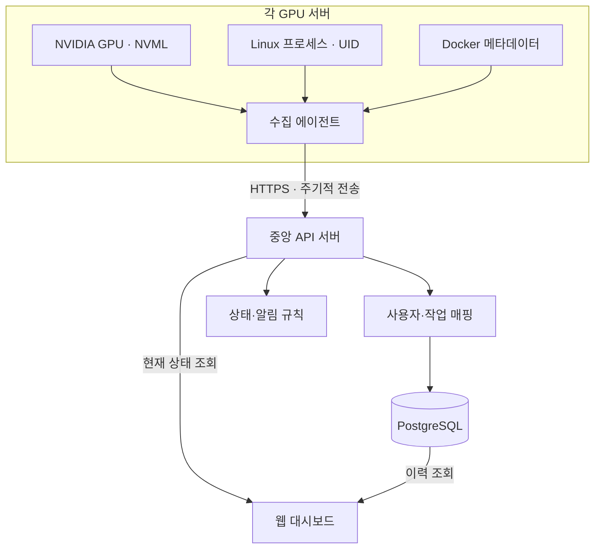

추천하는 구조는 **각 GPU 서버에 수집 에이전트를 설치하고, 중앙 웹서버에서 ‘GPU → 실행 작업 → 사용자’를 연결해서 보여주는 방식**입니다.

핵심은 GPU 사용률보다 **“누가, 어떤 작업으로, 어느 GPU를 얼마나 점유하고 있는가”**입니다. 특히 Docker나 공용 LLM 서비스를 사용하면 프로세스 소유자와 실제 사용자가 다를 수 있어, 사용자 식별 방식을 먼저 설계해야 합니다.

아래는 **Linux + NVIDIA GPU + Docker, 연구실·연구센터 내부의 여러 서버**를 가정한 기획안입니다.

**1. 서비스 목표와 범위**

웹페이지를 열었을 때 다음 질문에 바로 답할 수 있도록 만듭니다.

| 사용자 질문 | 제공 정보 |
|---|---|
| 지금 사용할 수 있는 GPU가 있나? | GPU별 메모리 여유, 사용률, 실행 작업 |
| 누가 사용하고 있나? | 사용자 이름, 계정, 프로젝트 |
| 무엇을 실행하고 있나? | 작업명, 프로그램, 컨테이너, 서비스 |
| 얼마나 오래 사용했나? | 시작 시각, 경과 시간, 사용 이력 |
| 메모리만 잡고 있는 작업이 있나? | 메모리 점유와 연산 활동 추이 |
| 서버가 정상인가? | 온도, 전력, 수집 상태, 마지막 응답 |

첫 버전은 **조회와 이력 관리**에 집중하는 것이 좋습니다. GPU 예약·작업 제출·강제 종료는 별도 단계로 두면 구현과 운영이 단순해집니다.

**2. 전체 아키텍처**



중앙 서버가 SSH로 반복 접속하기보다, **각 서버의 에이전트가 중앙으로 데이터를 전송하는 구조**를 권장합니다. 서버 추가 시 에이전트와 인증 정보만 설정하면 되고, 서버별 수집 오류도 분리하기 쉽습니다.

| 구성 요소 | 권장 구현 | 역할 |
|---|---|---|
| 수집 에이전트 | Python, NVML 바인딩, psutil | GPU·프로세스·사용자 정보 수집 |
| 에이전트 실행 | 호스트의 systemd 서비스 | 자동 시작·재시작, 호스트 PID 조회 |
| 중앙 백엔드 | FastAPI | 수집 API, 사용자 매핑, 상태·이력 조회 |
| 데이터베이스 | PostgreSQL | 서버·사용자·작업·시계열 저장 |
| 프런트엔드 | Vue 3 + TypeScript | 서버 목록, GPU 상태, 사용자별 이력 |
| 웹 배포 | Docker Compose + HTTPS 프록시 | 중앙 서비스 운영 |

초기에는 Redis나 별도 메시지 큐 없이 시작해도 됩니다. 수집 규모가 커지면 시계열 저장에 TimescaleDB 등을 검토하면 됩니다.

**3. 가장 중요한 설계: ‘누가 사용하는가’ 식별**

NVML은 GPU를 사용하는 프로세스 ID와 할당 GPU 메모리 등을 제공합니다. 여기에 OS 계정과 작업 정보를 연결해야 실제 사용자 화면을 만들 수 있습니다. [NVIDIA Developer](https://developer.nvidia.com/management-library-nvml?utm_source=chatgpt.com)

| 실행 환경 | 식별 방식 | 화면에 표시할 의미 |
|---|---|---|
| 개인 Linux 계정에서 실행 | GPU PID → 프로세스 UID → 등록 사용자 | 실행 계정 소유자 |
| 개인 Docker 컨테이너 | 호스트 PID → 컨테이너 → 등록된 소유자 | 컨테이너 담당자 |
| 공용 Linux 계정 | 작업 등록 정보와 PID 연결 | 등록된 작업 사용자 |
| Ollama 같은 공용 서비스 | 서비스 식별 + 애플리케이션 요청 로그 | 서비스 담당자 / 요청 사용자 |
| 연결 정보 없음 | 미확인으로 표시 | 추정해서 실명 표시하지 않음 |

예를 들어 GPU 프로세스가 `ollama` 계정으로 실행되면, OS 정보만으로는 **누가 해당 서비스에 요청했는지 알 수 없습니다.**

따라서 다음 정보를 분리해서 저장하는 것이 좋습니다.

- **실행 계정:** `taehoon`, `root`, `ollama` 등 OS 계정
- **작업 소유자:** 해당 학습 작업·컨테이너를 담당하는 사람
- **서비스 요청 사용자:** 공용 서비스를 호출한 사람

공용 서비스의 요청 사용자를 알아도 동시 요청·배치 처리 때문에 GPU 사용량을 사람별로 정확히 나누기는 어렵습니다. 첫 버전에서는 서비스 단위 점유를 보여주고, 사용자별 요청 이력은 별도 표시하는 편이 명확합니다.

Docker 작업은 다음과 같은 메타데이터 규칙을 제안합니다.

```yaml
labels:
  monitor.owner: "taehoon"
  monitor.project: "pbf-defect"
  monitor.job: "segmentation-training"
```

단, 사용자 입력 라벨은 **신고된 소유자 정보**입니다. 정확한 책임 추적이 필요하면 인증된 작업 등록 절차에서 소유자를 지정하도록 확장합니다.

**4. 수집 항목과 상태 판정**

| 구분 | 수집 항목 |
|---|---|
| 서버 | 서버 ID, 호스트명, CPU·RAM·디스크 사용량, 부팅 식별자 |
| GPU | UUID, 모델, 인덱스, 사용률, 메모리 사용량, 온도, 전력 |
| 프로세스 | 호스트 PID, 시작 시각, UID, 실행 파일명, GPU 메모리 |
| 컨테이너 | 컨테이너 ID·이름, 이미지, 소유자·프로젝트 라벨 |
| 수집 상태 | 측정 시각, 수신 시각, 에이전트 버전, 오류·미지원 항목 |

GPU 전체 사용률과 프로세스별 사용률은 구분해야 합니다. NVML에는 프로세스별 사용률 조회 API가 있지만, 실제 GPU·드라이버·구성에 따른 지원 여부를 확인해야 하므로 **미지원 값은 0이 아니라 ‘수집 불가’**로 표시합니다. [NVML API Reference Guide](https://docs.nvidia.com/deploy/nvml-api/latest/api/group__nvmlDeviceQueries.html?utm_source=chatgpt.com)

초기 수집 정책은 다음을 제안합니다.

| 항목 | 초기 설정안 |
|---|---|
| GPU·프로세스 수집 | 5초 간격 |
| 웹 화면 갱신 | 5초 간격 폴링 |
| 서버 연결 끊김 판정 | 30초 이상 데이터 미수신 |
| 상세 데이터 보관 | 7일 |
| 1분 집계 데이터 | 90일 |
| 작업 이력 | 1년, 운영 상황에 따라 조정 |

상태는 한 가지 색상으로 합치기보다 분리해서 보여주는 것이 좋습니다.

| 상태 축 | 표시 예시 |
|---|---|
| 연결 | 정상 / 지연 / 연결 끊김 |
| 점유 | 작업 없음 / 작업 실행 중 / 서비스 상주 |
| 활동 | 연산 중 / 낮은 활동 |
| 건강 | 정상 / 온도 경고 / 수집 오류 |

**사용률 0%라도 메모리를 점유하고 있을 수 있습니다.** 반대로 데이터 로딩·체크포인트 저장 중에는 정상 작업도 GPU 활동이 낮아집니다. 따라서 낮은 사용률만으로 ‘사용 가능’이나 ‘방치 작업’을 확정하지 않습니다.

**5. 화면 기획**

**메인 화면 — 서버 전체 현황**

상단에는 서버 수, 연결 끊긴 서버 수, GPU 수, 작업 없는 GPU 수를 표시하고 아래에 GPU 목록을 배치합니다.

다음은 화면에 들어갈 예시 데이터입니다.

| 서버 / GPU | 작업 소유자 | 작업 | GPU 사용률 | VRAM | 경과 시간 |
|---|---|---|---:|---:|---:|
| GPU-01 / GPU 0 | 임태훈 | PBF 학습 | 92% | 28 / 32 GB | 3시간 |
| GPU-01 / GPU 1 | — | 작업 없음 | 0% | 0.3 / 32 GB | — |
| GPU-02 / GPU 0 | 공용 서비스 | Ollama | 3% | 36 / 48 GB | 2일 |

서버·사용자·프로젝트로 필터링하고, **GPU 메모리 여유가 큰 순서**로 정렬할 수 있게 합니다. 마지막 갱신 시각도 항상 보여줍니다.

**GPU 상세 화면**

- 사용률·메모리·온도·전력 추이
- 현재 프로세스와 사용자, 컨테이너 목록
- 작업 시작 시각과 GPU 최초 관측 시각
- 해당 GPU의 과거 작업 타임라인
- 데이터 누락 구간과 수집 오류

**사용자별 화면**

- 현재 사용하는 GPU와 작업
- 프로젝트별 작업 이력
- GPU 점유 시간
- GPU 메모리 점유량의 시간 적분값, 예: GB·시간

여기서 점유 시간은 실제 연산 시간과 다릅니다. 공유 GPU의 사용자별 점유 시간을 합하면 서버의 실제 경과 시간을 초과할 수 있으므로 통계 정의를 화면에 명시합니다.

**관리 화면**

- 서버와 에이전트 등록
- 서버별 Linux 계정 ↔ 사용자 매핑
- 컨테이너·서비스 소유자 지정
- 수집 주기·보관 기간·알림 기준 설정

**6. 데이터 모델**

| 테이블 | 핵심 내용 |
|---|---|
| `servers` | 서버 ID, 이름, 마지막 수신 시각 |
| `gpus` | 서버 ID, GPU UUID, 모델, 표시 인덱스 |
| `users` | 사용자 ID, 이름, 소속 |
| `account_mappings` | 서버 ID + UID → 사용자 |
| `workloads` | 작업명, 유형, 소유자, 프로젝트, 컨테이너 |
| `process_instances` | 서버, 부팅 ID, PID, 프로세스 시작 시각 |
| `gpu_samples` | 시각별 GPU 지표 |
| `process_gpu_samples` | 프로세스·GPU별 메모리 및 지원되는 지표 |
| `events` | 작업 관측 시작·종료, 연결 끊김, 경고 |

설계상 중요한 부분은 세 가지입니다.

- **GPU는 UUID로 식별:** `GPU 0` 같은 인덱스는 표시용으로 사용합니다.
- **프로세스는 PID만으로 식별하지 않음:** PID 재사용을 고려해 서버·부팅·시작 시각을 함께 사용합니다.
- **프로세스와 GPU는 다대다 관계:** 하나의 작업이 여러 GPU를 사용하거나 하나의 GPU에 여러 작업이 실행될 수 있습니다.

에이전트 연결이 끊겼을 때는 작업을 ‘종료’로 처리하지 않고 **상태 미확인**으로 둡니다. 또한 5초 폴링 사이에 끝나는 짧은 작업은 누락될 수 있으므로, 이력은 기본적으로 ‘관측된 이력’입니다.

**7. 운영과 권한**

중앙 웹서버에는 GPU 서버의 Docker 소켓이나 임의 명령 실행 권한을 주지 않는 구조가 좋습니다. Docker 데몬 접근은 강한 호스트 제어 권한과 연결되므로, 필요한 컨테이너 메타데이터는 로컬 수집기 또는 조회 항목을 제한한 인터페이스를 통해 가져옵니다. [Docker Docs](https://docs.docker.com/engine/security/?utm_source=chatgpt.com)

구체적으로는 다음을 적용합니다.

- 서버별 에이전트 인증 정보와 HTTPS 사용
- 일반 사용자 조회 권한과 관리자 설정 권한 분리
- 전체 명령줄·환경변수 수집은 기본 제외해 토큰 노출 방지
- 중앙 서버 장애 시 짧은 로컬 버퍼와 재전송 적용
- 재전송 중복을 제거하고, 지연된 데이터를 최신 상태로 오인하지 않도록 처리

**8. 개발 순서와 완료 기준**

| 단계 | 구현 범위 | 완료 기준 |
|---|---|---|
| 1. 수집 검증 | 실제 서버 1대에서 GPU·PID·UID 조회 | 기본 지표가 `nvidia-smi`, OS 프로세스 정보와 대응 |
| 2. MVP | 중앙 API, DB, 서버 목록, GPU 상세, 사용자 매핑 | 누가 어느 GPU를 사용하는지 웹에서 확인 |
| 3. Docker 대응 | 컨테이너 연결, 소유자·프로젝트 라벨 | 호스트 작업과 컨테이너 작업 구분 |
| 4. 이력·알림 | 시계열, 작업 이력, 연결 끊김·온도 경고 | 수집 장애를 작업 종료와 구분 |
| 5. 공용 서비스 연동 | 요청 로그, 인증 사용자 연결 | 서비스 점유와 요청 사용자 구분 |
| 6. 운영 확장 | 예약, 작업 등록, 스케줄러 연동 | 실제 필요가 확인된 기능부터 도입 |

DCGM Exporter는 GPU 지표를 Prometheus 형식으로 제공하므로, 서버 수가 늘거나 기존 Prometheus·Grafana 환경이 있다면 GPU 지표 수집에 활용할 수 있습니다. 다만 사용자·프로젝트·작업 소유자 연결은 별도로 설계해야 합니다. [GitHub](https://github.com/NVIDIA/dcgm-exporter?utm_source=chatgpt.com)

현재 출발점으로는 **Python 수집 에이전트 + FastAPI + PostgreSQL + Vue**가 적합합니다. 첫 개발 목표를 **“실제 서버 한 대에서 개인 계정 작업, Docker 작업, 공용 서비스가 각각 누구의 작업으로 표시되는지 검증하기”**로 잡으면 가장 중요한 불확실성부터 해결할 수 있습니다.